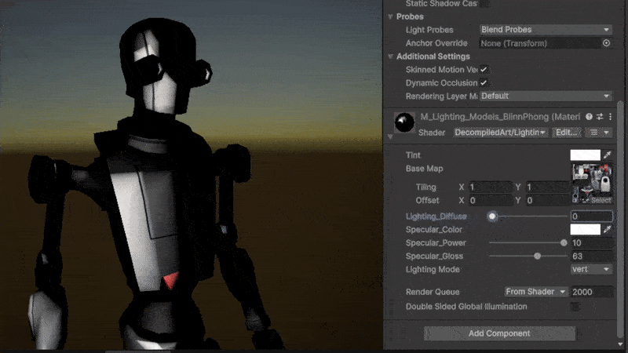
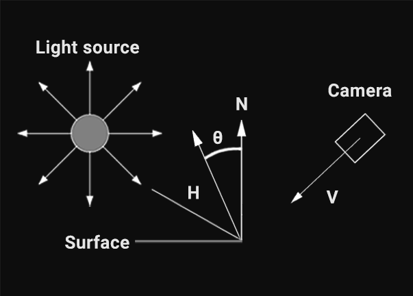

# Shader Story

## Lighting Models : Blinn-Phong

> Blinn-Phong shading is one of the most widely used lighting models in real-time graphics, extending [Lambertian](https://github.com/DeGGeD/ShaderStory/blob/main/Chapters/Lighting/Models/Lambertian.md) lighting by adding a specular lobe.

While [Lambertian](https://github.com/DeGGeD/ShaderStory/blob/main/Chapters/Lighting/Models/Lambertian.md) is excellent for simulating matte surfaces like chalk, clay, or fabric, Blinn-Phong brings materials to life by introducing a shiny, reflective component, perfect for **plastic**, **polished wood**, **metals**, and other **glossy surfaces**.

Its strength lies in its simplicity: brightness depends only on the cosine of the angle between the surface normal and the incoming light direction. This is known as Lambert’s Cosine Law.

---

### Visual demo

<p align="center">

</p>

---

```hlsl
// World-space directions
half3 viewDirection = normalize(_WorldSpaceCameraPos.xyz - i.posWorld.xyz);
half3 halfDirection = normalize(viewDirection + lightDirection);

// Diffuse (Lambertian)
float NdotL = max(0.0, dot(normalDirection, lightDirection));

// Specular (Blinn-Phong)
half NdotH = max(0.0, dot(normalDirection, halfDirection));
half3 specularity = pow(NdotH, SpecularGloss) * SpecularPower * _SpecularColor.rgb;

// Combine
half3 lightingModel = NdotL * diffuseColor + specularity;

// Light attenuation & final color
half attenuation = LIGHT_ATTENUATION(i);
half3 attenColor = attenuation * _LightColor0.rgb;

half4 finalColor = float4(lightingModel * attenColor, 1.0);

```

Complete per-vertex and per-pixel implementations, with detailed comments, are available on [Patreon](https://www.patreon.com/posts/shader-story-139391233).

---

### Basic idea

Light travels from the source, bounces off the surface, and reaches the viewer.
- Diffuse (Lambertian): Light scattered evenly in all directions, giving the object its base diffuse color.
- Specular (Blinn-Phong): Light reflected in a concentrated direction, creating a lobe that shifts as the camera moves.

<p align="center">

</p>

Blinn-Phong computes both contributions per pixel (or per vertex). Result: a smooth, physically plausible appearance for most real-time use cases.

### Blinn-Phong Equation

>d = Σ (from i=0 to n) [I_i x atten_i x (max(0.0, dot(N, L_i)) × DiffuseColor + SpecularColor x max(0.0, dot(N, H_i)^α))]

- Σ: summation over lights, adds up the contribution of every incident light source.
- I_i: light color and intensity per light (e.g. _LightColor0.rgb); scales both diffuse and specular contributions.
- atten_i: per-light distance falloff and shadowing (0..1); multiplies both terms, so the specular lobe dims with distance like diffuse light.
- DiffuseColor: material diffuse color/scale (0 → black, 1 → full reflection).
- max(0, N·L_i): Lambert’s cosine law, how directly the light hits the surface; ensures no negative contribution when the light is behind the surface.
- SpecularColor: specular color/intensity, controlling specular tint and strength (metals often tint the specular, dielectrics use white).
- H_i: half-vector, H = normalize(L+V) with V the view (camera) direction; approximates the reflection alignment more cheaply and stably than computing the reflection vector R.
- max(0, dot(N, H_i)^α): Blinn-Phong specular lobe; measures how aligned the surface normal is with the half-vector, and the power α (shininess / glossiness) controls the lobe width:
  - Low α → broad, soft lobes (rough surface)
  - High α → tight, sharp lobes (polished/smooth surface)

Clamping **max(0.0, ...)** prevents negative values and avoids lighting effect happening when the geometry faces away.

---

## 🔗 Related Functions

[Max](https://github.com/DeGGeD/ShaderStory/blob/main/Chapters/CommonFunctions/MinMax.md) • [Dot](https://github.com/DeGGeD/ShaderStory/blob/main/Chapters/CommonFunctions/Dot.md) • [Normalize](https://github.com/DeGGeD/ShaderStory/blob/main/Chapters/CommonFunctions/Normalize.md)

---

## ❤️ Support Shader Story

If this article helped you, consider supporting the project on Patreon: you'll get access to the related source files and reference cheat-sheets.

<p align="center">
  <a href="https://www.patreon.com/decompiled_art" target="_blank">
    
  </a>
  <a href="https://www.buymeacoffee.com/shaderstory" target="_blank">
    
  </a>
</p>

Your support helps keep this library open and free for everyone.
