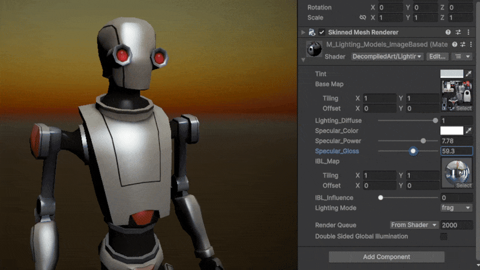

# Shader Story

## Lighting Models : Image-Based Lighting (IBL)

> **Image-Based Lighting (IBL)** simulates real-world reflections and ambient lighting using environment maps instead of relying solely on direct lights.

Instead of computing lighting only from light sources, IBL samples a cubemap texture representing the surrounding environment, capturing diffuse and specular reflections from it.

IBL is a foundational technique for modern physically based rendering (PBR) pipelines and is often **combined with Blinn-Phong** or **GGX specular** terms for more control.

Perfect for **metals**, **glossy plastics**, **lookdev**.

---

### Visual demo

<p align="center">

</p>

---

```hlsl
// Pseudo-code (Complete per-vertex and per-pixel implementations, with detailed comments, are available in the related Patreon post)
// Link: https://www.patreon.com/posts/shader-story-142344957


// Blinn-Phong diffuse
NdotL = max(0, dot(N, lightDir))
diffuse = diffuseFactor x NdotL x lightColor

// Blinn-Phong specular
H = normalize(V + lightDir)
NdotH = max(0, dot(N, H))
specular = pow(NdotH, specularGloss) x specularPower x specularColor

// Compute reflection direction for IBL
R = reflect(-V, N)
envColor = sampleCube(IBL_Map, R)

// Blend regular specular with environment reflection
specular = lerp(specular, envColor x specular, IBL_Influence)

// Combine diffuse + specular terms
return diffuse + specular

```

Complete per-vertex and per-pixel implementations, with detailed comments, are available on [Patreon](https://www.patreon.com/posts/shader-story-142344957).

---

### Basic idea

Light doesn’t only come from direct light sources: the world around emits ambient light as well.

With IBL, surrounding light is captured using a **cubemap** (like a **panoramic HDR image**) and used to light the surface.

1. The shading method **first calculates standard Blinn-Phong lighting** for base diffuse and specular terms.
2. Then, **a reflection vector is computed** from the view and surface normal.
3. That **reflection vector samples the environment cubemap**, fetching the color the object “sees” in that direction.
4. Finally, **the reflection blends with the Blinn-Phong specular result** according to an IBL influence factor.


### Image-Based Lighting Equation

> C_output = (N*L × D x L_i) + lerp(S, T(R) × S, I)

Where:

- N·L: diffuse light contribution
- D: diffuse factor
- L_i: light color
- S: Blinn-Phong specular contribution
- R: reflection vector (reflect(-V, N))
- T(R): cubemap texture sample using reflection direction
- I: IBL influence factor (0 → classic Blinn-Phong, 1 → fully IBL-driven)

---

## 🔗 Related Functions

[Lerp](https://github.com/DeGGeD/ShaderStory/blob/main/Chapters/CommonFunctions/Lerp.md) • [Dot](https://github.com/DeGGeD/ShaderStory/blob/main/Chapters/CommonFunctions/Dot.md) • [Saturate](https://github.com/DeGGeD/ShaderStory/blob/main/Chapters/CommonFunctions/ClampSaturate.md)

---

## ❤️ Support Shader Story

If this article helped you, consider supporting the project on Patreon: you'll get access to the related source files and reference cheat-sheets.

<p align="center">
  <a href="https://www.patreon.com/decompiled_art" target="_blank">
    
  </a>
  <a href="https://www.buymeacoffee.com/shaderstory" target="_blank">
    
  </a>
</p>

Your support helps keep this library open and free for everyone.
