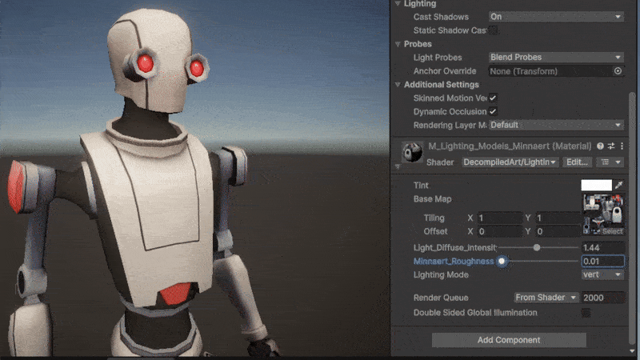

# Shader Story

## Lighting Models : Minnaert

> The **Minnaert Model** was originally designed to replicate the way light scatters off the surface of the moon. That is why it’s also called the **Moon Shader**.

Unlike Lambertian lighting, which assumes light scatters evenly in all directions, Minnaert introduces a view-dependent component. This makes it ideal for simulating materials where light tends to backscatter: porous surfaces such as **dust** and **chalk**, fibrous materials like **velvet**, **velour**, **suede**, and **carpets**, and soft rough surfaces such as **cloth** and **unpolished stone**.

The result is a shading effect where surfaces facing the viewer look slightly darker or lighter depending on the chosen roughness parameter. It produces a soft, velvety look that’s very close to the more complex Oren-Nayar model, but cheaper to compute.

---

### Visual demo

<p align="center">

</p>

---

```hlsl
// Pseudo-code (Complete per-vertex and per-pixel implementations, with detailed comments, are available in the related Patreon post)
// Link: https://www.patreon.com/posts/shader-story-139479113


// World-space directions
float3 viewDirection = normalize(_WorldSpaceCameraPos.xyz - i.posWorld.xyz);

// Lambertian cosine falloff
float NdotL = max(0.0, dot(normalDirection, lightDirection));
float NdotV = max(0.0, dot(normalDirection, viewDirection));

// Minnaert factor (view-dependent diffuse)
float minnaertFactor = saturate(NdotL pow(NdotL NdotV, _Roughness));

// Apply diffuse color
float3 lightingModel = minnaertFactor * diffuseColor;

// Light attenuation and final output
float attenuation = LIGHT_ATTENUATION(i);
float3 attenColor = attenuation * _LightColor0.rgb;
half4 finalColor = half4(lightingModel * attenColor, 1.0);

```

Complete per-vertex and per-pixel implementations, with detailed comments, are available on [Patreon](https://www.patreon.com/posts/shader-story-139479113).

---

### Basic idea

Light travels from the source, hits the surface, and reaches the viewer.

1. **Diffuse (Lambertian):** Compute the cosine falloff (dot(N, L)) to measure how directly light hits the surface.
2. **View Dependency:** Compute dot(N, V) to measure how directly the viewer looks at the surface.
3. **Minnaert Adjustment:** Multiply dot(N, L) by (dot(N, L) x dot(N, V))^k to darken grazing angles based on the chosen roughness k.
4. **Final Shading:** Multiply the Minnaert factor by the surface diffuse color, light color, and attenuation to get the final shaded result.


### Minnaert Equation

> d = Σ (from i=0 to n) [ I_i x atten_i x diffuseFactor x clamp( (max(0.0, dot(N, L_i)))^(1.0 + k) x (max(0.0, dot(N, V)))^k , 0.0, 1.0 ) ]

Where:

**I_i**: per-light intensity & color
**atten_i**: per-light attenuation (distance/shadows)
**N**: surface normal
**L_i**: light direction
**V**: view direction
**k**: Minnaert exponent (roughness)
- k=0: plain Lambertian
- k>0: darkens edges

---

## 🔗 Related Functions

[Max](https://github.com/DeGGeD/ShaderStory/blob/main/Chapters/CommonFunctions/MinMax.md) • [Dot](https://github.com/DeGGeD/ShaderStory/blob/main/Chapters/CommonFunctions/Dot.md) • [Saturate](https://github.com/DeGGeD/ShaderStory/blob/main/Chapters/CommonFunctions/ClampSaturate.md)

---

## ❤️ Support Shader Story

If this article helped you, consider supporting the project on Patreon: you'll get access to the related source files and reference cheat-sheets.

<p align="center">
  <a href="https://www.patreon.com/decompiled_art" target="_blank">
    
  </a>
  <a href="https://www.buymeacoffee.com/shaderstory" target="_blank">
    
  </a>
</p>

Your support helps keep this library open and free for everyone.
