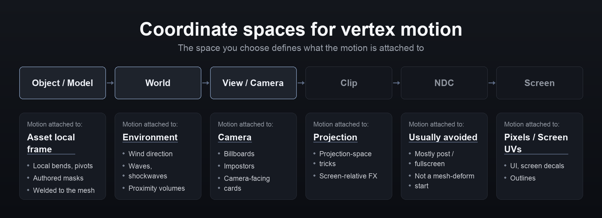
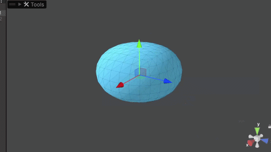
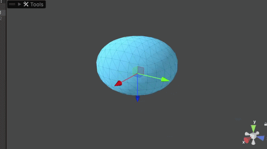
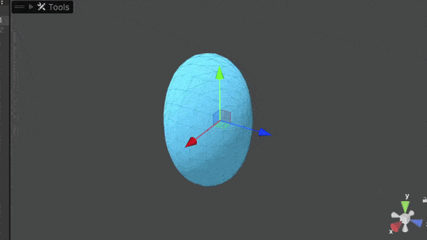

# Shader Story

## Vertex Animation: Coordinate Spaces

> **Coordinate space** decides *who owns the motion*. The same sine wave evaluated in **object space**, **world space**, or **view space** produces three completely different behaviors. Choosing the space first, before writing any motion math, prevents the "almost right, but wrong" class of vertex bugs.


```hlsl
// Object space: the mesh owns the motion
positionOS += normalOS * sin(positionOS.y * _Frequency + phase) * _Amplitude;
```
---

### The five spaces

When you start moving vertices, the first question is not "what's the formula?" The first question is: **what is this motion attached to?**

- **Object (model) space**: the motion belongs to the asset's local frame. If the object rotates, the motion rotates with it. This is what you want for local bends, pivots, and behavior that should stay welded to the mesh.
- **World space**: the motion belongs to the environment. The right choice for wind direction, waves, shockwaves, and gameplay volumes, because *many objects need to agree on the same position or direction.*
- **View (camera) space**: the motion belongs to the camera. Useful for billboards, impostors, and view-dependent effects. Risky for anything that should feel physically grounded, because the motion changes relative to the viewer.
- **Clip / NDC space**: projection-space tricks, outlines, screen-relative effects. A specialist lane, not a starting point for mesh deformation.
- **Screen space**: UI, screen-space decals, outlines. Same story.

The practical pattern: you usually start from the object-space position; if you need world behavior (wind, gameplay fields) you transform to world, apply the offset, then transform to clip for rendering. If you need camera-relative behavior, you do it in view space.

<p align="center">

</p>

### Two rules that prevent most space bugs

1. **The position and the offset must agree on space.** Don't add a world-space wind offset to an object-space position without transforming one into the other.
2. **Positions, directions, and normals are different things.** Positions include translation (w = 1). Directions don't (w = 0). Normals need their own transform, and scale skews them.

Get the space wrong and the effect looks *almost* right, which is worse than obviously wrong.

---

### Visual demo
One mesh, one wave, three owners. Rotate or move the asset: in object space the wave travels *with* the mesh. In world space the asset moves *through* a fixed pattern. In view space the deformation follows the camera, not the asset. The math is nearly identical in each, and the *behavior* changes completely depending on where the position and offset are evaluated.

<p align="center">

</p>

<p align="center">

</p>

<p align="center">

</p>

---

### URP Shader Code
One wave, three spaces, one enum, so you can live-toggle the difference. The displacement always follows the normal of the space it is evaluated in, so the three modes stay comparable.

```hlsl
Shader "DecompiledArt/VertexAnimation/CoordinateSpaces/CoordinateSpaces"
{
    Properties
    {
        [MainColor] _BaseColor("Base Color", Color) = (0.4, 0.8, 1.0, 1.0)
        [Enum(Object,0,World,1,View,2)] _MotionSpace("Motion Space", Float) = 0
        _Amplitude("Amplitude", Range(0.0, 0.5)) = 0.08
        _Frequency("Frequency", Range(0.0, 20.0)) = 6.0
        _Speed("Speed", Range(-4.0, 4.0)) = 1.0
        _Ambient("Ambient", Range(0.0, 1.0)) = 0.2
    }

    SubShader
    {
        Tags { "RenderType" = "Opaque" "RenderPipeline" = "UniversalPipeline" "Queue" = "Geometry" }

        Pass
        {
            Name "ForwardOnly"
            Tags { "LightMode" = "UniversalForward" }

            HLSLPROGRAM
            #pragma vertex Vert
            #pragma fragment Frag

            #include "Packages/com.unity.render-pipelines.universal/ShaderLibrary/Core.hlsl"
            #include "Packages/com.unity.render-pipelines.universal/ShaderLibrary/Lighting.hlsl"

            struct Attributes
            {
                float4 positionOS : POSITION;
                half3 normalOS : NORMAL;
            };

            struct Varyings
            {
                float4 positionCS : SV_POSITION;
                half3 normalWS : TEXCOORD0;
            };

            CBUFFER_START(UnityPerMaterial)
                half4 _BaseColor;
                half _MotionSpace;
                half _Amplitude;
                half _Frequency;
                half _Speed;
                half _Ambient;
            CBUFFER_END

            // Keep the animated phase bounded to avoid ever-growing time inputs.
            half GetAnimatedPhase()
            {
                return frac(_Time.y * _Speed) * TWO_PI;
            }

            Varyings Vert(Attributes IN)
            {
                Varyings OUT;

                float3 positionOS = IN.positionOS.xyz;
                half3 normalOS = normalize(IN.normalOS);

                float3 positionWS = TransformObjectToWorld(positionOS);
                half3 normalWS = normalize(TransformObjectToWorldNormal(normalOS));

                half timePhase = GetAnimatedPhase();

                // Object space: motion belongs to the mesh.
                if (_MotionSpace < 0.5h)
                {
                    half wave = sin(positionOS.y * _Frequency + timePhase) * _Amplitude;
                    positionOS += normalOS * wave;

                    VertexPositionInputs posInputs = GetVertexPositionInputs(positionOS);
                    OUT.positionCS = posInputs.positionCS;
                    OUT.normalWS = normalize(TransformObjectToWorldNormal(normalOS));
                }
                // World space: motion belongs to the environment.
                else if (_MotionSpace < 1.5h)
                {
                    half wave = sin(positionWS.y * _Frequency + timePhase) * _Amplitude;
                    positionWS += normalWS * wave;

                    OUT.positionCS = TransformWorldToHClip(positionWS);
                    OUT.normalWS = normalWS;
                }
                // View space: motion belongs to the camera.
                else
                {
                    float3 positionVS = TransformWorldToView(positionWS);
                    half3 normalVS = normalize(mul((float3x3)UNITY_MATRIX_V, normalWS));

                    half wave = sin(positionVS.x * _Frequency + timePhase) * _Amplitude;
                    positionVS += normalVS * wave;

                    OUT.positionCS = mul(UNITY_MATRIX_P, float4(positionVS, 1.0));
                    OUT.normalWS = normalWS;  // keep lighting world-space to stay focused on ownership
                }

                return OUT;
            }

            half4 Frag(Varyings IN) : SV_Target
            {
                half3 normalWS = normalize(IN.normalWS);
                Light mainLight = GetMainLight();
                half NdotL = saturate(dot(normalWS, mainLight.direction));

                half3 litColor = _BaseColor.rgb * (_Ambient + NdotL * mainLight.color);
                return half4(litColor, _BaseColor.a);
            }
            ENDHLSL
        }
    }

    FallBack Off
}
```

---

## 🔗 Related Chapters

[Data Sources](https://github.com/DeGGeD/ShaderStory/blob/main/Chapters/VertexAnimation/DataSources.md) • [Procedural Masks](https://github.com/DeGGeD/ShaderStory/blob/main/Chapters/VertexAnimation/Masks/ProceduralMasks.md) • [Sine Wave Offset](https://github.com/DeGGeD/ShaderStory/blob/main/Chapters/VertexAnimation/Patterns/SineWaveOffset.md)

**Related functions:** [Normalize](https://github.com/DeGGeD/ShaderStory/blob/main/Chapters/CommonFunctions/Normalize.md) • [Frac](https://github.com/DeGGeD/ShaderStory/blob/main/Chapters/CommonFunctions/Frac.md) • [Sine / Cosine](https://github.com/DeGGeD/ShaderStory/blob/main/Chapters/CommonFunctions/SineCosine.md)

---

## ❤️ Support Shader Story

If this article helped you, consider supporting the project on Patreon - you'll get access to the related source files, reference cheat-sheets, and other exclusive resources:

<p align="center">
  <a href="https://www.patreon.com/decompiled_art" target="_blank">
    
  </a>
  <a href="https://www.buymeacoffee.com/shaderstory" target="_blank">
    
  </a>
</p>

Your support helps keep this library open, growing, and free for everyone.
