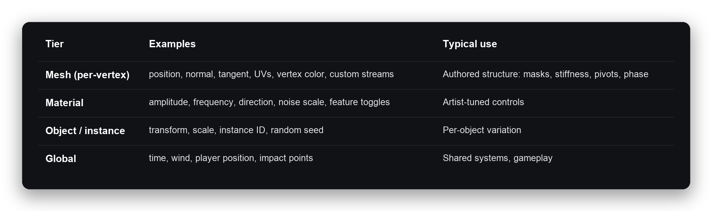
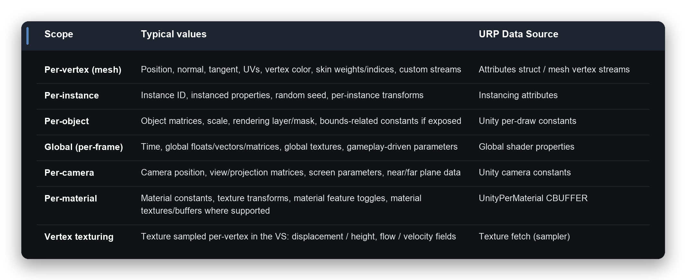

# Shader Story

## Vertex Animation: Data Sources

> Every input that drives vertex motion has an owner. **Material properties**, **vertex colors and UVs**, **per-instance data**, and **global shader properties** are four different scopes with four different update costs. Picking the smallest stable data path that satisfies the control, and writing the convention down, is what keeps vertex animation maintainable.


```hlsl
// The convention is the contract:
float3 pivot = lerp(_BoundsMin, _BoundsMax, color.rgb);  // baked per-vertex
float influence = color.a;  // baked per-vertex
float phase = frac(_Time.y * _Speed + _PhaseOffset);  // artist-tuned property
float3 wind = _WindDirectionWS;  // shared global, set from C#
```
---

### The data hierarchy

Everything a vertex shader can read falls into tiers, from "baked forever" to "changes every frame":

<p align="center">

</p>

Camera data exists too, but it belongs to view-dependent effects, not to physically grounded deformation.

### Where custom motion data should live

The rule: **pick the smallest stable data path that satisfies the control.**

- Painted or baked per-vertex, rarely changes → **vertex colors / UVs / custom streams** (masks, stiffness, pivot weights, phase offsets).
- Artist-tuned for the whole material → **material properties** (amplitude, frequency, direction, noise scale).
- Different for each placed object → **per-object / instanced data** (random seed, phase offset, bend multiplier).
- Belongs to a shared system → **global shader properties** (wind, player position, impact points).
- Large, or changing every frame → **buffers**, with the understanding that this adds setup and an extra memory read.

<p align="center">

</p>

### The production lesson

> **A lot of vertex motion bugs are not math bugs. They are undocumented data-ownership bugs.**

If UV2.x means pivot weight, vertex-color red means stiffness, and alpha means phase, *write that convention down*. Document the valid range and how the shader decodes it. A shader can be brilliant and still rot in three months if only one person remembers what the channels mean.

---

### Visual demo
The same traveling wave, driven by data from each scope. Move the knobs: the property changes the whole material, the vertex color changes only where painted, the per-instance value changes only that object, and the global moves everything in agreement.

---

### URP Shader Code
Four data scopes, one wave. Each scope drives its own layer of displacement so you can see exactly what each ownership model does, and where the conventions have to be written down.

```hlsl
Shader "DecompiledArt/VertexAnimation/DataSources/DataSources"
{
    Properties
    {
        [MainColor] _BaseColor("Base Color", Color) = (0.7, 0.85, 1.0, 1.0)

        [Header(Material scope - tuned for the whole material)]
        _Speed("Speed", Float) = 1.0
        _Amplitude("Amplitude", Float) = 0.15

        [Header(Vertex scope - painted or baked per vertex)]
        _ColorInfluenceScale("Vertex Color A Influence", Range(0.0, 2.0)) = 1.0

        [Header(Instance scope - different for each placed object)]
        [PerRendererData] _InstanceOffset("Instance Phase Offset", Range(0.0, 1.0)) = 0.0

        [Header(Global scope - shared system, set from C#)]
        _GlobalWindX("Global Wind X (set from C#)", Range(-1.0, 1.0)) = 0.0
    }

    SubShader
    {
        Tags { "RenderType" = "Opaque" "RenderPipeline" = "UniversalPipeline" "Queue" = "Geometry" }

        Pass
        {
            Name "Forward"
            Tags { "LightMode" = "UniversalForward" }

            HLSLPROGRAM
            #pragma target 4.5
            #pragma vertex vert
            #pragma fragment frag
            #pragma multi_compile_instancing

            #include "Packages/com.unity.render-pipelines.universal/ShaderLibrary/Core.hlsl"

            struct Attributes
            {
                float4 positionOS : POSITION;
                half3 normalOS : NORMAL;
                half4 color : COLOR;
                UNITY_VERTEX_INPUT_INSTANCE_ID
            };

            struct Varyings
            {
                float4 positionHCS : SV_POSITION;
                half3 normalWS : TEXCOORD0;
                half scopeDebug : TEXCOORD1;
            };

            CBUFFER_START(UnityPerMaterial)
                half4 _BaseColor;
                half _Speed;
                half _Amplitude;
                half _ColorInfluenceScale;
                half _InstanceOffset;
                half _GlobalWindX;
            CBUFFER_END

            // A per-instance property lives in its own buffer so instanced
            // draw calls can override it without splitting the batch.
            UNITY_INSTANCING_BUFFER_START(PerInstance)
                UNITY_DEFINE_INSTANCED_PROP(half, _InstanceOffset)
            UNITY_INSTANCING_BUFFER_END(PerInstance)

            // Stable hash fallback: objects without an explicit override still
            // get a deterministic per-object phase from where they were placed.
            float Hash13(float3 value)
            {
                value = frac(value * 0.1031);
                value += dot(value, value.yzx + 33.33);
                return frac((value.x + value.y) * value.z);
            }

            Varyings vert(Attributes IN)
            {
                Varyings OUT;

                UNITY_SETUP_INSTANCE_ID(IN);

                float3 positionOS = IN.positionOS.xyz;

                // One bounded phase, one shared clock:
                half phase = frac(_Time.y * _Speed) * TWO_PI;

                // Instance scope: stable random from object position,
                // plus any explicit per-renderer override.
                float3 objectPivotWS = TransformObjectToWorld(float3(0.0, 0.0, 0.0));
                half seed = (half)Hash13(objectPivotWS);
                half instOverride = UNITY_ACCESS_INSTANCED_PROP(PerInstance, _InstanceOffset);
                phase += (seed + instOverride) * TWO_PI;

                // Vertex scope: painted influence, e.g. 0 at the root, 1 at the tip.
                half influence = saturate(IN.color.a * _ColorInfluenceScale);

                // Global scope: a shared wind vector agreed on by every object.
                half3 windDirOS = normalize(half3(_GlobalWindX, 0.0h, 0.0h) + half3(1.0h, 0.0h, 0.0h));

                half wave = sin(phase + positionOS.x * 4.0);
                positionOS += windDirOS * (wave * _Amplitude * influence);

                OUT.positionHCS = TransformObjectToHClip(positionOS);
                OUT.normalWS = TransformObjectToWorldNormal(IN.normalOS);
                OUT.scopeDebug = influence;
                return OUT;
            }

            half4 frag(Varyings IN) : SV_Target
            {
                half3 normalWS = normalize(IN.normalWS);
                half ndl = saturate(dot(normalWS, normalize(half3(0.35h, 0.8h, 0.2h))));
                half lit = 0.25h + 0.75h * ndl;

                // A thin rim shows the painted influence so the data is visible.
                half3 color = _BaseColor.rgb * lit * (0.8h + 0.6h * IN.scopeDebug);
                return half4(color, _BaseColor.a);
            }
            ENDHLSL
        }
    }

    FallBack Off
}
```

And the other half of the contract, setting the global from C#:

```csharp
// A global belongs to a shared system: wind, player position, impact points.
MaterialPropertyBlock block = new MaterialPropertyBlock();

void Update()
{
    Vector3 wind = Vector3.right * Mathf.Sin(Time.time * 0.4f) * 0.8f;
    block.SetFloat("_GlobalWindX", wind.x);
    renderer.ShaderProperties = block;  // no material instance, batching survives
}
```

> A `MaterialPropertyBlock` keeps per-object values out of material instances; the same reason per-instance variation must not create unique materials (see [Instancing](https://github.com/DeGGeD/ShaderStory/blob/main/Chapters/VertexAnimation/Shipping/Instancing.md)).

---

## 🔗 Related Chapters

[Coordinate Spaces](https://github.com/DeGGeD/ShaderStory/blob/main/Chapters/VertexAnimation/CoordinateSpaces.md) • [Procedural Masks](https://github.com/DeGGeD/ShaderStory/blob/main/Chapters/VertexAnimation/Masks/ProceduralMasks.md) • [Authored Masks](https://github.com/DeGGeD/ShaderStory/blob/main/Chapters/VertexAnimation/Masks/AuthoredMasks.md) • [Instancing](https://github.com/DeGGeD/ShaderStory/blob/main/Chapters/VertexAnimation/Shipping/Instancing.md)

**Related functions:** [Lerp](https://github.com/DeGGeD/ShaderStory/blob/main/Chapters/CommonFunctions/Lerp.md) • [Frac](https://github.com/DeGGeD/ShaderStory/blob/main/Chapters/CommonFunctions/Frac.md) • [Normalize](https://github.com/DeGGeD/ShaderStory/blob/main/Chapters/CommonFunctions/Normalize.md)

---

## ❤️ Support Shader Story

If this article helped you, consider supporting the project on Patreon - you'll get access to the related source files, reference cheat-sheets, and other exclusive resources:

<p align="center">
  <a href="https://www.patreon.com/decompiled_art" target="_blank">
    
  </a>
  <a href="https://www.buymeacoffee.com/shaderstory" target="_blank">
    
  </a>
</p>

Your support helps keep this library open, growing, and free for everyone.
