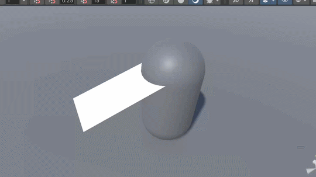
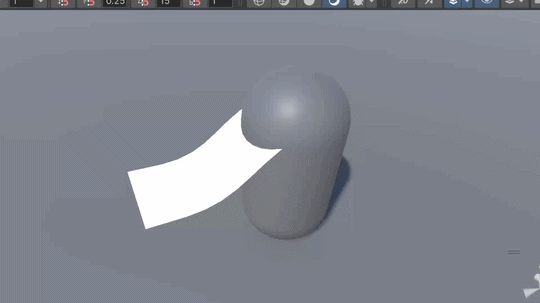
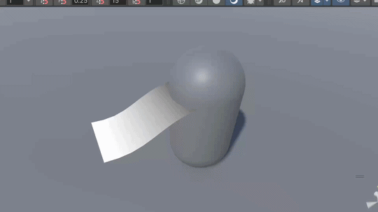
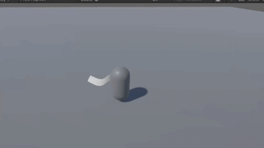

# Shader Story

## Vertex Animation: Gameplay-Driven Motion

> Vertex motion stops being a loop and becomes *behavior* when **live game state modulates it**. The build order that makes this legible: **time only → + axis → + mask → + gameplay parameters**. Each addition is a distinct, visible level of believability, and each one reuses the same motion function, so the effect stays composable.

> **Filter gameplay data before it drives deformation.** Smooth and clamp on the CPU; never let raw, jittery inputs reach the vertex math directly.

```hlsl
float speed01 = saturate(_SmoothedSpeed / _MaxSpeed);
float activation = smoothstep(0.05, 0.5, speed01);
float response = _IdleAmplitude + activation;  // small idle flutter even at rest
```
---

### The four steps

**Step 1: Time only.** Every vertex receives the same temporal input, so the whole surface pulses uniformly. *This is motion, not yet behavior*, but it's a valuable checkpoint: it proves the deformation path is live before anything else is added.

**Step 2: + Axis.** Project world position onto a direction to spread the phase across the mesh. Now the wave *travels* instead of pulsing. Note the two jobs: the **axis** sets *where the pattern travels*; the **move direction** sets *which way vertices displace*. Different vectors, different effects.

**Step 3: + Mask.** Tell the shader *where motion is allowed*. A vertex-color influence, near zero at the attached end, strong at the free end, does the work: the motion function stays generic and reusable; the *asset* decides where that motion is allowed. Same shader, different meshes, different character.

**Step 4: + Gameplay parameters.** Live data modulates everything: speed scales the response (running streams, standing still leaves a subtle idle flutter), turning adds sideways drag. Two details that matter:

- A *fully static* idle reads as dead; an instant jump from still to full motion reads as fake. Keep a small masked flutter alive at zero speed.
- The inputs are **smoothed** on the CPU (asymmetric response times: fast to engage, slower to settle) so the response feels physical instead of noisy.

---

### Visual demo
Follow the same shader through the four states; this is the whole subject in thirty seconds.

<p align="center">

</p>

<p align="center">

</p>

<p align="center">

</p>

<p align="center">

</p>

---

### URP Shader Code
The four states as one enum, with the mask source switchable between vertex color and UV gradient, and the gameplay inputs arriving as smoothed globals from C#.

```hlsl
Shader "DecompiledArt/VertexAnimation/GameplayDrivenMotion/GameplayDrivenMotion"
{
    Properties
    {
        [Enum(None,0,TimeOnly,1,WorldAxis,2,VertexMask,3,Velocity,4)]
        _DemoState("Demo State", Float) = 0

        [Enum(VertexColor,0,UVGradient,1)]
        _MaskSource("Mask Source", Float) = 0

        _MaskPower("Mask Power", Float) = 1.0
        _MaskInvert("Mask Invert", Float) = 0.0

        _Amplitude("Amplitude", Float) = 0.08
        _Frequency("Frequency", Float) = 3.0
        _Speed("Speed", Float) = 1.5

        // Gameplay inputs: smoothed on the CPU before they get here.
        _IdleAmplitude("Idle Amplitude", Float) = 0.02
        _VelocityStrength("Velocity Strength", Float) = 1.2
        _VelocityClamp("Velocity Clamp", Float) = 2.0
        _AngularStrength("Angular Strength", Float) = 0.8

        _CharacterVelocityWS("Velocity", Vector) = (0, 0, 0, 0)
        _CharacterForwardWS("Forward", Vector) = (0, 0, 1, 0)
        _AngularVelocityWS("Angular Velocity", Vector) = (0, 0, 0, 0)
        _SmoothedSpeed("Smoothed Speed", Float) = 0.0

        [Toggle] _DebugMask("Debug Selected Mask", Float) = 0
    }

    SubShader
    {
        Tags { "RenderType" = "Opaque" "Queue" = "Geometry" "RenderPipeline" = "UniversalPipeline" }

        Pass
        {
            Tags { "LightMode" = "UniversalForward" }
            Cull Off

            HLSLPROGRAM
            #pragma vertex vert
            #pragma fragment frag

            #include "Packages/com.unity.render-pipelines.universal/ShaderLibrary/Core.hlsl"

            CBUFFER_START(UnityPerMaterial)
                half _DemoState;
                half _MaskSource;
                half _MaskPower;
                half _MaskInvert;

                half _Amplitude;
                half _Frequency;
                half _Speed;
                half _IdleAmplitude;
                half _VelocityStrength;
                half _VelocityClamp;
                half _AngularStrength;

                float3 _CharacterVelocityWS;
                float3 _CharacterForwardWS;
                float3 _AngularVelocityWS;
                half _SmoothedSpeed;

                half _DebugMask;
            CBUFFER_END

            struct Attributes
            {
                float4 positionOS : POSITION;
                float3 normalOS : NORMAL;
                float4 color : COLOR;
                float2 uv : TEXCOORD0;
            };

            struct Varyings
            {
                float4 positionHCS : SV_POSITION;
                half mask : TEXCOORD1;
            };

            // Bounded temporal phase: keep sin() inputs small in long sessions.
            float GetWrappedTemporalPhase()
            {
                float phase = _Time.y * _Speed * _Frequency;
                return frac(phase / TWO_PI) * TWO_PI;
            }

            float3 SafeNormalizeAxis(float3 v, float3 fallback)
            {
                float lenSq = dot(v, v);
                return (lenSq > 1e-6) ? normalize(v) : fallback;
            }

            // Step 3: the asset decides where motion is allowed.
            half GetMask(Attributes IN)
            {
                half mask = 1.0h;

                if (_DemoState >= 3.0h)
                {
                    if (_MaskSource < 0.5)
                    {
                        mask = IN.color.r;  // painted influence
                    }
                    else
                    {
                        half t = IN.uv.y;  // UV gradient, remapped
                        mask = saturate(t);
                    }

                    if (_MaskInvert > 0.5h)
                        mask = 1.0h - mask;

                    mask = pow(mask, _MaskPower);
                }

                return mask;
            }

            Varyings vert(Attributes IN)
            {
                Varyings OUT;

                float3 positionWS = TransformObjectToWorld(IN.positionOS.xyz);
                float3 normalWS = TransformObjectToWorldNormal(IN.normalOS);

                half mask = GetMask(IN);
                float3 finalMove = 0;

                // =====================================================
                // Steps 1-3: the loop, gaining one ingredient at a time
                // =====================================================
                if (_DemoState < 4.0h)
                {
                    if (_DemoState > 0.0h)
                    {
                        float phase = GetWrappedTemporalPhase();

                        // Step 2: position projects onto the axis -> the wave travels.
                        if (_DemoState >= 2.0h)
                        {
                            float3 axis = SafeNormalizeAxis(_CharacterForwardWS, float3(0, 0, 1));
                            phase += dot(positionWS, axis) * _Frequency;
                        }

                        float wave = sin(phase);

                        // Steps 2-3 displace along the surface normal;
                        // step 3 scales it by the mask so the base stays planted.
                        finalMove = normalWS * (wave * _Amplitude * mask);
                    }
                }

                // =====================================================
                // Step 4: live gameplay data modulates the loop
                // =====================================================
                else
                {
                    float3 vel = _CharacterVelocityWS;

                    // Filtered speed: clamped, then shaped into a smooth activation.
                    float speed = min(_SmoothedSpeed, _VelocityClamp);
                    float speed01 = saturate(speed / max(_VelocityClamp, 1e-4));
                    float activation = smoothstep(0.05, 0.5, speed01);

                    float3 forwardAxis = SafeNormalizeAxis(_CharacterForwardWS, float3(0, 0, 1));
                    float3 velocityAxis = SafeNormalizeAxis(vel, forwardAxis);
                    float3 sideAxis = SafeNormalizeAxis(cross(float3(0, 1, 0), forwardAxis), float3(1, 0, 0));

                    // Small masked flutter at rest: a fully static idle reads as dead.
                    float idlePhase = _Time.y * _Speed * 0.5h
                                     + dot(positionWS, forwardAxis) * _Frequency * 0.5;
                    float idleWave = sin(idlePhase) * cos(idlePhase * 0.7 + positionWS.y * 0.45);

                    float3 tipBias = float3(mask * mask * mask);

                    // Idle: subtle side sway. Moving: the wave streams with travel.
                    float3 idleMove = sideAxis * (idleWave * _IdleAmplitude * tipBias.x);

                    float travelAxis = SafeNormalizeAxis(lerp(forwardAxis, velocityAxis, activation), forwardAxis);
                    float temporalPhase = GetWrappedTemporalPhase();
                    float spatialPhase = dot(positionWS, travelAxis) * _Frequency;
                    float wave = sin(temporalPhase + spatialPhase);

                    float motionBoost = lerp(0.25, 1.0, speed01) * _VelocityStrength;
                    float3 animatedMove = normalWS * (wave * _Amplitude * mask * motionBoost);

                    // Signed turn rate: turning drags the free edge sideways.
                    float turnRate = dot(_AngularVelocityWS, float3(0, 1, 0));
                    float turnAmount = saturate(abs(turnRate) * _AngularStrength);
                    float3 turnTrail = (-sign(turnRate) * sideAxis) * (0.08h * turnAmount * tipBias.x);

                    finalMove = lerp(idleMove, animatedMove, activation) + turnTrail;
                }

                positionWS += (float3)finalMove;

                OUT.positionHCS = TransformWorldToHClip(positionWS);
                OUT.mask = mask;
                return OUT;
            }

            half4 frag(Varyings IN) : SV_Target
            {
                if (_DebugMask > 0.5h)
                    return half4(IN.mask.xxx, 1.0);  // look at the mask first

                return half4(1.0, 0.85, 0.2, 1.0);
            }
            ENDHLSL
        }
    }

    FallBack Off
}
```

And the smoothing that makes step 4 feel physical, asymmetric response times on the CPU:

```csharp
// Fast to engage, slower to settle: the classic physical-feel trick.
float responseTime = moving ? 0.08f : 0.25f;
float lerpFactor = 1f - Mathf.Exp(-Time.deltaTime / responseTime);
velocityWS = Vector3.Lerp(velocityWS, rawVelocity, lerpFactor);

targetRenderer.material.SetFloat("_SmoothedSpeed", velocityWS.magnitude);
targetRenderer.material.SetVector("_CharacterVelocityWS", velocityWS);
targetRenderer.material.SetVector("_CharacterForwardWS", transform.forward);
targetRenderer.material.SetVector("_AngularVelocityWS", Vector3.up * smoothedYawRate);
```

---

## 🔗 Related Chapters

[Procedural Masks](https://github.com/DeGGeD/ShaderStory/blob/main/Chapters/VertexAnimation/Masks/ProceduralMasks.md) • [Authored Masks](https://github.com/DeGGeD/ShaderStory/blob/main/Chapters/VertexAnimation/Masks/AuthoredMasks.md) • [Sine Wave Offset](https://github.com/DeGGeD/ShaderStory/blob/main/Chapters/VertexAnimation/Patterns/SineWaveOffset.md) • [Phase Offset](https://github.com/DeGGeD/ShaderStory/blob/main/Chapters/VertexAnimation/Time/PhaseOffset.md)

**Related functions:** [Dot](https://github.com/DeGGeD/ShaderStory/blob/main/Chapters/CommonFunctions/Dot.md) • [Smoothstep](https://github.com/DeGGeD/ShaderStory/blob/main/Chapters/CommonFunctions/Smoothstep.md) • [Clamp / Saturate](https://github.com/DeGGeD/ShaderStory/blob/main/Chapters/CommonFunctions/ClampSaturate.md)

---

## ❤️ Support Shader Story

If this article helped you, consider supporting the project on Patreon - you'll get access to the related source files, reference cheat-sheets, and other exclusive resources:

<p align="center">
  <a href="https://www.patreon.com/decompiled_art" target="_blank">
    
  </a>
  <a href="https://www.buymeacoffee.com/shaderstory" target="_blank">
    
  </a>
</p>

Your support helps keep this library open, growing, and free for everyone.
