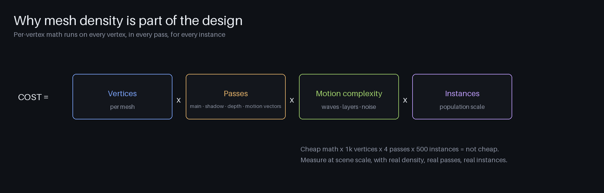
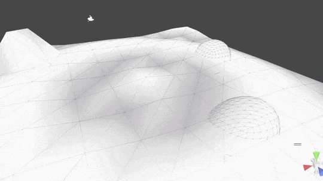
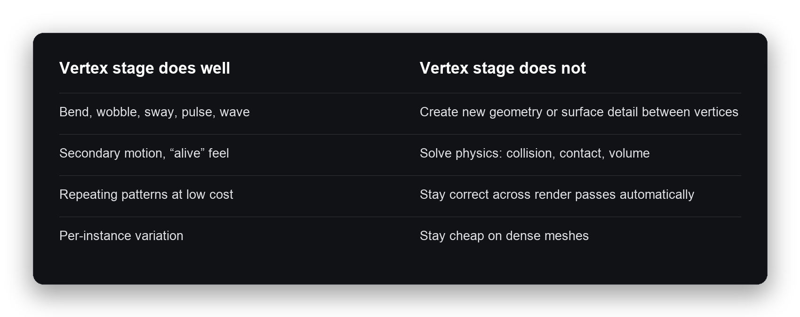

# Shader Story

## Vertex Animation: Introduction

> **Vertex animation** moves mesh vertices in the vertex shader, before rasterization, on the GPU, for every pixel-bound triangle. Used for **cheap, procedural, controllable motion**: foliage in the wind, flags, water ripples, impact reactions, and per-instance variation across thousands of objects sharing one shader.


```hlsl
float3 offsetOS = directionOS * amplitude * mask * sin(time * speed);
positionOS += offsetOS;
```
---

### When the vertex stage is the right tool

The rule that should guide every decision in this chapter:

> **Broad motion, low cost, high control. Not perfect motion.**

The vertex stage is strongest when you need motion that is *cheap, procedural, and controllable*, and it is the wrong tool when the motion has to match a precise simulation, an authored performance, or physical truth. Foliage in the wind: vertex stage. Cloth that must collide: a cloth solver. A flag that must match a recorded animation: bones or a geometry cache.

Keep this as the filter for every idea: *does this need to be believable, or does it need to be true?* Believable: the vertex stage. True: a real system.

One important condition: **the mesh has to be reasonable.** Cheap deformation on a sensible mesh is cheap. The same math on a dense mesh, rendered in four passes, and instanced a thousand times, is suddenly not.

<p align="center">

</p>

---

### What the vertex stage gives you

A well-built vertex stage setup can:

- replace bones, baked clips, and CPU-side updates with one shared shader
- drive *many* assets from a single material
- source variation from masks, vertex colors, time offsets, wind, instance data, or gameplay parameters

The cost model is simple and unforgiving: whatever math you write runs on **every vertex, in every pass, for every instance**. Measure at scene scale, with real density and real passes, never on a single hero asset.

---

### Visual demo
The same mesh, the same material, the only difference is that the vertex stage now adds motion before rasterization. Notice the controls: amplitude, frequency, direction, mask, variation. If you can't tune it, you don't have art direction; you have a trick.

<p align="center">

</p>

The honest limits of the stage, at a glance:

<p align="center">

</p>

---

### URP Shader Code
The smallest honest vertex-motion shader: one wrapped phase, one direction, one amplitude, one mask. Everything else in this chapter is a refinement of these four knobs.

```hlsl
Shader "DecompiledArt/VertexAnimation/Introduction/Introduction"
{
    Properties
    {
        [MainColor] _BaseColor("Base Color", Color) = (0.6, 0.85, 1.0, 1.0)
        [Enum(DirectTime,0,WrappedPhase,1)] _TimeMode("Time Mode", Float) = 1
        [Min(0.001)] _Speed("Speed", Float) = 1.0
        _Amplitude("Amplitude", Float) = 0.25
        _Frequency("Frequency", Float) = 1.0
        _MotionAxisOS("Motion Axis (Object Space)", Vector) = (0, 1, 0, 0)
        _MaskByHeight("Mask By Local Y", Float) = 0.0
        _HeightMin("Height Min", Float) = -0.5
        _HeightMax("Height Max", Float) = 0.5
    }

    SubShader
    {
        Tags { "RenderType" = "Opaque" "Queue" = "Geometry" "RenderPipeline" = "UniversalPipeline" }

        Pass
        {
            Name "Forward"
            Tags { "LightMode" = "UniversalForward" }

            HLSLPROGRAM
            #pragma target 4.5
            #pragma vertex vert
            #pragma fragment frag

            #include "Packages/com.unity.render-pipelines.universal/ShaderLibrary/Core.hlsl"

            struct Attributes
            {
                float4 positionOS : POSITION;
                half3 normalOS : NORMAL;
            };

            struct Varyings
            {
                float4 positionHCS : SV_POSITION;
                half3 normalWS : TEXCOORD0;
            };

            CBUFFER_START(UnityPerMaterial)
                half4 _BaseColor;
                half _TimeMode;
                half _Speed;
                half _Amplitude;
                half _Frequency;
                half3 _MotionAxisOS;
                half _MaskByHeight;
                half _HeightMin;
                half _HeightMax;
            CBUFFER_END

            // Wrapped 0..1 phase, then back to radians.
            // Bounded time keeps sin() inputs small in long sessions.
            inline half GetAngularTime()
            {
                half timeMode = step(0.5h, _TimeMode);
                half directAngle = _Time.y * _Speed * TWO_PI;
                half wrappedAngle = frac(_Time.y * _Speed) * TWO_PI;
                return lerp(directAngle, wrappedAngle, timeMode);
            }

            // Positional weighting so the mesh does not move as one rigid block.
            inline half GetHeightMask(float3 positionOS)
            {
                half t = saturate((positionOS.y - _HeightMin) / max(0.0001h, _HeightMax - _HeightMin));
                return lerp(1.0h, t * t * (3.0h - 2.0h * t), saturate(_MaskByHeight));
            }

            Varyings vert(Attributes IN)
            {
                Varyings OUT;

                float3 positionOS = IN.positionOS.xyz;

                half3 axisOS = normalize(_MotionAxisOS);
                half heightMask = GetHeightMask(positionOS);
                half angle = GetAngularTime() + positionOS.x * _Frequency;
                half wave = sin(angle);

                positionOS += axisOS * (wave * _Amplitude * heightMask);

                VertexPositionInputs positionInputs = GetVertexPositionInputs(positionOS);
                VertexNormalInputs normalInputs = GetVertexNormalInputs(IN.normalOS);

                OUT.positionHCS = positionInputs.positionCS;
                OUT.normalWS = normalInputs.normalWS;
                return OUT;
            }

            half4 frag(Varyings IN) : SV_Target
            {
                half3 normalWS = normalize(IN.normalWS);
                half ndl = saturate(dot(normalWS, normalize(half3(0.35h, 0.8h, 0.2h))));
                half lit = 0.25h + 0.75h * ndl;
                return half4(_BaseColor.rgb * lit, _BaseColor.a);
            }
            ENDHLSL
        }
    }

    FallBack Off
}
```

---

## 🔗 Related Chapters

[Coordinate Spaces](https://github.com/DeGGeD/ShaderStory/blob/main/Chapters/VertexAnimation/CoordinateSpaces.md) • [Time Wrapping](https://github.com/DeGGeD/ShaderStory/blob/main/Chapters/VertexAnimation/Time/TimeWrapping.md) • [Procedural Masks](https://github.com/DeGGeD/ShaderStory/blob/main/Chapters/VertexAnimation/Masks/ProceduralMasks.md) • [Sine Wave Offset](https://github.com/DeGGeD/ShaderStory/blob/main/Chapters/VertexAnimation/Patterns/SineWaveOffset.md) • [Pass Consistency](https://github.com/DeGGeD/ShaderStory/blob/main/Chapters/VertexAnimation/Shipping/PassConsistency.md)

---

## ❤️ Support Shader Story

If this article helped you, consider supporting the project on Patreon - you'll get access to the related source files, reference cheat-sheets, and other exclusive resources:

<p align="center">
  <a href="https://www.patreon.com/decompiled_art" target="_blank">
    
  </a>
  <a href="https://www.buymeacoffee.com/shaderstory" target="_blank">
    
  </a>
</p>

Your support helps keep this library open, growing, and free for everyone.
