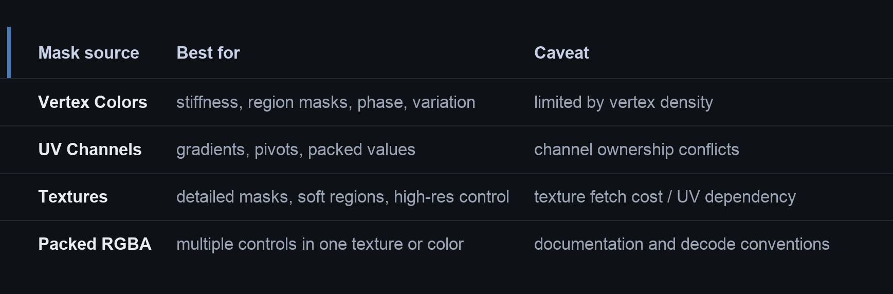
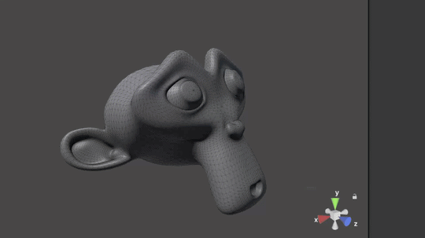

# Shader Story

## Vertex Animation: Authored Masks

> Procedural masks are fast, but they're still procedural *guesses*. When an artist or a tool needs **direct control over where motion happens**, the mask comes from authored data: **vertex colors, UV channels, packed channels, or textures** painted in a DCC tool. The shader decodes a documented convention; the artist paints the intent.

> **Packed channels only work if everyone agrees what each channel means. Write that convention down.**

```hlsl
half mask = IN.color.r;  // painted influence
mask = pow(mask, _MaskPower) * (1.0 - _MaskInvert > 0.5 ? 1.0 : 0.0);  // shape it
```
---

### The four authored sources

<p align="center">

</p>

The last row is the most powerful and the most fragile: a packed channel (RGB = pivot, A = phase, for example) is just a number until someone documents what it means. The source, the packing, and the decode path must all be explicitly defined; the same data-ownership rule as [Data Sources](https://github.com/DeGGeD/ShaderStory/blob/main/Chapters/VertexAnimation/DataSources.md).

### The single most repeated rule in this chapter

> **Debug the mask before you debug the motion.** Always build a mask-debug view first: render the decoded mask as the final color and *look at it*. If the painted regions land where you want motion, only then is the deformation trustworthy.

The channel-debug pattern below is exactly that: one toggle per channel, so a painted mask can be inspected channel by channel before it is allowed to drive anything.

---

### Visual demo
The mask rendered as color, before any displacement is applied. The red channel holds a painted influence gradient; the debug toggles expose each channel individually so the painted data can be verified against intent.

<p align="center">

</p>

---

### URP Shader Code
The mask-debug tool: per-channel toggles with a full-color fallback. This is the first thing to build for any authored-mask workflow; inspect the data before the data drives motion.

```hlsl
Shader "DecompiledArt/VertexAnimation/Masks/AuthoredMasks/AuthoredMasks"
{
    Properties
    {
        [Header(Vertex Color Debug Channels)]
        [Toggle] _DebugR("Show Red Channel", Float) = 0
        [Toggle] _DebugG("Show Green Channel", Float) = 0
        [Toggle] _DebugB("Show Blue Channel", Float) = 0
        [Toggle] _DebugA("Show Alpha Channel", Float) = 0

        [Toggle] _FallbackFullColor("Show Full Vertex Color When No Toggles", Float) = 1
    }

    SubShader
    {
        Tags
        {
            "RenderPipeline" = "UniversalPipeline"
            "RenderType" = "Opaque"
            "Queue" = "Geometry"
        }

        Pass
        {
            Name "VertexColorDebug"
            Tags { "LightMode" = "UniversalForward" }

            Cull Back
            ZWrite On
            ZTest LEqual

            HLSLPROGRAM
            #pragma target 2.0
            #pragma vertex vert
            #pragma fragment frag

            #include "Packages/com.unity.render-pipelines.universal/ShaderLibrary/Core.hlsl"

            CBUFFER_START(UnityPerMaterial)
                half _DebugR;
                half _DebugG;
                half _DebugB;
                half _DebugA;
                half _FallbackFullColor;
            CBUFFER_END

            struct Attributes
            {
                float3 positionOS : POSITION;
                half4 color : COLOR;
            };

            struct Varyings
            {
                float4 positionCS : SV_POSITION;
                half4 color : COLOR;
            };

            Varyings vert(Attributes IN)
            {
                Varyings OUT;
                OUT.positionCS = TransformObjectToHClip(IN.positionOS);
                OUT.color = saturate(IN.color);
                return OUT;
            }

            half4 frag(Varyings IN) : SV_Target
            {
                half4 vc = IN.color;

                // Any channel selected → show the selected channels only,
                // keeping channel identity: R = red, G = green, B = blue,
                // A = grayscale preview.
                half anyDebug = saturate(_DebugR + _DebugG + _DebugB + _DebugA);
                half3 debugColor = 0;

                debugColor += half3(vc.r, 0.0h, 0.0h) * _DebugR;
                debugColor += half3(0.0h, vc.g, 0.0h) * _DebugG;
                debugColor += half3(0.0h, 0.0h, vc.b) * _DebugB;
                debugColor += half3(vc.a, vc.a, vc.a) * _DebugA;

                half3 fullColor = vc.rgb;

                half3 finalColor = lerp(
                    fullColor * _FallbackFullColor,
                    saturate(debugColor),
                    anyDebug
                );

                return half4(finalColor, 1.0h);
            }
            ENDHLSL
        }
    }

    FallBack Off
}
```

Once the data is verified, consuming it is the trivial half: remap, shape, and hand it to the motion function, which stays generic and reusable:

```hlsl
// The motion function stays generic; the *asset* decides where motion is allowed.
half mask = IN.color.r;  // or a UV gradient, or a texture tap
mask = pow(saturate(mask), _MaskPower);
positionWS += _MoveAxisWS * wave * mask;
```

---

## 🔗 Related Chapters

[Procedural Masks](https://github.com/DeGGeD/ShaderStory/blob/main/Chapters/VertexAnimation/Masks/ProceduralMasks.md) • [Runtime Masks](https://github.com/DeGGeD/ShaderStory/blob/main/Chapters/VertexAnimation/Masks/RuntimeMasks.md) • [Data Sources](https://github.com/DeGGeD/ShaderStory/blob/main/Chapters/VertexAnimation/DataSources.md) • [Pivot Data](https://github.com/DeGGeD/ShaderStory/blob/main/Chapters/VertexAnimation/PivotMotion/SingleObjectPivotData.md)

**Related functions:** [Power](https://github.com/DeGGeD/ShaderStory/blob/main/Chapters/CommonFunctions/Power.md) • [Clamp / Saturate](https://github.com/DeGGeD/ShaderStory/blob/main/Chapters/CommonFunctions/ClampSaturate.md) • [Smoothstep](https://github.com/DeGGeD/ShaderStory/blob/main/Chapters/CommonFunctions/Smoothstep.md)

---

## ❤️ Support Shader Story

If this article helped you, consider supporting the project on Patreon - you'll get access to the related source files, reference cheat-sheets, and other exclusive resources:

<p align="center">
  <a href="https://www.patreon.com/decompiled_art" target="_blank">
    
  </a>
  <a href="https://www.buymeacoffee.com/shaderstory" target="_blank">
    
  </a>
</p>

Your support helps keep this library open, growing, and free for everyone.
