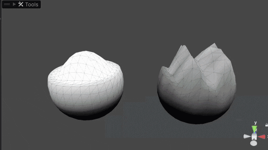

# Shader Story

## Vertex Animation: Procedural Masks

> A procedural mask answers *where the motion happens and how strongly*, using math, not authored data. The workhorse pairing: a **gradient** gives structure (the base stays planted, the top moves), **noise** breaks the uniformity (not every vertex moves in lockstep), and **smoothstep** turns the result into something an artist can direct.

> **The gradient gives structure, the noise adds variation.** Multiply them, and you get structure *with* variation.

```hlsl
half gradientMask = smoothstep(_MaskMin, _MaskMax, positionOS.y);
half noiseMask = SimpleNoise(positionOS.xz * _NoiseScale + scroll);
half mask = gradientMask * noiseMask;  // structure × breakup
```

---

### Structure × breakup

A gradient alone is structured but uniform; the whole cross-section moves together. Noise alone is varied but unstructured; no readable "planted base". The production pairing multiplies them:

- **Gradient**: a remap of position (object-space height, or a UV channel) through `smoothstep`, so the falloff is soft and tunable via `_MaskMin` / `_MaskMax`.
- **Noise**: a cheap 2D gradient noise, scaled and slowly scrolled. It scatters the phase and amplitude so neighbors don't move in perfect agreement.

Two rules that come from the mask being *procedural*:

1. **Masks are not space-neutral.** Noise sampled in object space sticks to the asset; noise sampled in world space stays fixed in the world while the asset moves through the pattern. Same function, different behavior. See [Coordinate Spaces](https://github.com/DeGGeD/ShaderStory/blob/main/Chapters/VertexAnimation/CoordinateSpaces.md).
2. **Debug the mask before you debug the motion.** Render the mask as the final color and *look at it* before applying any displacement. If the mask is wrong, the deformation will be wrong no matter how good the motion function is.

---

### Visual demo
Watch the mask stack up: no mask, the whole surface moves as one; add the gradient and the base stays planted; add noise and the motion breaks apart; combine them for structure with variation. Then move or rotate the asset to feel the object-space versus world-space difference. The debug toggle renders the mask itself as color.

<p align="center">

</p>

---

### URP Shader Code
One traveling wave plus a mask mode enum, None / Gradient / Noise / GradientNoise, with the noise space switchable between object and world, and a debug output that shows the mask before any displacement is applied.

```hlsl
Shader "DecompiledArt/VertexAnimation/Masks/ProceduralMasks/ProceduralMasks"
{
    Properties
    {
        [MainColor] _BaseColor("Base Color", Color) = (0.75, 0.85, 1.0, 1.0)

        [Header(Vertex Motion)]
        _Amplitude("Amplitude", Range(0.0, 2.0)) = 0.15
        _WaveFrequency("Wave Frequency", Range(0.0, 20.0)) = 2.0
        _WaveSpeed("Wave Speed", Range(-10.0, 10.0)) = 1.5
        _DisplaceDirectionOS("Displace Direction OS", Vector) = (0, 1, 0, 0)
        _WaveAxisOS("Wave Axis OS", Vector) = (0, 1, 0, 0)

        [Header(Mask Mode)]
        [KeywordEnum(None, Gradient, Noise, GradientNoise)] _MASKMODE("Mask Mode", Float) = 0

        [Header(Gradient)]
        [KeywordEnum(UV_Y, Object_Y)] _GRADIENTSOURCE("Gradient Source", Float) = 0
        _GradientScale("Gradient Scale (Object Y)", Float) = 1.0
        _GradientOffset("Gradient Offset (Object Y)", Float) = 0.0
        _MaskMin("Mask Min", Range(-2.0, 2.0)) = 0.0
        _MaskMax("Mask Max", Range(-2.0, 2.0)) = 1.0

        [Header(Noise)]
        [KeywordEnum(Object, World)] _NOISESPACE("Noise Space", Float) = 0
        _NoiseSeed("Noise Seed", Float) = 42.0
        _NoiseScale("Noise Scale", Range(0.01, 32.0)) = 4.0
        _NoiseSpeed("Noise Scroll Speed", Range(-5.0, 5.0)) = 0.5
        _NoiseContrast("Noise Contrast", Range(0.25, 4.0)) = 1.0

        [Header(Debug)]
        [Toggle(_DEBUG_MASK)] _DebugMask("Debug Mask Output", Float) = 0
    }

    SubShader
    {
        Tags { "RenderPipeline" = "UniversalPipeline" "RenderType" = "Opaque" "Queue" = "Geometry" }

        Pass
        {
            Name "Forward"
            Tags { "LightMode" = "UniversalForward" }

            HLSLPROGRAM
            #pragma target 3.0
            #pragma vertex vert
            #pragma fragment frag

            #pragma shader_feature_local _MASKMODE_NONE _MASKMODE_GRADIENT _MASKMODE_NOISE _MASKMODE_GRADIENTNOISE
            #pragma shader_feature_local _GRADIENTSOURCE_UV_Y _GRADIENTSOURCE_OBJECT_Y
            #pragma shader_feature_local _NOISESPACE_OBJECT _NOISESPACE_WORLD
            #pragma shader_feature_local _DEBUG_MASK

            #include "Packages/com.unity.render-pipelines.universal/ShaderLibrary/Core.hlsl"
            #include "Packages/com.unity.render-pipelines.universal/ShaderLibrary/Lighting.hlsl"

            struct Attributes
            {
                float4 positionOS : POSITION;
                half3 normalOS : NORMAL;
                half2 uv : TEXCOORD0;
            };

            struct Varyings
            {
                float4 positionHCS : SV_POSITION;
                float3 positionWS : TEXCOORD0;
                half3 normalWS : TEXCOORD1;
                half mask : TEXCOORD2;
            };

            CBUFFER_START(UnityPerMaterial)
                half4 _BaseColor;
                half _Amplitude;
                half _WaveFrequency;
                half _WaveSpeed;
                half4 _DisplaceDirectionOS;
                half4 _WaveAxisOS;
                half _GradientScale;
                half _GradientOffset;
                half _MaskMin;
                half _MaskMax;
                half _NoiseSeed;
                half _NoiseScale;
                half _NoiseSpeed;
                half _NoiseContrast;
            CBUFFER_END

            // ------------------------------------------------------------
            // Helpers
            // ------------------------------------------------------------

            inline half Fade(half t) { return t * t * (3.0h - 2.0h * t); }

            // Cheap cubic fade for gradient-noise interpolation.
            inline half ApproxPowPositive(half x, half p)
            {
                return exp2(p * log2(max(x, 1e-4h)));
            }

            // Pseudo-random 2D hash for gradient generation.
            inline half2 Hash2(half2 p)
            {
                p += _NoiseSeed;
                p = half2(
                    dot(p, half2(127.1h, 311.7h)),
                    dot(p, half2(269.5h, 183.3h))
                );
                return frac(sin(p) * 43758.5453h) * 2.0h - 1.0h;
            }

            // Simple 2D gradient noise, output ≈ [-1, 1].
            inline half GradientNoise2D(half2 p)
            {
                half2 cell = floor(p);
                half2 f = frac(p);

                half2 g00 = Hash2(cell);
                half2 g10 = Hash2(cell + half2(1.0h, 0.0h));
                half2 g01 = Hash2(cell + half2(0.0h, 1.0h));
                half2 g11 = Hash2(cell + half2(1.0h, 1.0h));

                half n00 = dot(g00, f);
                half n10 = dot(g10, f - half2(1.0h, 0.0h));
                half n01 = dot(g01, f - half2(0.0h, 1.0h));
                half n11 = dot(g11, f - half2(1.0h, 1.0h));

                half2 u = half2(Fade(f.x), Fade(f.y));

                half nx0 = lerp(n00, n10, u.x);
                half nx1 = lerp(n01, n11, u.x);

                return lerp(nx0, nx1, u.y);
            }

            // Wrapped angular time, bounded phase for long sessions.
            inline half GetWrappedWavePhase()
            {
                return frac(_Time.y * _WaveSpeed) * TWO_PI;
            }

            // ------------------------------------------------------------
            // Mask evaluation
            // ------------------------------------------------------------

            inline half EvaluateGradientMask(float3 positionOS, half2 uv)
            {
                half rawGradient;

                #if defined(_GRADIENTSOURCE_UV_Y)
                    rawGradient = uv.y;  // authored UV layout
                #else
                    rawGradient = positionOS.y * _GradientScale + _GradientOffset;
                #endif

                // smoothstep remap: a soft, art-directable falloff.
                return smoothstep(_MaskMin, _MaskMax, rawGradient);
            }

            inline half EvaluateNoiseMask(float3 positionOS, float3 positionWS)
            {
                half2 noiseUV;

                #if defined(_NOISESPACE_OBJECT)
                    noiseUV = (half2)positionOS.xz;  // noise moves with the object
                #else
                    noiseUV = (half2)positionWS.xz;  // noise fixed in the world
                #endif

                noiseUV *= _NoiseScale;
                noiseUV.x += frac(_Time.y * _NoiseSpeed);  // wrapped scroll, never grows

                half n = GradientNoise2D(noiseUV) * 0.5h + 0.5h;
                n = ApproxPowPositive(saturate(n), _NoiseContrast);
                return saturate(n);
            }

            inline half EvaluateMask(float3 positionOS, float3 positionWS, half2 uv)
            {
                #if defined(_MASKMODE_NONE)
                    return 1.0h;
                #elif defined(_MASKMODE_GRADIENT)
                    return EvaluateGradientMask(positionOS, uv);
                #elif defined(_MASKMODE_NOISE)
                    return EvaluateNoiseMask(positionOS, positionWS);
                #else
                    // Structure × breakup.
                    return EvaluateGradientMask(positionOS, uv) * EvaluateNoiseMask(positionOS, positionWS);
                #endif
            }

            // ------------------------------------------------------------
            // Vertex / Fragment
            // ------------------------------------------------------------

            Varyings vert(Attributes IN)
            {
                Varyings OUT;

                float3 positionOS = IN.positionOS.xyz;
                float3 originalPositionWS = TransformObjectToWorld(positionOS);

                // Evaluate the mask before deformation, so it stays stable
                // relative to the source coordinates.
                half mask = EvaluateMask(positionOS, originalPositionWS, IN.uv);

                half3 waveAxisOS = normalize(_WaveAxisOS.xyz);
                half3 displaceDirOS = normalize(_DisplaceDirectionOS.xyz);

                half phaseCoord = dot((half3)positionOS, waveAxisOS);
                half wave = sin(phaseCoord * _WaveFrequency + GetWrappedWavePhase());
                half displacement = wave * _Amplitude * mask;

                positionOS += (float3)(displaceDirOS * displacement);

                OUT.positionWS = TransformObjectToWorld(positionOS);
                OUT.positionHCS = TransformWorldToHClip(OUT.positionWS);
                OUT.normalWS = TransformObjectToWorldNormal(IN.normalOS);
                OUT.mask = mask;
                return OUT;
            }

            half4 frag(Varyings IN) : SV_Target
            {
                // Debug: look at the mask itself before trusting the motion.
                #if defined(_DEBUG_MASK)
                    return half4(IN.mask.xxx, 1.0h);
                #else
                    half3 normalWS = normalize(IN.normalWS);
                    Light mainLight = GetMainLight();

                    half3 lambert = LightingLambert(mainLight.color, mainLight.direction, normalWS);
                    half3 ambient = SampleSH(normalWS);

                    return half4(_BaseColor.rgb * (ambient + lambert), _BaseColor.a);
                #endif
            }
            ENDHLSL
        }
    }

    FallBack Off
}
```

---

## 🔗 Related Chapters

[Authored Masks](https://github.com/DeGGeD/ShaderStory/blob/main/Chapters/VertexAnimation/Masks/AuthoredMasks.md) • [Runtime Masks](https://github.com/DeGGeD/ShaderStory/blob/main/Chapters/VertexAnimation/Masks/RuntimeMasks.md) • [Coordinate Spaces](https://github.com/DeGGeD/ShaderStory/blob/main/Chapters/VertexAnimation/CoordinateSpaces.md)

**Related functions:** [Smoothstep](https://github.com/DeGGeD/ShaderStory/blob/main/Chapters/CommonFunctions/Smoothstep.md) • [Sine / Cosine](https://github.com/DeGGeD/ShaderStory/blob/main/Chapters/CommonFunctions/SineCosine.md) • [Frac](https://github.com/DeGGeD/ShaderStory/blob/main/Chapters/CommonFunctions/Frac.md)

---

## ❤️ Support Shader Story

If this article helped you, consider supporting the project on Patreon - you'll get access to the related source files, reference cheat-sheets, and other exclusive resources:

<p align="center">
  <a href="https://www.patreon.com/decompiled_art" target="_blank">
    
  </a>
  <a href="https://www.buymeacoffee.com/shaderstory" target="_blank">
    
  </a>
</p>

Your support helps keep this library open, growing, and free for everyone.
