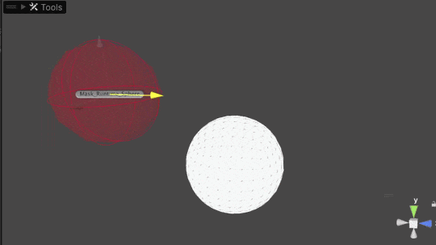

# Shader Story

## Vertex Animation: Runtime Masks

> Procedural masks come from math, authored masks come from artists, **runtime-driven masks come from live game state**, and this is where vertex motion stops being decoration and starts being *behavior*. The workhorse is the **sphere mask**: the game provides a world-space center, radius, and falloff; every vertex checks its distance to that center and computes its own local response. The same setup drives a player-proximity lean, a wind gust, a shockwave, or a water ripple; only the displacement direction and shaping change.

```hlsl
float dist = distance(positionWS, _MaskCenterWS);
float mask = 1.0 - smoothstep(_MaskRadius, _MaskRadius + _MaskSoftness, dist);
positionWS += _DisplaceDirectionWS * _Amplitude * mask;
```

---

### Why a sphere

A sphere is the cheapest "field" that reads as intent: one center, one radius, one falloff. Because it's a distance test, it composes naturally with anything that exists in world space: a player, an impact point, a gust origin; *every object in the scene samples the same field*, so everything in range reacts in agreement.

The space rule bites here, exactly as in [Coordinate Spaces](https://github.com/DeGGeD/ShaderStory/blob/main/Chapters/VertexAnimation/CoordinateSpaces.md): if the mask center is world-space, the position used for the test *must* be world-space too. Mismatch the spaces and the mask silently fails; no error, just "nothing reacts".

Two practical limits:

- The falloff (`_MaskSoftness`) decides whether the edge of the field reads as soft intent or hard clipping. Start generous; a sphere mask with a hard edge looks like a bug.
- One or two global masks are simple. If you need *many* overlapping fields, move to arrays, buffers, or a gameplay-side aggregation system, not a dozen hand-authored global properties.

---

### Visual demo
A live field, moved through a surface: only the vertices inside the radius respond, and the falloff keeps the edge soft instead of hard. Everything in range reacts together because they all sample the same world-space field. The debug blend tints the surface by mask strength so the field itself is visible.

<p align="center">

</p>

---

### URP Shader Code
The sphere mask as a complete URP shader. The field parameters live in the material CBUFFER, so a single `MaterialPropertyBlock` from C# drives the whole population without splitting batches.

```hlsl
Shader "DecompiledArt/VertexAnimation/Masks/RuntimeMasks/RuntimeMasks"
{
    Properties
    {
        _BaseColor("Base Color", Color) = (0.7, 0.7, 0.7, 1)
        _MaskColor("Debug Mask Color", Color) = (1, 0, 0, 1)

        // Final displacement strength applied after the runtime mask is evaluated.
        _DisplaceStrength("Displace Strength", Float) = 0.5

        // Normal mode is the clearest default for sphere-mask deformation.
        // Custom World mode shows an upward or sideways push instead.
        [Enum(NormalWS,0,CustomWorldDirection,1)] _DisplaceMode("Displace Mode", Float) = 0
        _DisplaceDirectionWS("Displace Direction WS", Vector) = (0, 1, 0, 0)

        _DebugMask("Debug Mask Visibility", Range(0, 1)) = 1
    }

    SubShader
    {
        Tags { "RenderPipeline" = "UniversalPipeline" "RenderType" = "Opaque" }

        Pass
        {
            Name "Forward"
            Tags { "LightMode" = "UniversalForward" }

            HLSLPROGRAM
            #pragma vertex vert
            #pragma fragment frag

            #include "Packages/com.unity.render-pipelines.universal/ShaderLibrary/Core.hlsl"

            struct Attributes
            {
                float4 positionOS : POSITION;
                float3 normalOS : NORMAL;
            };

            struct Varyings
            {
                float4 positionHCS : SV_POSITION;
                float3 positionWS : TEXCOORD0;
                float mask : TEXCOORD1;
            };

            CBUFFER_START(UnityPerMaterial)
                half4 _BaseColor;
                half4 _MaskColor;

                float _DisplaceStrength;
                float _DisplaceMode;
                float4 _DisplaceDirectionWS;
                float _DebugMask;

                // The live field: set from C# every frame (or on events).
                float3 _MaskCenterWS;
                float _MaskRadius;
                float _MaskSoftness;
            CBUFFER_END

            // Distance test with a smooth falloff beyond the radius.
            float ComputeSphereMask(float3 positionWS)
            {
                float dist = distance(positionWS, _MaskCenterWS);

                return 1.0 - smoothstep(
                    _MaskRadius,
                    _MaskRadius + _MaskSoftness,
                    dist
                );
            }

            // Only normalize when the vector is valid.
            float3 SafeNormalizeWS(float3 v, float3 fallbackValue)
            {
                float lenSq = dot(v, v);
                return (lenSq > 1e-6) ? v * rsqrt(lenSq) : fallbackValue;
            }

            float3 EvaluateDisplaceDirectionWS(float3 normalWS)
            {
                float useCustomDirection = step(0.5, _DisplaceMode);
                float3 customDirectionWS = SafeNormalizeWS(_DisplaceDirectionWS.xyz, float3(0.0, 1.0, 0.0));
                return normalize(lerp(normalWS, customDirectionWS, useCustomDirection));
            }

            Varyings vert(Attributes v)
            {
                Varyings o;

                // The mask center is world-space, so the position for the
                // distance test must be world-space too.
                float3 positionWS = TransformObjectToWorld(v.positionOS.xyz);
                float3 normalWS = SafeNormalizeWS(TransformObjectToWorldNormal(v.normalOS), float3(0.0, 1.0, 0.0));

                float mask = ComputeSphereMask(positionWS);
                float3 displaceDirectionWS = EvaluateDisplaceDirectionWS(normalWS);

                positionWS += displaceDirectionWS * mask * _DisplaceStrength;

                o.positionWS = positionWS;
                o.mask = mask;
                o.positionHCS = TransformWorldToHClip(positionWS);

                return o;
            }

            half4 frag(Varyings i) : SV_Target
            {
                // Debug visualization: tint by mask strength.
                half3 color = lerp(
                    _BaseColor.rgb,
                    _MaskColor.rgb,
                    i.mask * _DebugMask
                );

                return half4(color, 1.0);
            }

            ENDHLSL
        }
    }

    FallBack Off
}
```

And the other half of the system, a live field from C#:

```csharp
// A global field set from gameplay state. One block drives every object.
MaterialPropertyBlock block = new MaterialPropertyBlock();
Vector3 playerPosition;  // filled from the player each frame

void Update()
{
    Vector3 center = playerPosition + Vector3.up * 0.5f;

    // A gust: the field wanders on top of the player position.
    center += new Vector3(Mathf.Sin(Time.time * 0.7f), 0, Mathf.Cos(Time.time * 0.5f)) * 1.5f;

    block.SetVector("_MaskCenterWS", center);
    block.SetFloat("_MaskRadius", 2.0f);
    block.SetFloat("_MaskSoftness", 0.6f);
    renderer.ShaderProperties = block;
}
```

> Filter the gameplay data before it drives deformation (see [Gameplay-Driven Motion](https://github.com/DeGGeD/ShaderStory/blob/main/Chapters/VertexAnimation/GameplayDrivenMotion.md)); a jittery center makes a jittery field.

---

## 🔗 Related Chapters

[Procedural Masks](https://github.com/DeGGeD/ShaderStory/blob/main/Chapters/VertexAnimation/Masks/ProceduralMasks.md) • [Authored Masks](https://github.com/DeGGeD/ShaderStory/blob/main/Chapters/VertexAnimation/Masks/AuthoredMasks.md) • [Gameplay-Driven Motion](https://github.com/DeGGeD/ShaderStory/blob/main/Chapters/VertexAnimation/GameplayDrivenMotion.md)

**Related functions:** [Distance](https://github.com/DeGGeD/ShaderStory/blob/main/Chapters/CommonFunctions/Distance.md) • [Smoothstep](https://github.com/DeGGeD/ShaderStory/blob/main/Chapters/CommonFunctions/Smoothstep.md) • [Normalize](https://github.com/DeGGeD/ShaderStory/blob/main/Chapters/CommonFunctions/Normalize.md)

---

## ❤️ Support Shader Story

If this article helped you, consider supporting the project on Patreon - you'll get access to the related source files, reference cheat-sheets, and other exclusive resources:

<p align="center">
  <a href="https://www.patreon.com/decompiled_art" target="_blank">
    
  </a>
  <a href="https://www.buymeacoffee.com/shaderstory" target="_blank">
    
  </a>
</p>

Your support helps keep this library open, growing, and free for everyone.
