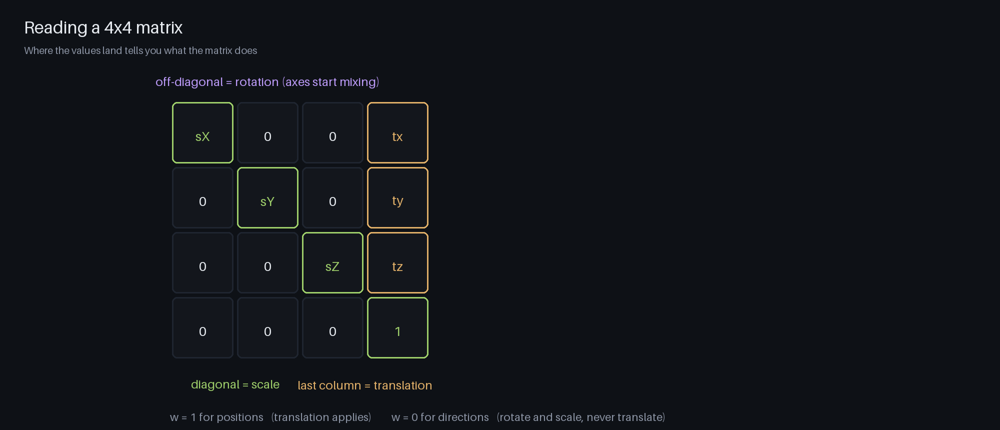
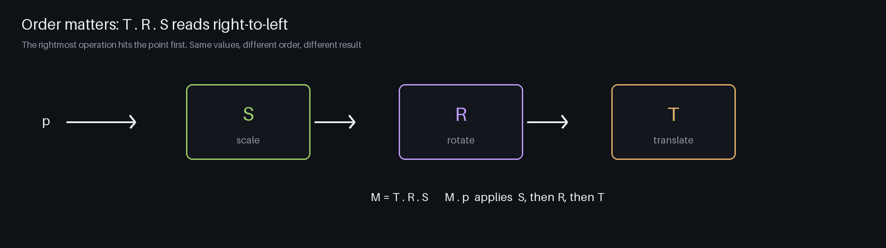

# Shader Story

## Vertex Animation: Matrices

> A **4×4 matrix** is a recipe that builds a new position from an old one. **Scale** lives on the diagonal, **translation** lives in the last column, and **rotation** lives where the axes start mixing off-diagonal. And because matrix multiplication applies right-to-left, T · R · S means Scale → Rotate → Translate: the same values produce a different result when the order changes.

> Use matrices when they improve clarity or are structurally required. Don't build them out of habit when simpler math says the same thing.


```hlsl
float4x4 M = mul(T, mul(R, S));  // M * p applies S, then R, then T
```

---

### Reading the matrix

Where values land is meaningful:

<p align="center">

</p>

Two things to remember:

**W matters.** We use 4×4 matrices even though positions are XYZ because W lets translation live in the same multiply. Positions use `w = 1` (translation applies); directions use `w = 0` (they rotate/scale but never translate).

**Order matters.** Scale, rotate, and translate are not interchangeable.

<p align="center">

</p>

In Unity the local matrix is composed `T * R * S`, but a point experiences **Scale → Rotation → Translation** because the rightmost operation applies first. That sentence will save you at least once per project.

### Theory vs. production

For *learning*, writing out explicit matrices is great: the structure becomes visible. In production vertex code, though, explicit matrices can cost more ALU per vertex, increase register pressure, make row-major/column-major mistakes easier, and block compiler optimizations. So the lesson isn't "never use matrices"; it's: use them where they earn their keep, and prefer direct math when it says the same thing:

```hlsl
// The same pivot rotation without materializing a matrix:
float3 local = positionOS - pivotOS;
local = RotateAroundAxis(local, axisOS, angle);  // Rodrigues, 1 sincos + 2 dots
positionOS = pivotOS + local;
```

See [Single Object Mesh Pivot](https://github.com/DeGGeD/ShaderStory/blob/main/Chapters/VertexAnimation/PivotMotion/SingleObjectMeshPivot.md) for the production form of exactly this.

---

### Visual demo
The same object, the same values, six orders. Drag the rotation and watch: only a few of the six orders read as "the intended" motion. Non-commutativity is not a theory here; it is the difference between a branch bending and a branch teleporting.

---

### URP Shader Code
Explicit matrix builders for teaching, plus a keyword to swap the composition order live. The custom TRS stays in object space; Unity still applies its regular object-to-world and world-to-clip transforms afterwards.

```hlsl
Shader "DecompiledArt/VertexAnimation/Matrices/Matrices"
{
    Properties
    {
        [Header(Translation)]
        _Translate("Translation", Vector) = (0, 0, 0, 0)

        [Header(Scale)]
        _Scale("Scale", Vector) = (1, 1, 1, 0)

        [Header(Rotation XYZ, degrees)]
        _Rotation("Rotation", Vector) = (0, 0, 0, 0)

        [KeywordEnum(TRS, TSR, RTS, RST, STR, SRT)]
        _TransformOrder("Transform Order", Float) = 0
    }

    SubShader
    {
        Tags { "RenderType" = "Opaque" "RenderPipeline" = "UniversalPipeline" }

        Pass
        {
            HLSLPROGRAM
            #pragma vertex vert
            #pragma fragment frag

            #pragma shader_feature_local _TRANSFORMORDER_TRS _TRANSFORMORDER_TSR _TRANSFORMORDER_RTS _TRANSFORMORDER_RST _TRANSFORMORDER_STR _TRANSFORMORDER_SRT

            #include "Packages/com.unity.render-pipelines.universal/ShaderLibrary/Core.hlsl"

            struct Attributes
            {
                float4 positionOS : POSITION;
            };

            struct Varyings
            {
                float4 positionCS : SV_POSITION;
            };

            CBUFFER_START(UnityPerMaterial)
                float3 _Translate;
                float3 _Scale;
                float3 _Rotation;
            CBUFFER_END

            // Translation lives in the last column.
            // It affects positions because positions use w = 1.
            float4x4 Translation(float3 t)
            {
                return float4x4(
                    1, 0, 0, t.x,
                    0, 1, 0, t.y,
                    0, 0, 1, t.z,
                    0, 0, 0, 1
                );
            }

            // Scale on the diagonal.
            float4x4 Scale(float3 s)
            {
                return float4x4(
                    s.x, 0, 0, 0,
                    0, s.y, 0, 0,
                    0, 0, s.z, 0,
                    0, 0, 0, 1
                );
            }

            // Rotation: off-diagonal mixing of the axes.
            float4x4 Rotation(float3 rDeg)
            {
                float3 r = radians(rDeg);

                float cx = cos(r.x); float sx = sin(r.x);
                float cy = cos(r.y); float sy = sin(r.y);
                float cz = cos(r.z); float sz = sin(r.z);

                float4x4 Rx = float4x4(
                    1, 0, 0, 0,
                    0, cx, -sx, 0,
                    0, sx, cx, 0,
                    0, 0, 0, 1
                );
                float4x4 Ry = float4x4(
                    cy, 0, sy, 0,
                    0, 1, 0, 0,
                    -sy, 0, cy, 0,
                    0, 0, 0, 1
                );
                float4x4 Rz = float4x4(
                    cz, -sz, 0, 0,
                    sz, cz, 0, 0,
                    0, 0, 1, 0,
                    0, 0, 0, 1
                );

                return mul(Rz, mul(Ry, Rx));
            }

            Varyings vert(Attributes v)
            {
                Varyings o;

                float4x4 T = Translation(_Translate);
                float4x4 S = Scale(_Scale);
                float4x4 R = Rotation(_Rotation);

                // Use w = 1 because this is a position.
                // Transforming a direction would use w = 0 so translation never applies.
                float4 pos = v.positionOS;

                // Order matters: T * R * S executes S, then R, then T.
                #if defined(_TRANSFORMORDER_TRS)
                    pos = mul(T, mul(R, mul(S, pos)));
                #elif defined(_TRANSFORMORDER_TSR)
                    pos = mul(T, mul(S, mul(R, pos)));
                #elif defined(_TRANSFORMORDER_RTS)
                    pos = mul(R, mul(T, mul(S, pos)));
                #elif defined(_TRANSFORMORDER_RST)
                    pos = mul(R, mul(S, mul(T, pos)));
                #elif defined(_TRANSFORMORDER_STR)
                    pos = mul(S, mul(T, mul(R, pos)));
                #elif defined(_TRANSFORMORDER_SRT)
                    pos = mul(S, mul(R, mul(T, pos)));
                #endif

                // The custom TRS logic stays in object space.
                // After that, Unity still applies the regular object-to-world
                // and world-to-clip transforms for rasterization.
                float3 posWS = TransformObjectToWorld(pos.xyz);
                o.positionCS = TransformWorldToHClip(posWS);

                return o;
            }

            half4 frag(Varyings i) : SV_Target
            {
                return 1.0;
            }

            ENDHLSL
        }
    }

    FallBack Off
}
```

---

## 🔗 Related Chapters

[Single Object Mesh Pivot](https://github.com/DeGGeD/ShaderStory/blob/main/Chapters/VertexAnimation/PivotMotion/SingleObjectMeshPivot.md) • [Coordinate Spaces](https://github.com/DeGGeD/ShaderStory/blob/main/Chapters/VertexAnimation/CoordinateSpaces.md)

**Related functions:** [Sine / Cosine](https://github.com/DeGGeD/ShaderStory/blob/main/Chapters/CommonFunctions/SineCosine.md) • [Dot](https://github.com/DeGGeD/ShaderStory/blob/main/Chapters/CommonFunctions/Dot.md) • [Cross](https://github.com/DeGGeD/ShaderStory/blob/main/Chapters/CommonFunctions/Cross.md)

---

## ❤️ Support Shader Story

If this article helped you, consider supporting the project on Patreon: you'll get access to the related source files, reference cheat-sheets, and other exclusive resources:

<p align="center">
  <a href="https://www.patreon.com/decompiled_art" target="_blank">
    
  </a>
  <a href="https://www.buymeacoffee.com/shaderstory" target="_blank">
    
  </a>
</p>

Your support helps keep this library open, growing, and free for everyone.
