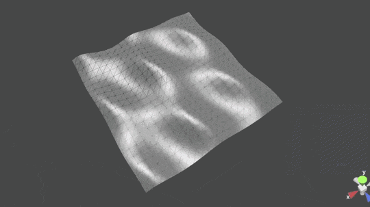

# Shader Story

## Vertex Animation: Controlled Irregularity

> Procedural motion usually fails not because the math is wrong, but because **the pattern becomes visible**. One wave, same speed, same amplitude, same phase on every object → the whole field moves like a machine. And the first instinct, *more amplitude*, usually makes the fakeness *louder*. The real toolkit is **controlled irregularity**: enough variation to hide the repetition, not so much that the motion loses its art direction.

```hlsl
half noise = GradientNoise(positionOS.xz * _NoiseScale + seed);
half speed = lerp(_MinSpeed, _MaxSpeed, noise);
half phase = seed * TWO_PI;
half wave = sin(dot(positionOS, axis) * _Frequency + _Time.y * speed + phase) * _Amplitude;
```
---

### Why "more" fails

The eye has a low threshold for *correlation*. When neighbors move in agreement, the pattern is readable as a system, and the system reads as a trick. Amplifying the same correlated motion doesn't break the correlation; it makes the pattern *bigger* and therefore easier to see.

### The actual toolkit

Every lever below breaks correlation at a different scale. Combine two or three; all of them are cheap:

- **Phase offsets** across vertices, objects, or instances; the single highest-value line of the whole chapter (see [Phase Offset](https://github.com/DeGGeD/ShaderStory/blob/main/Chapters/VertexAnimation/Time/PhaseOffset.md)).
- **Slightly different amplitudes, speeds, and frequencies** per object: a stable random in a *narrow* band, not a wide one. A field where everything moves "about the same amount, at about the same time, but not quite" reads as alive.
- **Layered broad + small secondary motion**: a hierarchy, not one uniform wave; a slow large-scale sway plus a fast small-scale flutter on the tips (masked by vertex data).
- **Masks and noise** to break uniform patterns spatially, structure × breakup, as in [Procedural Masks](https://github.com/DeGGeD/ShaderStory/blob/main/Chapters/VertexAnimation/Masks/ProceduralMasks.md).
- **Reduced motion by distance, importance, or LOD**: spend the variation where the player can actually read it (see [LODs](https://github.com/DeGGeD/ShaderStory/blob/main/Chapters/VertexAnimation/Shipping/Lods.md)).

The calibration is artistic: too little variation and the machine shows; too much and the field has no shared identity, and the art direction dies. Start from a shared motion, then add irregularity one layer at a time until the repetition disappears, and no further.

---

### Visual demo
Repetition made visible: a field running on one shared phase moves as one organism. Then the same field with controlled irregularity, phase offsets, varied speeds, and a secondary layer, so it reads as *many things* instead of one.

<p align="center">

</p>

---

### URP Shader Code
One wave, three desync levers exposed: per-vertex noise jitter, a per-instance band of speeds, and a masked secondary flutter. Turn the levers in order and watch the "machine" dissolve.

```hlsl
Shader "DecompiledArt/VertexAnimation/Patterns/ControlledIrregularity/ControlledIrregularity"
{
    Properties
    {
        [MainColor] _BaseColor("Base Color", Color) = (0.5, 0.85, 0.55, 1.0)

        [Header(Shared motion)]
        _Amplitude("Amplitude", Range(0.0, 1.0)) = 0.2
        _Frequency("Frequency", Range(0.0, 10.0)) = 2.0
        _Speed("Base Speed", Range(0.1, 5.0)) = 1.2
        _MotionAxisOS("Motion Axis (Object Space)", Vector) = (0, 1, 0, 0)

        [Header(Levers of irregularity)]
        // 1 - Per-vertex noise jitter on the phase.
        _PhaseJitter("Phase Jitter (0..1)", Range(0.0, 1.0)) = 0.5
        _NoiseScale("Noise Scale", Range(0.1, 16.0)) = 2.0

        // 2 - Per-instance speed band: same motion, narrow spread of tempos.
        _SpeedJitter("Speed Jitter (0..1)", Range(0.0, 1.0)) = 0.4

        // 3 - Masked secondary flutter on the free end.
        _FlutterStrength("Flutter Strength", Range(0.0, 1.0)) = 0.3
        _FlutterFrequency("Flutter Frequency", Range(0.0, 20.0)) = 6.0
        _FlutterMaskPower("Flutter Mask Power", Range(1.0, 8.0)) = 3.0
    }

    SubShader
    {
        Tags { "RenderType" = "Opaque" "Queue" = "Geometry" "RenderPipeline" = "UniversalPipeline" }

        Pass
        {
            Name "Forward"
            Tags { "LightMode" = "UniversalForward" }

            HLSLPROGRAM
            #pragma target 3.0
            #pragma vertex vert
            #pragma fragment frag

            #include "Packages/com.unity.render-pipelines.universal/ShaderLibrary/Core.hlsl"

            struct Attributes
            {
                float4 positionOS : POSITION;
                half3 normalOS : NORMAL;
                half4 color : COLOR;
            };

            struct Varyings
            {
                float4 positionHCS : SV_POSITION;
                half3 normalWS : TEXCOORD0;
            };

            CBUFFER_START(UnityPerMaterial)
                half4 _BaseColor;
                half _Amplitude;
                half _Frequency;
                half _Speed;
                half3 _MotionAxisOS;
                half _PhaseJitter;
                half _NoiseScale;
                half _SpeedJitter;
                half _FlutterStrength;
                half _FlutterFrequency;
                half _FlutterMaskPower;
            CBUFFER_END

            // Cheap 2D gradient noise, same construction as the procedural masks.
            inline half Fade(half t) { return t * t * (3.0h - 2.0h * t); }

            inline half2 Hash2(half2 p)
            {
                p = half2(dot(p, half2(127.1h, 311.7h)), dot(p, half2(269.5h, 183.3h)));
                return frac(sin(p) * 43758.5453h) * 2.0h - 1.0h;
            }

            inline half GradientNoise2D(half2 p)
            {
                half2 cell = floor(p);
                half2 f = frac(p);

                half n00 = dot(Hash2(cell), f);
                half n10 = dot(Hash2(cell + half2(1.0h, 0.0h)), f - half2(1.0h, 0.0h));
                half n01 = dot(Hash2(cell + half2(0.0h, 1.0h)), f - half2(0.0h, 1.0h));
                half n11 = dot(Hash2(cell + half2(1.0h, 1.0h)), f - half2(1.0h, 1.0h));

                half2 u = half2(Fade(f.x), Fade(f.y));
                return lerp(lerp(n00, n10, u.x), lerp(n01, n11, u.x), u.y) * 0.5h + 0.5h;
            }

            // Stable per-object identity for the speed band.
            float Hash13(float3 value)
            {
                value = frac(value * 0.1031);
                value += dot(value, value.yzx + 33.33);
                return frac((value.x + value.y) * value.z);
            }

            Varyings vert(Attributes IN)
            {
                Varyings OUT;

                float3 positionOS = IN.positionOS.xyz;
                half3 axisOS = normalize(_MotionAxisOS);

                // A stable per-object seed: the same value every frame,
                // which is what keeps this variation from reading as shimmer.
                float3 objectPivotWS = TransformObjectToWorld(float3(0.0, 0.0, 0.0));
                half seed = (half)Hash13(objectPivotWS);

                // Lever 2: a narrow band of tempos per object.
                half speed = lerp(_Speed * (1.0h - _SpeedJitter), _Speed, seed);

                // Lever 1: per-vertex phase jitter from noise.
                half vertexNoise = GradientNoise2D((half2)positionOS.xz * _NoiseScale);
                half phase = seed * TWO_PI + (vertexNoise - 0.5h) * _PhaseJitter * TWO_PI;

                // The shared broad motion.
                half wave = sin(dot((half3)positionOS, axisOS) * _Frequency
                                 + frac(_Time.y * speed / TWO_PI) * TWO_PI + phase);
                half3 broad = axisOS * (wave * _Amplitude);

                // Lever 3: a fast, small, masked secondary flutter, a hierarchy,
                // not one uniform wave. The painted channel decides where it lands.
                half flutterMask = pow(saturate(IN.color.a), _FlutterMaskPower);
                half flutter = sin(positionOS.y * _FlutterFrequency + _Time.y * (speed * 3.0h) + phase * 2.0h);
                half3 flutterMove = axisOS * (flutter * _Amplitude * 0.25h * _FlutterStrength * flutterMask);

                positionOS += broad + flutterMove;

                OUT.positionHCS = TransformObjectToHClip(positionOS);
                OUT.normalWS = TransformObjectToWorldNormal(IN.normalOS);
                return OUT;
            }

            half4 frag(Varyings IN) : SV_Target
            {
                half3 normalWS = normalize(IN.normalWS);
                half ndl = saturate(dot(normalWS, normalize(half3(0.35h, 0.8h, 0.2h))));
                half lit = 0.25h + 0.75h * ndl;
                return half4(_BaseColor.rgb * lit, _BaseColor.a);
            }
            ENDHLSL
        }
    }

    FallBack Off
}
```

> Population-scale variation with *instanced* data instead of per-vertex data is the next step up; see [Instancing](https://github.com/DeGGeD/ShaderStory/blob/main/Chapters/VertexAnimation/Shipping/Instancing.md). The rule: **variation should break sync, not batching.**

---

## 🔗 Related Chapters

[Sine Wave Offset](https://github.com/DeGGeD/ShaderStory/blob/main/Chapters/VertexAnimation/Patterns/SineWaveOffset.md) • [Phase Offset](https://github.com/DeGGeD/ShaderStory/blob/main/Chapters/VertexAnimation/Time/PhaseOffset.md) • [Procedural Masks](https://github.com/DeGGeD/ShaderStory/blob/main/Chapters/VertexAnimation/Masks/ProceduralMasks.md) • [Instancing](https://github.com/DeGGeD/ShaderStory/blob/main/Chapters/VertexAnimation/Shipping/Instancing.md) • [LODs](https://github.com/DeGGeD/ShaderStory/blob/main/Chapters/VertexAnimation/Shipping/Lods.md)

**Related functions:** [Sine / Cosine](https://github.com/DeGGeD/ShaderStory/blob/main/Chapters/CommonFunctions/SineCosine.md) • [Lerp](https://github.com/DeGGeD/ShaderStory/blob/main/Chapters/CommonFunctions/Lerp.md) • [Power](https://github.com/DeGGeD/ShaderStory/blob/main/Chapters/CommonFunctions/Power.md)

---

## ❤️ Support Shader Story

If this article helped you, consider supporting the project on Patreon - you'll get access to the related source files, reference cheat-sheets, and other exclusive resources:

<p align="center">
  <a href="https://www.patreon.com/decompiled_art" target="_blank">
    
  </a>
  <a href="https://www.buymeacoffee.com/shaderstory" target="_blank">
    
  </a>
</p>

Your support helps keep this library open, growing, and free for everyone.
