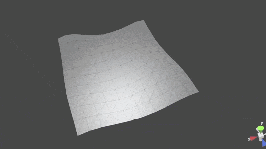

# Shader Story

## Vertex Animation: Gerstner Waves

> A single sine is readable, and *obviously repetitive within a few seconds*. The fix is **layering**: several waves, each with its own direction, amplitude, frequency, speed, phase, and steepness. The step that makes the result read as water instead of a bumpy plane: Gerstner displaces **horizontally along the wave direction, not just vertically**, which produces the sharp, leaning crest.

> **Layer enough waves to sell the surface; keep the count deliberately controlled.** Every wave adds math per vertex, repeated across every pass, multiplied by mesh density.

```hlsl
float3 GerstnerOffset(float3 baseWS, float2 dir, float amp, float freq, float speed, float phase, float steep)
{
    float s = sin(phase);
    float c = cos(phase);
    float3 offset;
    offset.xz = dir * (saturate(steep) * amp * c);  // horizontal lean
    offset.y = amp * s;  // vertical crest
    return offset;
}
```

---

### Why the horizontal component matters

A plain sine only moves vertices up and down; the result is a "bumpy plane", acceptable for a stylized surface, unconvincing for water. Gerstner adds a horizontal term scaled by `cos(phase)` and a *steepness* factor `Q`:

- At the **crest**, the surface leans forward in the direction of travel.
- At the **trough**, it leans back.
- `Q → 0` collapses back to a plain sine; `Q` higher gives sharper, more aggressive crests.

And the layering rule that keeps the waves honest: **sample every layer from the same original position.** Each wave behaves like an independent field that happens to sum. Feeding each wave the *previous* wave's output compounds the phases and turns clean layering into mush.

```hlsl
float3 displaced = baseWS;
displaced += GerstnerOffset(baseWS, dirA, ...);  // note: baseWS, not displaced
displaced += GerstnerOffset(baseWS, dirB, ...);
displaced += GerstnerOffset(baseWS, dirC, ...);
```

The cost scales with the layer count: each wave is a sin+cos per vertex, in every pass, at population scale. Two to three well-chosen layers sell most surfaces; four is the practical ceiling for hero water.

And remember: displaced water is not only a vertex problem, **normals, reflections, and foam must support the motion**. The normal side of the story lives in [Normals Reconstruction](https://github.com/DeGGeD/ShaderStory/blob/main/Chapters/VertexAnimation/Patterns/NormalsReconstruction.md).

---

### Visual demo
One wave → layered Gerstner. As waves stack with different directions, amplitudes, and speeds, the obvious single-sine repetition breaks up and the crests sharpen. Watch it go from bumpy plane to water.

<p align="center">

</p>

---

### URP Shader Code
Up to four independent layers, all sampled from the same base position. The detail normal map only rides on top of a repaired geometric normal, large motion from geometry, micro-detail from shading.

```hlsl
Shader "DecompiledArt/VertexAnimation/Patterns/GerstnerWaves/GerstnerWaves"
{
    Properties
    {
        [MainColor] _BaseColor("Base Color", Color) = (0.18, 0.42, 0.65, 1.0)
        _AmbientStrength("Ambient Strength", Range(0.0, 1.0)) = 0.2

        _SpecColor("Specular Color", Color) = (1.0, 1.0, 1.0, 1.0)
        _SpecIntensity("Specular Intensity", Range(0.0, 4.0)) = 1.5
        _SpecPower("Specular Power", Range(2.0, 64.0)) = 20.0

        [Toggle(_RECONSTRUCT_NORMALS)] _ReconstructNormals("Reconstruct Normals", Float) = 0
        _NormalEpsilon("Normal Reconstruction Epsilon", Range(0.001, 0.25)) = 0.05

        [NoScaleOffset] _NormalMap("Detail Normal Map", 2D) = "bump" {}
        _NormalMapStrength("Detail Normal Strength", Range(0.0, 2.0)) = 1.0

        [IntRange] _WaveCount("Wave Count", Range(1, 4)) = 2

        _DirA("Wave A Direction XZ", Vector) = (1.0, 0.0, 0.0, 0.0)
        _AmpA("Wave A Amplitude", Range(0.0, 1.0)) = 0.18
        _FreqA("Wave A Frequency", Range(0.0, 10.0)) = 2.0
        _SpeedA("Wave A Speed", Range(-10.0, 10.0)) = 1.0
        _PhaseA("Wave A Phase Offset", Range(-6.283185, 6.283185)) = 0.0
        _SteepA("Wave A Steepness", Range(0.0, 1.0)) = 0.55

        _DirB("Wave B Direction XZ", Vector) = (0.7, 0.7, 0.0, 0.0)
        _AmpB("Wave B Amplitude", Range(0.0, 1.0)) = 0.12
        _FreqB("Wave B Frequency", Range(0.0, 10.0)) = 3.6
        _SpeedB("Wave B Speed", Range(-10.0, 10.0)) = 1.4
        _PhaseB("Wave B Phase Offset", Range(-6.283185, 6.283185)) = 1.3
        _SteepB("Wave B Steepness", Range(0.0, 1.0)) = 0.45

        _DirC("Wave C Direction XZ", Vector) = (-0.3, 1.0, 0.0, 0.0)
        _AmpC("Wave C Amplitude", Range(0.0, 1.0)) = 0.08
        _FreqC("Wave C Frequency", Range(0.0, 10.0)) = 5.2
        _SpeedC("Wave C Speed", Range(-10.0, 10.0)) = 1.8
        _PhaseC("Wave C Phase Offset", Range(-6.283185, 6.283185)) = 2.4
        _SteepC("Wave C Steepness", Range(0.0, 1.0)) = 0.35

        _DirD("Wave D Direction XZ", Vector) = (-1.0, 0.2, 0.0, 0.0)
        _AmpD("Wave D Amplitude", Range(0.0, 1.0)) = 0.05
        _FreqD("Wave D Frequency", Range(0.0, 10.0)) = 7.0
        _SpeedD("Wave D Speed", Range(-10.0, 10.0)) = 2.2
        _PhaseD("Wave D Phase Offset", Range(-6.283185, 6.283185)) = 0.7
        _SteepD("Wave D Steepness", Range(0.0, 1.0)) = 0.25
    }

    SubShader
    {
        Tags
        {
            "RenderType" = "Opaque"
            "RenderPipeline" = "UniversalPipeline"
            "Queue" = "Geometry"
        }

        Pass
        {
            Name "Forward"
            Tags { "LightMode" = "UniversalForward" }

            HLSLPROGRAM
            #pragma target 3.5
            #pragma vertex Vert
            #pragma fragment Frag

            #pragma shader_feature_local _ _RECONSTRUCT_NORMALS

            #pragma multi_compile _ _MAIN_LIGHT_SHADOWS
            #pragma multi_compile _ _MAIN_LIGHT_SHADOWS_CASCADE
            #pragma multi_compile_fragment _ _SHADOWS_SOFT

            #include "Packages/com.unity.render-pipelines.universal/ShaderLibrary/Core.hlsl"
            #include "Packages/com.unity.render-pipelines.universal/ShaderLibrary/Lighting.hlsl"

            // Forward declaration so the shared include can call the
            // shader-specific displacement before its definition below.
            float3 ApplyAllWaves(float3 baseWS);

            #include "Workshop_WaveNormalsReconstruction.hlsl"

            CBUFFER_START(UnityPerMaterial)
                half4 _BaseColor;
                half _AmbientStrength;
                half4 _SpecColor;
                half _SpecIntensity;
                half _SpecPower;

                int _WaveCount;
                float _NormalEpsilon;
                half _NormalMapStrength;

                float4 _DirA; float _AmpA; float _FreqA; float _SpeedA; float _PhaseA; float _SteepA;
                float4 _DirB; float _AmpB; float _FreqB; float _SpeedB; float _PhaseB; float _SteepB;
                float4 _DirC; float _AmpC; float _FreqC; float _SpeedC; float _PhaseC; float _SteepC;
                float4 _DirD; float _AmpD; float _FreqD; float _SpeedD; float _PhaseD; float _SteepD;
            CBUFFER_END

            TEXTURE2D(_NormalMap);
            SAMPLER(sampler_NormalMap);

            struct Attributes
            {
                float4 positionOS : POSITION;
                half3 normalOS : NORMAL;
                half4 tangentOS : TANGENT;
                float2 uv : TEXCOORD0;
            };

            struct Varyings
            {
                float4 positionCS : SV_POSITION;
                float3 positionWS : TEXCOORD0;
                half3 geometricNormalWS : TEXCOORD1;
                float4 shadowCoord : TEXCOORD2;
                half3 bakedGI : TEXCOORD3;
                float2 uv : TEXCOORD4;
                half4 tangentWS : TEXCOORD5;
            };

            float2 SafeNormalizeXZ(float2 value)
            {
                float lenSq = dot(value, value);
                return (lenSq > 1e-6) ? value * rsqrt(lenSq) : float2(1.0, 0.0);
            }

            float GetWrappedPhase(float speed)
            {
                return frac((_Time.y * speed) / TWO_PI) * TWO_PI;
            }

            // The Gerstner step: horizontal lean along the direction of travel,
            // vertical crest. Q = 0 collapses this to a plain sine.
            float3 GerstnerOffset(float3 baseWS, float2 dirXZ, float amplitude,
                                  float frequency, float speed, float phaseOffset, float steepness)
            {
                float2 dir = SafeNormalizeXZ(dirXZ);
                float phase = dot(baseWS.xz, dir) * frequency + GetWrappedPhase(speed) + phaseOffset;

                float s = sin(phase);
                float c = cos(phase);
                float Q = saturate(steepness);

                float3 offset;
                offset.xz = dir * (Q * amplitude * c);
                offset.y = amplitude * s;
                return offset;
            }

            // Sample every layer from the same original position so the waves
            // combine as independent surface contributions instead of compounding.
            float3 ApplyAllWaves(float3 baseWS)
            {
                float3 displaced = baseWS;
                displaced += GerstnerOffset(baseWS, _DirA.xy, _AmpA, _FreqA, _SpeedA, _PhaseA, _SteepA);
                if (_WaveCount > 1) displaced += GerstnerOffset(baseWS, _DirB.xy, _AmpB, _FreqB, _SpeedB, _PhaseB, _SteepB);
                if (_WaveCount > 2) displaced += GerstnerOffset(baseWS, _DirC.xy, _AmpC, _FreqC, _SpeedC, _PhaseC, _SteepC);
                if (_WaveCount > 3) displaced += GerstnerOffset(baseWS, _DirD.xy, _AmpD, _FreqD, _SpeedD, _PhaseD, _SteepD);
                return displaced;
            }

            Varyings Vert(Attributes IN)
            {
                Varyings OUT;

                float3 baseWS = TransformObjectToWorld(IN.positionOS.xyz);
                float3 posWS = ApplyAllWaves(baseWS);

                #if defined(_RECONSTRUCT_NORMALS)
                    // Finite-difference reconstruction follows the actual
                    // displaced shape, required because Gerstner moves
                    // the surface horizontally as well as vertically.
                    half3 geometricNormalWS = (half3)ReconstructWaveNormalWS(baseWS, _NormalEpsilon);
                #else
                    // The bind-pose normal, kept on purpose: this is the
                    // shading mismatch the reconstruction toggle repairs.
                    half3 geometricNormalWS = TransformObjectToWorldNormal(IN.normalOS);
                #endif

                VertexNormalInputs normalInputs = GetVertexNormalInputs(IN.normalOS, IN.tangentOS);

                OUT.positionWS = posWS;
                OUT.positionCS = TransformWorldToHClip(posWS);
                OUT.geometricNormalWS = normalize(geometricNormalWS);
                OUT.shadowCoord = TransformWorldToShadowCoord(posWS);
                OUT.bakedGI = SampleSH(OUT.geometricNormalWS);
                OUT.uv = IN.uv;
                OUT.tangentWS = half4(normalInputs.tangentWS.xyz, IN.tangentOS.w);
                return OUT;
            }

            half4 Frag(Varyings IN) : SV_Target
            {
                half3 normalWS = normalize(IN.geometricNormalWS);

                #if defined(_RECONSTRUCT_NORMALS)
                    // Micro-detail rides on top of the repaired large form only.
                    float3 detailTS = SampleDetailNormalTS(TEXTURE2D_ARGS(_NormalMap, sampler_NormalMap), IN.uv, _NormalMapStrength);
                    normalWS = (half3)ApplyDetailNormalTS_WS(normalWS, IN.tangentWS, detailTS);
                #endif

                Light mainLight = GetMainLight(IN.shadowCoord);
                half3 viewDirWS = SafeNormalize(GetWorldSpaceViewDir(IN.positionWS));
                half3 halfDirWS = SafeNormalize(mainLight.direction + viewDirWS);

                half NdotL = saturate(dot(normalWS, mainLight.direction));
                half NdotH = saturate(dot(normalWS, halfDirWS));

                half3 diffuse = _BaseColor.rgb * mainLight.color * (NdotL * mainLight.shadowAttenuation);
                half3 ambient = _BaseColor.rgb * IN.bakedGI * _AmbientStrength;

                half spec = ((_SpecPower + 2.0h) * 0.125h)
                          * pow(max(NdotH, 0.0001h), _SpecPower)
                          * _SpecIntensity * NdotL * mainLight.shadowAttenuation;

                half3 specular = _SpecColor.rgb * mainLight.color * spec;
                return half4(diffuse + ambient + specular, _BaseColor.a);
            }
            ENDHLSL
        }
    }

    FallBack Off
}
```

The shared include the shader pulls in (`Workshop_WaveNormalsReconstruction.hlsl`):

```hlsl
#ifndef WORKSHOP_WAVE_NORMALS_RECONSTRUCTION_INCLUDED
#define WORKSHOP_WAVE_NORMALS_RECONSTRUCTION_INCLUDED

// Rebuild the large-scale geometric normal from nearby displaced samples.
float3 ReconstructWaveNormalWS(float3 baseWS, float normalEpsilon)
{
    float eps = max(normalEpsilon, 0.0001);

    float3 p = ApplyAllWaves(baseWS);
    float3 px = ApplyAllWaves(baseWS + float3(eps, 0.0, 0.0));
    float3 pz = ApplyAllWaves(baseWS + float3(0.0, 0.0, eps));

    float3 dx = px - p;
    float3 dz = pz - p;

    // Cross order chosen for an upward-facing XZ plane convention.
    return normalize(cross(dz, dx));
}

// Decode a tangent-space normal map with Unity's helper so platform-specific
// packing / import settings are handled correctly.
float3 SampleDetailNormalTS(TEXTURE2D_PARAM(normalTex, normalSampler), float2 uv, half strength)
{
    half4 packed = SAMPLE_TEXTURE2D(normalTex, normalSampler, uv);
    return normalize(UnpackNormalScale(packed, strength));
}

// Apply a tangent-space detail normal on top of the reconstructed normal,
// re-orthonormalizing the tangent against it so the micro detail rides on
// the displaced surface shape instead of the original flat plane.
float3 ApplyDetailNormalTS_WS(float3 geometricNormalWS, float4 tangentWSAndSign, float3 detailNormalTS)
{
    float3 tangentWS = normalize(tangentWSAndSign.xyz);
    tangentWS = normalize(tangentWS - geometricNormalWS * dot(tangentWS, geometricNormalWS));

    float tangentSign = tangentWSAndSign.w;
    float3 bitangentWS = normalize(cross(geometricNormalWS, tangentWS)) * tangentSign;

    float3 detailWS =
        tangentWS * detailNormalTS.x +
        bitangentWS * detailNormalTS.y +
        geometricNormalWS * detailNormalTS.z;

    return normalize(detailWS);
}

#endif
```

---

## 🔗 Related Chapters

[Sine Wave Offset](https://github.com/DeGGeD/ShaderStory/blob/main/Chapters/VertexAnimation/Patterns/SineWaveOffset.md) • [Normals Reconstruction](https://github.com/DeGGeD/ShaderStory/blob/main/Chapters/VertexAnimation/Patterns/NormalsReconstruction.md) • [Controlled Irregularity](https://github.com/DeGGeD/ShaderStory/blob/main/Chapters/VertexAnimation/Patterns/ControlledIrregularity.md)

**Related functions:** [Sine / Cosine](https://github.com/DeGGeD/ShaderStory/blob/main/Chapters/CommonFunctions/SineCosine.md) • [Dot](https://github.com/DeGGeD/ShaderStory/blob/main/Chapters/CommonFunctions/Dot.md) • [Cross](https://github.com/DeGGeD/ShaderStory/blob/main/Chapters/CommonFunctions/Cross.md) • [Ripple Waves](https://github.com/DeGGeD/ShaderStory/blob/main/Chapters/Patterns/Ripplewaves.md)

---

## ❤️ Support Shader Story

If this article helped you, consider supporting the project on Patreon: you'll get access to the related source files, reference cheat-sheets, and other exclusive resources:

<p align="center">
  <a href="https://www.patreon.com/decompiled_art" target="_blank">
    
  </a>
  <a href="https://www.buymeacoffee.com/shaderstory" target="_blank">
    
  </a>
</p>

Your support helps keep this library open, growing, and free for everyone.
