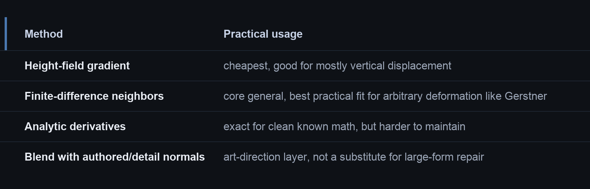
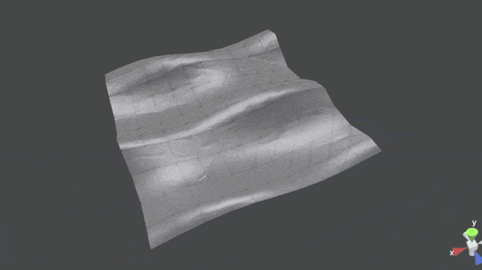

# Shader Story

## Vertex Animation: Normals Reconstruction

> Displaced geometry with **bind-pose normals** is the classic vertex-animation trap: the surface moves *perfectly*, but the lighting behaves as if it never changed. Highlights slide the wrong way, reflections feel detached, and the deformation sells itself as fake in one glance. **Normal reconstruction** rebuilds the normal from the *displaced* surface, and the right method depends on the motion.

> **Large motion from geometry, small detail from shading.** A partial repair blended with a normal map is usually the better answer than chasing mathematical perfection.

```hlsl
float3 p = deform(baseWS);
float3 px = deform(baseWS + float3(eps, 0, 0));
float3 pz = deform(baseWS + float3(0, 0, eps));
float3 n = normalize(cross(pz - p, px - p));  // the new geometric normal
```

---

### The four repair methods

The methods, and when each one fits:

<p align="center">

</p>

1. **Original mesh normals**: zero cost, and *correct enough* for subtle flutter on art-directed normals that were bent and averaged at import. Physically "correct" reconstruction can make a stylized asset look *worse*.
2. **Height-field gradient**: treat the surface as `y = h(x, z)` and build the normal from the height slope. Cheap, and right for mostly-vertical motion. It ignores horizontal displacement by construction.
3. **Finite-difference neighbors**: evaluate the *actual* displacement at the point and at two small nearby offsets, then cross the two neighbor directions. More expensive, but it follows the true deformed shape, the practical default for wave-style surfaces that move in all directions.
4. **Analytic derivatives**: differentiate the wave math symbolically. Most exact for this specific deformation, and the hardest to maintain: every new wave layer means more derivative code.

Two details that separate a working repair from a broken one:

- **The epsilon must be an artist knob.** Too small and floating-point noise flickers; too large and the normal smears the crest. Expose it.
- **The cross order must match the surface convention.** `cross(dz, dx)` for an upward-facing XZ plane; flip it and every highlight lights from the underside.

And keep one artistic knob on top of everything: a **repair-strength blend** from original normal to fully reconstructed. In production, partial repair plus a normal map for micro-detail is usually the answer.

> The same decision, framed as a shipping choice, lives in [Normals (Shipping)](https://github.com/DeGGeD/ShaderStory/blob/main/Chapters/VertexAnimation/Shipping/NormalsShipping.md). For screen-space derivative-based normal tricks on static geometry, see [Harden Normals](https://github.com/DeGGeD/ShaderStory/blob/main/Chapters/Derivatives/HardenNormals.md).

---

### Visual demo
Same displaced Gerstner geometry, four repair strategies on one switch. The original normal slides highlights the wrong way across the crests; the reconstructed normal tracks the wave slope. Toggle the repair strength to find the artistic middle ground.

<p align="center">

</p>

---

### URP Shader Code
One Gerstner surface, four methods, one honest comparison, same waves, same light, only the repair strategy changes. The final blend keeps the artistic control.

```hlsl
Shader "DecompiledArt/VertexAnimation/Patterns/NormalsReconstruction/NormalsReconstruction"
{
    Properties
    {
        [MainColor] _BaseColor("Base Color", Color) = (0.18, 0.42, 0.65, 1.0)
        _AmbientStrength("Ambient Strength", Range(0.0, 1.0)) = 0.2

        _SpecColor("Specular Color", Color) = (1.0, 1.0, 1.0, 1.0)
        _SpecIntensity("Specular Intensity", Range(0.0, 4.0)) = 1.0
        _SpecPower("Specular Power", Range(2.0, 64.0)) = 20.0

        [Header(Normal Repair Method)]
        // One surface, swap only the strategy: keeps the comparison honest.
        [Enum(OriginalMeshNormals,0,HeightFieldGradient,1,FiniteDifferenceNeighbors,2,AnalyticDerivatives,3)]
        _NormalMethod("Normal Method", Float) = 2

        [IntRange] _WaveCount("Wave Count", Range(1, 4)) = 2
        _NormalEpsilon("Sample Epsilon", Range(0.001, 0.25)) = 0.05
        _NormalRepairStrength("Repair Strength", Range(0.0, 1.0)) = 1.0

        // Detail normals layer *after* the large-form repair.
        // Default zero so the geometric fix is seen clearly first.
        [NoScaleOffset] _NormalMap("Detail Normal Map", 2D) = "bump" {}
        _NormalMapStrength("Detail Normal Strength", Range(0.0, 2.0)) = 0.0

        [Toggle] _DebugNormals("Debug Final Normal", Float) = 0

        [Header(Wave A)]
        _DirA("Wave A Direction XZ", Vector) = (1.0, 0.0, 0.0, 0.0)
        _AmpA("Wave A Amplitude", Range(0.0, 1.0)) = 0.18
        _FreqA("Wave A Frequency", Range(0.0, 10.0)) = 2.0
        _SpeedA("Wave A Speed", Range(-10.0, 10.0)) = 1.0
        _PhaseA("Wave A Phase Offset", Range(-6.283185, 6.283185)) = 0.0
        _SteepA("Wave A Steepness", Range(0.0, 1.0)) = 0.55

        [Header(Wave B)]
        _DirB("Wave B Direction XZ", Vector) = (0.7, 0.7, 0.0, 0.0)
        _AmpB("Wave B Amplitude", Range(0.0, 1.0)) = 0.12
        _FreqB("Wave B Frequency", Range(0.0, 10.0)) = 3.6
        _SpeedB("Wave B Speed", Range(-10.0, 10.0)) = 1.4
        _PhaseB("Wave B Phase Offset", Range(-6.283185, 6.283185)) = 1.3
        _SteepB("Wave B Steepness", Range(0.0, 1.0)) = 0.45

        [Header(Wave C)]
        _DirC("Wave C Direction XZ", Vector) = (-0.3, 1.0, 0.0, 0.0)
        _AmpC("Wave C Amplitude", Range(0.0, 1.0)) = 0.08
        _FreqC("Wave C Frequency", Range(0.0, 10.0)) = 5.2
        _SpeedC("Wave C Speed", Range(-10.0, 10.0)) = 1.8
        _PhaseC("Wave C Phase Offset", Range(-6.283185, 6.283185)) = 2.4
        _SteepC("Wave C Steepness", Range(0.0, 1.0)) = 0.35

        [Header(Wave D)]
        _DirD("Wave D Direction XZ", Vector) = (-1.0, 0.2, 0.0, 0.0)
        _AmpD("Wave D Amplitude", Range(0.0, 1.0)) = 0.05
        _FreqD("Wave D Frequency", Range(0.0, 10.0)) = 7.0
        _SpeedD("Wave D Speed", Range(-10.0, 10.0)) = 2.2
        _PhaseD("Wave D Phase Offset", Range(-6.283185, 6.283185)) = 0.7
        _SteepD("Wave D Steepness", Range(0.0, 1.0)) = 0.25
    }

    SubShader
    {
        Tags
        {
            "RenderType" = "Opaque"
            "RenderPipeline" = "UniversalPipeline"
            "Queue" = "Geometry"
        }

        Pass
        {
            Name "Forward"
            Tags { "LightMode" = "UniversalForward" }

            HLSLPROGRAM
            #pragma target 3.5
            #pragma vertex Vert
            #pragma fragment Frag

            #pragma multi_compile _ _MAIN_LIGHT_SHADOWS
            #pragma multi_compile _ _MAIN_LIGHT_SHADOWS_CASCADE
            #pragma multi_compile_fragment _ _SHADOWS_SOFT

            #include "Packages/com.unity.render-pipelines.universal/ShaderLibrary/Core.hlsl"
            #include "Packages/com.unity.render-pipelines.universal/ShaderLibrary/Lighting.hlsl"

            // The height-field method calls the summed wave-height helper
            // defined in the block after this shader; declare it first.
            float EvaluateAllWaveHeight(float3 baseWS);

            CBUFFER_START(UnityPerMaterial)
                half4 _BaseColor;
                half _AmbientStrength;
                half4 _SpecColor;
                half _SpecIntensity;
                half _SpecPower;

                half _NormalMethod;
                int _WaveCount;
                float _NormalEpsilon;
                half _NormalRepairStrength;
                half _NormalMapStrength;
                half _DebugNormals;

                float4 _DirA; float _AmpA; float _FreqA; float _SpeedA; float _PhaseA; float _SteepA;
                float4 _DirB; float _AmpB; float _FreqB; float _SpeedB; float _PhaseB; float _SteepB;
                float4 _DirC; float _AmpC; float _FreqC; float _SpeedC; float _PhaseC; float _SteepC;
                float4 _DirD; float _AmpD; float _FreqD; float _SpeedD; float _PhaseD; float _SteepD;
            CBUFFER_END

            TEXTURE2D(_NormalMap);
            SAMPLER(sampler_NormalMap);

            struct Attributes
            {
                float4 positionOS : POSITION;
                half3 normalOS : NORMAL;
                half4 tangentOS : TANGENT;
                float2 uv : TEXCOORD0;
            };

            struct Varyings
            {
                float4 positionCS : SV_POSITION;
                float3 positionWS : TEXCOORD0;
                half3 originalNormalWS : TEXCOORD1;
                half3 repairedNormalWS : TEXCOORD2;
                float4 shadowCoord : TEXCOORD3;
                float2 uv : TEXCOORD4;
                half4 tangentWS : TEXCOORD5;
            };

            float2 SafeNormalizeXZ(float2 value)
            {
                float lenSq = dot(value, value);
                return (lenSq > 1e-6) ? value * rsqrt(lenSq) : float2(1.0, 0.0);
            }

            float GetWrappedPhase(float speed)
            {
                return frac((_Time.y * speed) / TWO_PI) * TWO_PI;
            }

            float EvaluateWavePhase(float3 baseWS, float2 dirXZ, float frequency, float speed, float phaseOffset)
            {
                float2 dir = SafeNormalizeXZ(dirXZ);
                return dot(baseWS.xz, dir) * frequency + GetWrappedPhase(speed) + phaseOffset;
            }

            float3 GerstnerOffset(float3 baseWS, float2 dirXZ, float amplitude,
                                  float frequency, float speed, float phaseOffset, float steepness)
            {
                float2 dir = SafeNormalizeXZ(dirXZ);
                float phase = EvaluateWavePhase(baseWS, dirXZ, frequency, speed, phaseOffset);

                float s = sin(phase);
                float c = cos(phase);
                float Q = saturate(steepness);

                float3 offset;
                offset.xz = dir * (Q * amplitude * c);
                offset.y = amplitude * s;
                return offset;
            }

            float EvaluateWaveHeight(float3 baseWS, float2 dirXZ, float amplitude,
                                     float frequency, float speed, float phaseOffset)
            {
                float phase = EvaluateWavePhase(baseWS, dirXZ, frequency, speed, phaseOffset);
                return amplitude * sin(phase);
            }

            float3 ApplyAllWaves(float3 baseWS)
            {
                float3 displaced = baseWS;
                displaced += GerstnerOffset(baseWS, _DirA.xy, _AmpA, _FreqA, _SpeedA, _PhaseA, _SteepA);
                if (_WaveCount > 1) displaced += GerstnerOffset(baseWS, _DirB.xy, _AmpB, _FreqB, _SpeedB, _PhaseB, _SteepB);
                if (_WaveCount > 2) displaced += GerstnerOffset(baseWS, _DirC.xy, _AmpC, _FreqC, _SpeedC, _PhaseC, _SteepC);
                if (_WaveCount > 3) displaced += GerstnerOffset(baseWS, _DirD.xy, _AmpD, _FreqD, _SpeedD, _PhaseD, _SteepD);
                return displaced;
            }

            // Method 1 (HeightFieldGradient):
            // Treat the surface as a pure height field y = h(x, z).
            // Cheap, and right for mostly vertical displacement, it ignores
            // Gerstner horizontal motion on purpose.
            float3 BuildHeightFieldGradientNormalWS(float3 baseWS)
            {
                float eps = max(_NormalEpsilon, 0.0001);

                float h = EvaluateAllWaveHeight(baseWS);
                float hx = EvaluateAllWaveHeight(baseWS + float3(eps, 0.0, 0.0));
                float hz = EvaluateAllWaveHeight(baseWS + float3(0.0, 0.0, eps));

                float3 p = float3(baseWS.x, baseWS.y + h, baseWS.z);
                float3 px = float3(baseWS.x + eps, baseWS.y + hx, baseWS.z);
                float3 pz = float3(baseWS.x, baseWS.y + hz, baseWS.z + eps);

                return normalize(cross(pz - p, px - p));
            }

            // Method 2 (FiniteDifferenceNeighbors):
            // Sample nearby *displaced* positions and rebuild the normal from
            // the deformed surface itself. More general, more expensive:
            // the practical default for wave-style surfaces.
            float3 BuildFiniteDifferenceNormalWS(float3 baseWS)
            {
                float eps = max(_NormalEpsilon, 0.0001);

                float3 p = ApplyAllWaves(baseWS);
                float3 px = ApplyAllWaves(baseWS + float3(eps, 0.0, 0.0));
                float3 pz = ApplyAllWaves(baseWS + float3(0.0, 0.0, eps));

                return normalize(cross(pz - p, px - p));
            }

            // Method 3 (AnalyticDerivatives):
            // Exact for this specific wave math, hardest to maintain as layers grow.
            void AccumulateAnalyticWaveDerivatives(
                float3 baseWS, float2 dirXZ, float amplitude, float frequency,
                float speed, float phaseOffset, float steepness,
                inout float3 dPdx, inout float3 dPdz)
            {
                float2 dir = SafeNormalizeXZ(dirXZ);
                float phase = EvaluateWavePhase(baseWS, dirXZ, frequency, speed, phaseOffset);

                float s = sin(phase);
                float c = cos(phase);
                float Q = saturate(steepness);

                float common = Q * amplitude * frequency * s;
                float vertical = amplitude * frequency * c;

                dPdx += float3(-dir.x * dir.x * common, dir.x * vertical, -dir.y * dir.x * common);
                dPdz += float3(-dir.x * dir.y * common, dir.y * vertical, -dir.y * dir.y * common);
            }

            float3 BuildAnalyticNormalWS(float3 baseWS)
            {
                float3 dPdx = float3(1.0, 0.0, 0.0);
                float3 dPdz = float3(0.0, 0.0, 1.0);

                AccumulateAnalyticWaveDerivatives(baseWS, _DirA.xy, _AmpA, _FreqA, _SpeedA, _PhaseA, _SteepA, dPdx, dPdz);
                if (_WaveCount > 1) AccumulateAnalyticWaveDerivatives(baseWS, _DirB.xy, _AmpB, _FreqB, _SpeedB, _PhaseB, _SteepB, dPdx, dPdz);
                if (_WaveCount > 2) AccumulateAnalyticWaveDerivatives(baseWS, _DirC.xy, _AmpC, _FreqC, _SpeedC, _PhaseC, _SteepC, dPdx, dPdz);
                if (_WaveCount > 3) AccumulateAnalyticWaveDerivatives(baseWS, _DirD.xy, _AmpD, _FreqD, _SpeedD, _PhaseD, _SteepD, dPdx, dPdz);

                return normalize(cross(dPdz, dPdx));
            }

            float3 SelectRepairedNormalWS(float3 baseWS, float3 originalNormalWS)
            {
                if (_NormalMethod < 0.5)
                    return originalNormalWS;
                if (_NormalMethod < 1.5)
                    return BuildHeightFieldGradientNormalWS(baseWS);
                if (_NormalMethod < 2.5)
                    return BuildFiniteDifferenceNormalWS(baseWS);

                return BuildAnalyticNormalWS(baseWS);
            }

            float3 SampleDetailNormalTS(float2 uv)
            {
                half4 packed = SAMPLE_TEXTURE2D(_NormalMap, sampler_NormalMap, uv);
                return normalize(UnpackNormalScale(packed, _NormalMapStrength));
            }

            // Detail normals are not a repair method on their own.
            // They ride on top of whichever large-form normal was selected.
            float3 ApplyDetailNormalTS_WS(float3 baseNormalWS, float4 tangentWSAndSign, float2 uv)
            {
                float3 tangentWS = normalize(tangentWSAndSign.xyz);
                tangentWS = normalize(tangentWS - baseNormalWS * dot(tangentWS, baseNormalWS));

                float tangentSign = tangentWSAndSign.w;
                float3 bitangentWS = normalize(cross(baseNormalWS, tangentWS)) * tangentSign;
                float3 detailTS = SampleDetailNormalTS(uv);

                float3 detailWS =
                    tangentWS * detailTS.x +
                    bitangentWS * detailTS.y +
                    baseNormalWS * detailTS.z;

                return normalize(detailWS);
            }

            Varyings Vert(Attributes IN)
            {
                Varyings OUT;

                float3 baseWS = TransformObjectToWorld(IN.positionOS.xyz);
                float3 positionWS = ApplyAllWaves(baseWS);
                float3 originalNormalWS = normalize(TransformObjectToWorldNormal(IN.normalOS));
                float3 repairedNormalWS = normalize(SelectRepairedNormalWS(baseWS, originalNormalWS));

                VertexNormalInputs normalInputs = GetVertexNormalInputs(IN.normalOS, IN.tangentOS);

                OUT.positionWS = positionWS;
                OUT.originalNormalWS = (half3)originalNormalWS;
                OUT.repairedNormalWS = (half3)repairedNormalWS;
                OUT.positionCS = TransformWorldToHClip(positionWS);
                OUT.shadowCoord = TransformWorldToShadowCoord(positionWS);
                OUT.uv = IN.uv;
                OUT.tangentWS = half4(normalInputs.tangentWS.xyz, IN.tangentOS.w);
                return OUT;
            }

            half4 Frag(Varyings IN) : SV_Target
            {
                half3 originalNormalWS = normalize(IN.originalNormalWS);
                half3 repairedNormalWS = normalize(IN.repairedNormalWS);

                // Two separate decisions:
                // 1) which repair method was used (vertex)
                // 2) how much to trust it (this blend, fragment)
                half3 largeFormNormalWS = normalize(lerp(originalNormalWS, repairedNormalWS, saturate(_NormalRepairStrength)));

                half3 normalWS = (half3)ApplyDetailNormalTS_WS(largeFormNormalWS, IN.tangentWS, IN.uv);

                // Debug: render the final normal as color and *look* at it.
                if (_DebugNormals > 0.5h)
                    return half4(normalWS * 0.5h + 0.5h, 1.0h);

                Light mainLight = GetMainLight(IN.shadowCoord);
                half3 viewDirWS = SafeNormalize(GetWorldSpaceViewDir(IN.positionWS));
                half3 halfDirWS = SafeNormalize(mainLight.direction + viewDirWS);

                half NdotL = saturate(dot(normalWS, mainLight.direction));
                half NdotH = saturate(dot(normalWS, halfDirWS));

                half3 diffuse = _BaseColor.rgb * mainLight.color * (NdotL * mainLight.shadowAttenuation);
                half3 ambient = _BaseColor.rgb * SampleSH(normalWS) * _AmbientStrength;

                half spec = ((_SpecPower + 2.0h) * 0.125h)
                          * pow(max(NdotH, 0.0001h), _SpecPower)
                          * _SpecIntensity * NdotL * mainLight.shadowAttenuation;

                half3 specular = _SpecColor.rgb * mainLight.color * spec;
                return half4(diffuse + ambient + specular, _BaseColor.a);
            }
            ENDHLSL
        }
    }

    FallBack Off
}
```

One small helper the height-field method needs: the summed wave height, mirroring `ApplyAllWaves` but vertical-only:

```hlsl
float EvaluateAllWaveHeight(float3 baseWS)
{
    float height = EvaluateWaveHeight(baseWS, _DirA.xy, _AmpA, _FreqA, _SpeedA, _PhaseA);
    if (_WaveCount > 1) height += EvaluateWaveHeight(baseWS, _DirB.xy, _AmpB, _FreqB, _SpeedB, _PhaseB);
    if (_WaveCount > 2) height += EvaluateWaveHeight(baseWS, _DirC.xy, _AmpC, _FreqC, _SpeedC, _PhaseC);
    if (_WaveCount > 3) height += EvaluateWaveHeight(baseWS, _DirD.xy, _AmpD, _FreqD, _SpeedD, _PhaseD);
    return height;
}
```

---

## 🔗 Related Chapters

[Gerstner Waves](https://github.com/DeGGeD/ShaderStory/blob/main/Chapters/VertexAnimation/Patterns/GerstnerWaves.md) • [Normals (Shipping)](https://github.com/DeGGeD/ShaderStory/blob/main/Chapters/VertexAnimation/Shipping/NormalsShipping.md) • [Harden Normals](https://github.com/DeGGeD/ShaderStory/blob/main/Chapters/Derivatives/HardenNormals.md)

**Related functions:** [Cross](https://github.com/DeGGeD/ShaderStory/blob/main/Chapters/CommonFunctions/Cross.md) • [Normalize](https://github.com/DeGGeD/ShaderStory/blob/main/Chapters/CommonFunctions/Normalize.md) • [Lerp](https://github.com/DeGGeD/ShaderStory/blob/main/Chapters/CommonFunctions/Lerp.md) • [Dot](https://github.com/DeGGeD/ShaderStory/blob/main/Chapters/CommonFunctions/Dot.md)

---

## ❤️ Support Shader Story

If this article helped you, consider supporting the project on Patreon: you'll get access to the related source files, reference cheat-sheets, and other exclusive resources:

<p align="center">
  <a href="https://www.patreon.com/decompiled_art" target="_blank">
    
  </a>
  <a href="https://www.buymeacoffee.com/shaderstory" target="_blank">
    
  </a>
</p>

Your support helps keep this library open, growing, and free for everyone.
