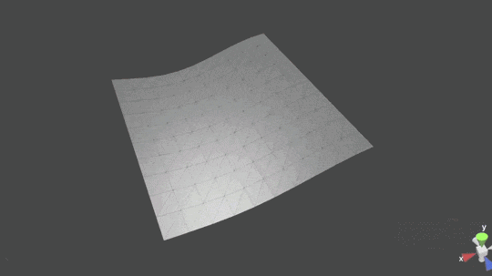

# Shader Story

## Vertex Animation: Sine Wave Offset

> The **sine-wave offset** is the universal first pattern of vertex motion: two independent phases, **position** spreads the wave across the surface, **time** advances it. Amplitude is how far it moves, frequency how tightly packed, direction where it travels, phase offset the per-object anti-sync. The right first pattern for flags, cloth strips, grass, water-like surfaces, and idle sway, anything that benefits from *rhythmic* deformation.

> **Be honest about what it is: it is not a simulation.** You are not solving cloth or water. You are building a controllable, repeatable *pattern* that sells the effect cheaply.

```hlsl
float3 offsetDirOS = normalize(_OffsetDirectionOS);

float spatialPhase = dot(positionOS, axisOS) * _Frequency;
float temporalPhase = frac(_Time.y * _Speed) * TWO_PI;

float wave = sin(spatialPhase + temporalPhase + _PhaseOffset) * _Amplitude;
positionOS += offsetDirOS * wave * mask;
```

---

### Anatomy of the pattern

Each parameter has one job:

- **Position phase** (`dot(positionOS, axis) * frequency`): the wave *travels* across the surface instead of pulsing in place. This is the difference between "alive" and "vibrating".
- **Time phase** (`frac(time * speed) * 2π`): advances the wave; wrapped, so long sessions stay numerically stable (see [Time Wrapping](https://github.com/DeGGeD/ShaderStory/blob/main/Chapters/VertexAnimation/Time/TimeWrapping.md)).
- **Amplitude**: how far vertices move. The art-direction knob: a flag and a leaf need very different amplitudes.
- **Direction**: where the displacement points. Object space for behavior welded to the asset, world space for environmental agreement.
- **Phase offset**: per-object or per-vertex desync, so populations don't pulse in unison (see [Phase Offset](https://github.com/DeGGeD/ShaderStory/blob/main/Chapters/VertexAnimation/Time/PhaseOffset.md)).

And the standing warning from the patterns chapter: a single sine is readable, and *obviously repetitive within a few seconds*. When the repetition shows, the fix is layering; see [Gerstner Waves](https://github.com/DeGGeD/ShaderStory/blob/main/Chapters/VertexAnimation/Patterns/GerstnerWaves.md), not more amplitude.

---

### Visual demo
A wave whose phase spreads across the surface and advances over time, so it travels instead of pulsing in place. Amplitude, frequency, direction, and phase are all live knobs.

<p align="center">

</p>

---

### URP Shader Code
One wave in world space, with a normal-reconstruction toggle so you can see the shading mismatch that displaced surfaces create; the setup that [Normals Reconstruction](https://github.com/DeGGeD/ShaderStory/blob/main/Chapters/VertexAnimation/Patterns/NormalsReconstruction.md) fixes.

```hlsl
Shader "DecompiledArt/VertexAnimation/Patterns/SineWaveOffset/SineWaveOffset"
{
    Properties
    {
        [MainColor] _BaseColor("Base Color", Color) = (0.18, 0.42, 0.65, 1.0)
        _AmbientStrength("Ambient Strength", Range(0.0, 1.0)) = 0.2

        _SpecColor("Specular Color", Color) = (1.0, 1.0, 1.0, 1.0)
        _SpecIntensity("Specular Intensity", Range(0.0, 4.0)) = 1.5
        _SpecPower("Specular Power", Range(2.0, 64.0)) = 20.0

        [Toggle(_RECONSTRUCT_NORMALS)] _ReconstructNormals("Reconstruct Normals", Float) = 0
        _NormalEpsilon("Normal Reconstruction Epsilon", Range(0.001, 0.25)) = 0.05

        _Amplitude("Amplitude", Range(0.0, 1.0)) = 0.2
        _Frequency("Frequency", Range(0.0, 10.0)) = 2.0
        _Speed("Speed", Range(-10.0, 10.0)) = 1.0
        _PhaseOffset("Phase Offset", Range(-6.283185, 6.283185)) = 0.0
        _WaveDirectionXZ("Wave Direction XZ", Vector) = (1.0, 0.0, 0.0, 0.0)
    }

    SubShader
    {
        Tags
        {
            "RenderType" = "Opaque"
            "RenderPipeline" = "UniversalPipeline"
            "Queue" = "Geometry"
        }

        Pass
        {
            Name "Forward"
            Tags { "LightMode" = "UniversalForward" }

            HLSLPROGRAM
            #pragma target 3.5
            #pragma vertex Vert
            #pragma fragment Frag

            #pragma shader_feature_local _ _RECONSTRUCT_NORMALS

            #pragma multi_compile _ _MAIN_LIGHT_SHADOWS
            #pragma multi_compile _ _MAIN_LIGHT_SHADOWS_CASCADE
            #pragma multi_compile_fragment _ _SHADOWS_SOFT

            #include "Packages/com.unity.render-pipelines.universal/ShaderLibrary/Core.hlsl"
            #include "Packages/com.unity.render-pipelines.universal/ShaderLibrary/Lighting.hlsl"

            // Forward declaration so the normal helper can call the
            // displacement function before its definition appears below.
            float3 ApplyAllWaves(float3 baseWS);

            CBUFFER_START(UnityPerMaterial)
                half4 _BaseColor;
                half _AmbientStrength;
                half4 _SpecColor;
                half _SpecIntensity;
                half _SpecPower;

                float _NormalEpsilon;

                float _Amplitude;
                float _Frequency;
                float _Speed;
                float _PhaseOffset;
                float4 _WaveDirectionXZ;
            CBUFFER_END

            struct Attributes
            {
                float4 positionOS : POSITION;
                half3 normalOS : NORMAL;
                float2 uv : TEXCOORD0;
            };

            struct Varyings
            {
                float4 positionCS : SV_POSITION;
                float3 positionWS : TEXCOORD0;
                half3 normalWS : TEXCOORD1;
                float4 shadowCoord : TEXCOORD2;
                half3 bakedGI : TEXCOORD3;
            };

            float2 SafeNormalizeXZ(float2 value)
            {
                float lenSq = dot(value, value);
                return (lenSq > 1e-6) ? value * rsqrt(lenSq) : float2(1.0, 0.0);
            }

            // Bounded temporal phase.
            float GetWrappedPhase(float speed)
            {
                return frac((_Time.y * speed) / TWO_PI) * TWO_PI;
            }

            // The pattern: position spreads the wave, time advances it.
            float3 ApplyAllWaves(float3 baseWS)
            {
                float2 dir = SafeNormalizeXZ(_WaveDirectionXZ.xy);
                float phase = dot(baseWS.xz, dir) * _Frequency
                            + GetWrappedPhase(_Speed)
                            + _PhaseOffset;

                float3 displaced = baseWS;
                displaced.y += sin(phase) * _Amplitude;
                return displaced;
            }

            // Finite-difference normal from displaced neighbors.
            // Follows the actual displaced shape, unlike the bind-pose normal.
            float3 ReconstructWaveNormalWS(float3 baseWS, float eps)
            {
                eps = max(eps, 0.0001);

                float3 p = ApplyAllWaves(baseWS);
                float3 px = ApplyAllWaves(baseWS + float3(eps, 0.0, 0.0));
                float3 pz = ApplyAllWaves(baseWS + float3(0.0, 0.0, eps));

                return normalize(cross(pz - p, px - p));  // order: up-facing XZ plane
            }

            Varyings Vert(Attributes IN)
            {
                Varyings OUT;

                float3 baseWS = TransformObjectToWorld(IN.positionOS.xyz);
                float3 posWS = ApplyAllWaves(baseWS);

                #if defined(_RECONSTRUCT_NORMALS)
                    half3 normalWS = (half3)ReconstructWaveNormalWS(baseWS, _NormalEpsilon);
                #else
                    // Intentionally the original mesh normal: this is what makes
                    // the shading mismatch visible, and the thing to fix.
                    half3 normalWS = TransformObjectToWorldNormal(IN.normalOS);
                #endif

                OUT.positionWS = posWS;
                OUT.positionCS = TransformWorldToHClip(posWS);
                OUT.normalWS = normalize(normalWS);
                OUT.shadowCoord = TransformWorldToShadowCoord(posWS);
                OUT.bakedGI = SampleSH(OUT.normalWS);
                return OUT;
            }

            half4 Frag(Varyings IN) : SV_Target
            {
                half3 normalWS = normalize(IN.normalWS);
                Light mainLight = GetMainLight(IN.shadowCoord);

                half3 viewDirWS = SafeNormalize(GetWorldSpaceViewDir(IN.positionWS));
                half3 halfDirWS = SafeNormalize(mainLight.direction + viewDirWS);

                half NdotL = saturate(dot(normalWS, mainLight.direction));
                half NdotH = saturate(dot(normalWS, halfDirWS));

                half3 diffuse = _BaseColor.rgb * mainLight.color * (NdotL * mainLight.shadowAttenuation);
                half3 ambient = _BaseColor.rgb * IN.bakedGI * _AmbientStrength;

                half spec = ((_SpecPower + 2.0h) * 0.125h)
                          * pow(max(NdotH, 0.0001h), _SpecPower)
                          * _SpecIntensity * NdotL * mainLight.shadowAttenuation;

                half3 specular = _SpecColor.rgb * mainLight.color * spec;
                return half4(diffuse + ambient + specular, _BaseColor.a);
            }
            ENDHLSL
        }
    }

    FallBack Off
}
```

---

## 🔗 Related Chapters

[Gerstner Waves](https://github.com/DeGGeD/ShaderStory/blob/main/Chapters/VertexAnimation/Patterns/GerstnerWaves.md) • [Normals Reconstruction](https://github.com/DeGGeD/ShaderStory/blob/main/Chapters/VertexAnimation/Patterns/NormalsReconstruction.md) • [Controlled Irregularity](https://github.com/DeGGeD/ShaderStory/blob/main/Chapters/VertexAnimation/Patterns/ControlledIrregularity.md) • [Time Wrapping](https://github.com/DeGGeD/ShaderStory/blob/main/Chapters/VertexAnimation/Time/TimeWrapping.md)

**Related functions:** [Sine / Cosine](https://github.com/DeGGeD/ShaderStory/blob/main/Chapters/CommonFunctions/SineCosine.md) • [Dot](https://github.com/DeGGeD/ShaderStory/blob/main/Chapters/CommonFunctions/Dot.md) • [Cross](https://github.com/DeGGeD/ShaderStory/blob/main/Chapters/CommonFunctions/Cross.md) • [Ripple Waves](https://github.com/DeGGeD/ShaderStory/blob/main/Chapters/Patterns/Ripplewaves.md)

---

## ❤️ Support Shader Story

If this article helped you, consider supporting the project on Patreon: you'll get access to the related source files, reference cheat-sheets, and other exclusive resources:

<p align="center">
  <a href="https://www.patreon.com/decompiled_art" target="_blank">
    
  </a>
  <a href="https://www.buymeacoffee.com/shaderstory" target="_blank">
    
  </a>
</p>

Your support helps keep this library open, growing, and free for everyone.
