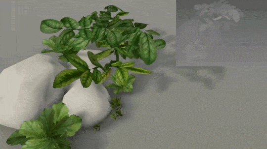

# Shader Story

## Vertex Animation: Bounds

> The CPU decides visibility from **bounds computed at rest**: before the GPU vertex shader ever runs. If displaced vertices escape those bounds, the object **pops, clips, or disappears at the edge of the screen**, even though the shader math is perfectly correct. Culling decided this before the GPU ran. The same mismatch can hurt shadows and other depth-dependent systems too.

> **Don't make bounds arbitrarily huge.** Oversized bounds wreck culling efficiency. Design for the *maximum possible displacement*, and expand bounds just enough to cover that worst case.

```hlsl
// The design step, done on day one, outside the shader:
renderer.bounds = new Bounds(center, size + 2 * maxDisplacement);
```

---

### Why it fails

The pipeline splits responsibility: the CPU culls using the static bounds; the GPU displaces vertices *after* that decision. Any motion whose worst case exceeds the original extents is a coin flip, visible when the object is centered, gone when it's near the frustum edge.

The fix is **not** in the shader; it's in bounds management. The shader's role is to *reveal* the problem, because a shader can't expand its own culling bounds. The real fixes:

1. **Define the maximum displacement early.** It should be a project number on day one, because it drives bounds, shadows, and performance budget together.
2. **Expand renderer bounds** by that worst case, at runtime, in a tool, or via a mesh override. Just enough, not "a lot".
3. **Author safer mesh bounds** in the DCC tool for known-bad assets.
4. **Reduce extreme far-distance motion** where the pop is invisible anyway (pairs with [LODs](https://github.com/DeGGeD/ShaderStory/blob/main/Chapters/VertexAnimation/Shipping/Lods.md)).

```hlsl
// The budget, in one line:
float3 safeExtents = originalExtents + float3(maxRadius, maxRadius, maxRadius);
```

The shader demo below is honest about what it is: it **visualizes** vertices that would leave the bounds box and **simulates** the pop; it cannot reproduce the real CPU culling decision, which happens before the shader runs.

---

### Visual demo
Push the motion until displaced vertices leave the original bounds: the object pops and clips at the edge of the screen even though the shader math is fine. The risk visualization paints the escaping vertices red; the simulate toggle discards them to show the pop.

<p align="center">

</p>

---

### URP Shader Code
A wind deformation plus the bounds-risk visualizer: the shader measures the animated position against a bounds box (original extents + padding) and flags the vertices that would be culled.

```hlsl
Shader "DecompiledArt/VertexAnimation/Shipping/Bounds/Bounds"
{
    Properties
    {
        [MainColor] _Color("Main Color", Color) = (0.6, 0.9, 0.5, 1)

        [Header(Wind)]
        _WindDir("Wind Direction OS", Vector) = (1, 0.2, 0, 0)
        _WindAmplitude("Wind Amplitude", Float) = 0.4
        _WindFrequency("Wind Frequency", Float) = 1.2
        _HeightMask("Height Mask Base", Float) = 0.0

        [Header(Bounds Debug)]
        [Toggle(_VISUALIZE_BOUNDS_RISK)] _VisualizeBoundsRisk("Visualize Bounds Risk", Float) = 0
        [Toggle(_SIMULATE_BOUNDS_POP)] _SimulateBoundsPop("Simulate Bounds Pop", Float) = 0
        _DebugBoundsExtents("Debug Bounds Extents", Vector) = (0.5, 0.5, 0.5, 0)
        _DebugBoundsPadding("Debug Bounds Padding", Float) = 0.0
    }

    SubShader
    {
        Tags
        {
            "RenderPipeline" = "UniversalPipeline"
            "RenderType" = "Opaque"
            "Queue" = "Geometry"
        }

        Pass
        {
            Name "UniversalForward"
            Tags { "LightMode" = "UniversalForward" }

            Cull Off
            ZWrite On
            ZTest LEqual

            HLSLPROGRAM
            #pragma target 3.0
            #pragma vertex Vert
            #pragma fragment Frag

            #pragma shader_feature_local _VISUALIZE_BOUNDS_RISK
            #pragma shader_feature_local _SIMULATE_BOUNDS_POP

            #include "Packages/com.unity.render-pipelines.universal/ShaderLibrary/Core.hlsl"
            #include "Packages/com.unity.render-pipelines.universal/ShaderLibrary/Lighting.hlsl"

            CBUFFER_START(UnityPerMaterial)
                half4 _Color;
                float3 _WindDir;
                float _WindAmplitude;
                float _WindFrequency;
                float _HeightMask;

                float3 _DebugBoundsExtents;
                float _DebugBoundsPadding;
            CBUFFER_END

            struct Attributes
            {
                float3 positionOS : POSITION;
                float3 normalOS : NORMAL;
                float4 color : COLOR;
            };

            struct Varyings
            {
                float4 positionCS : SV_POSITION;
                float3 normalWS : TEXCOORD0;
                float3 worldPos : TEXCOORD1;
                half boundsRisk : TEXCOORD2;
            };

            // Bounded time for long sessions.
            float WrappedTime()
            {
                const float kWrapPeriod = 1024.0;
                return frac(_Time.y / kWrapPeriod) * kWrapPeriod;
            }

            // The shared wind deformation.
            float3 ApplyWindOffset(float3 positionOS, float3 worldPos, float time)
            {
                float mask = saturate(positionOS.y + _HeightMask);
                float phase = time * _WindFrequency + worldPos.x * 0.5;

                float3 bendDir = normalize(_WindDir);
                return bendDir * (sin(phase) * _WindAmplitude) * mask;
            }

            // Returns 1 when the animated vertex leaves the (padded) bounds box.
            // Teaching approximation: real culling happens on the CPU before
            // this shader runs; this *shows* what would be culled.
            half ComputeBoundsRisk(float3 positionOS)
            {
                float3 paddedExtents = _DebugBoundsExtents + _DebugBoundsPadding;

                float3 overflow = abs(positionOS) - paddedExtents;
                float maxOverflow = max(overflow.x, max(overflow.y, overflow.z));

                return step(0.0, maxOverflow);
            }

            Varyings Vert(Attributes IN)
            {
                Varyings OUT;

                float3 displacedOS =
                    IN.positionOS + ApplyWindOffset(IN.positionOS,
                        TransformObjectToWorld(IN.positionOS), WrappedTime());

                float3 displacedWS = TransformObjectToWorld(displacedOS);

                OUT.positionCS = TransformWorldToHClip(displacedWS);
                OUT.normalWS = TransformObjectToWorldNormal(IN.normalOS);
                OUT.worldPos = displacedWS;
                OUT.boundsRisk = ComputeBoundsRisk(displacedOS);
                return OUT;
            }

            half4 Frag(Varyings IN) : SV_Target
            {
                // The simulated pop: discard the vertices that the CPU
                // culler would already have thrown away.
                #if defined(_SIMULATE_BOUNDS_POP)
                    clip(0.5h - IN.boundsRisk);
                #endif

                half3 normalWS = normalize(IN.normalWS);
                Light mainLight = GetMainLight(TransformWorldToShadowCoord(IN.worldPos));

                half NdotL = saturate(dot(normalWS, mainLight.direction));
                half3 finalColor = _Color.rgb * (0.25 + NdotL) * mainLight.color;
                finalColor *= mainLight.shadowAttenuation;

                // The risk view: escaping vertices paint red.
                #if defined(_VISUALIZE_BOUNDS_RISK)
                    half3 riskColor = half3(1.0h, 0.1h, 0.1h);
                    finalColor = lerp(finalColor, riskColor, IN.boundsRisk);
                #endif

                return half4(finalColor, 1.0);
            }
            ENDHLSL
        }
    }

    FallBack Off
}
```

And the production fix, on the C# side, where bounds actually live:

```csharp
// Expand renderer bounds by the known worst-case displacement, once.
[RequireComponent(typeof(Renderer))]
public class SafeBounds : MonoBehaviour
{
    public Vector3 maxDisplacement = new Vector3(0.5f, 0.5f, 0.5f);

    void Start()
    {
        var r = GetComponent<Renderer>();
        r.bounds = new Bounds(
            r.bounds.center,
            r.bounds.size + maxDisplacement * 2f
        );
    }
}
```

---

## 🔗 Related Chapters

[Pass Consistency](https://github.com/DeGGeD/ShaderStory/blob/main/Chapters/VertexAnimation/Shipping/PassConsistency.md) • [LODs](https://github.com/DeGGeD/ShaderStory/blob/main/Chapters/VertexAnimation/Shipping/Lods.md)

**Related functions:** [Length](https://github.com/DeGGeD/ShaderStory/blob/main/Chapters/CommonFunctions/Length.md) • [Step](https://github.com/DeGGeD/ShaderStory/blob/main/Chapters/CommonFunctions/Step.md)

---

## ❤️ Support Shader Story

If this article helped you, consider supporting the project on Patreon: you'll get access to the related source files, reference cheat-sheets, and other exclusive resources:

<p align="center">
  <a href="https://www.patreon.com/decompiled_art" target="_blank">
    
  </a>
  <a href="https://www.buymeacoffee.com/shaderstory" target="_blank">
    
  </a>
</p>

Your support helps keep this library open, growing, and free for everyone.
