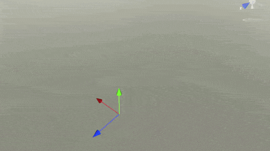

# Shader Story

## Vertex Animation: Instancing

> One plant in the wind is believable. **A hundred identical plants pulsing in unison is a machine**, and the problem only becomes visible at population scale, which is the trap: the single-asset test always passes. The fix is **per-instance variation**: phase offset, bend multiplier, stiffness, tint, sourced from a *supported* per-instance channel, with the shader logic itself staying shared.

> **Variation should break sync, not batching.** The cardinal sin is solving synchronization by creating a unique material per plant: that destroys batching, multiplies draw calls and material state, and trades one artificial-looking problem for an expensive one.

```hlsl
half seed = Hash13(objectPivotWS);  // stable per object
half phase = seed * _Jitter * TWO_PI;  // breaks the sync
half amp = lerp(1 - _Jitter, 1, seed) * _Override;  // narrow band, not chaos
```
---

### Where per-instance data lives

Four supported scopes, in order of flexibility:

1. **A stable hash of identity**: e.g. the object's world position, hashed once per frame. Zero authoring, zero CPU cost, works on any renderer. The value is *stable* (same object, same hash, every frame); that stability is what makes it desync instead of shimmer.
2. **Instanced material properties** (`UNITY_INSTANCING_BUFFER`): Unity assigns per-instance values from `MaterialPropertyBlock`s; the whole batch keeps one material and one draw call.
3. **Per-renderer data** (`[PerRendererData]`), explicit per-object overrides that still batch when the SRP Batcher can.
4. **Indirect / GPU instancing buffers**: for massive populations where the CPU can't drive per-instance state at all.

Two rules that come with the territory:

- **Keep the variation in a narrow band.** "Random 0..1 amplitude" looks like a bug; "0.75..1.0 amplitude, 0..2π phase" looks like a forest.
- **Variation must be consistent across passes.** If the main pass varies per instance but the shadow pass ignores the seed, you're back to the first shipping check ([Pass Consistency](https://github.com/DeGGeD/ShaderStory/blob/main/Chapters/VertexAnimation/Shipping/PassConsistency.md)); the shadow forest pulses in unison under the varied one.

And debug at field scale, not on one branch: batch and draw-call behavior only tells the truth with a hundred instances on screen.

---

### Visual demo
Per-instance phase offsets: each plant runs a slightly different phase, so the whole field sways as many things instead of one machine. Same mesh, same shader, one shared material. The combined-failure view shows what an unshipped vertex effect looks like up close: the mesh moves, but its shadow, depth, and temporal history each disagree.

<p align="center">

</p>

<p align="center">

</p>

---

### URP Shader Code
One wind function, three variation sources: a stable identity hash, an explicit per-instance buffer, and a narrow artist band, all multiplicative, all batch-safe.

```hlsl
Shader "DecompiledArt/VertexAnimation/Shipping/Instancing/Instancing"
{
    Properties
    {
        [MainColor] _Color("Main Color", Color) = (0.6, 0.9, 0.5, 1)

        [Header(Wind)]
        _WindDir("Wind Direction OS", Vector) = (1, 0.2, 0, 0)
        _WindAmplitude("Wind Amplitude", Float) = 0.4
        _WindFrequency("Wind Frequency", Float) = 1.2
        _HeightMask("Height Mask Base", Float) = 0.0

        [Header(Instance Variation)]
        // Narrow band, not chaos: 0 = all identical, 1 = full spread.
        _InstancePhaseJitter("Instance Phase Jitter", Range(0, 1)) = 1.0
        _InstanceAmplitudeJitter("Instance Amplitude Jitter", Range(0, 1)) = 0.25

        // Explicit per-renderer overrides (set from MaterialPropertyBlock).
        [PerRendererData] _InstancePhaseOffset("Instance Phase Offset", Range(0, 1)) = 0.0
        [PerRendererData] _InstanceAmplitudeScale("Instance Amplitude Scale", Range(0.5, 2)) = 1.0
    }

    SubShader
    {
        Tags
        {
            "RenderPipeline" = "UniversalPipeline"
            "RenderType" = "Opaque"
            "Queue" = "Geometry"
        }

        Pass
        {
            Name "UniversalForward"
            Tags { "LightMode" = "UniversalForward" }

            Cull Off
            ZWrite On
            ZTest LEqual

            HLSLPROGRAM
            #pragma target 3.0
            #pragma vertex Vert
            #pragma fragment Frag
            #pragma multi_compile_instancing

            #include "Packages/com.unity.render-pipelines.universal/ShaderLibrary/Core.hlsl"
            #include "Packages/com.unity.render-pipelines.universal/ShaderLibrary/Lighting.hlsl"

            CBUFFER_START(UnityPerMaterial)
                half4 _Color;
                float3 _WindDir;
                float _WindAmplitude;
                float _WindFrequency;
                float _HeightMask;

                float _InstancePhaseJitter;
                float _InstanceAmplitudeJitter;
            CBUFFER_END

            // Per-instance values live in their own buffer so instanced draw
            // calls can override them without splitting the batch.
            UNITY_INSTANCING_BUFFER_START(PerInstance)
                UNITY_DEFINE_INSTANCED_PROP(float, _InstancePhaseOffset)
                UNITY_DEFINE_INSTANCED_PROP(float, _InstanceAmplitudeScale)
            UNITY_INSTANCING_BUFFER_END(PerInstance)

            struct Attributes
            {
                float3 positionOS : POSITION;
                float3 normalOS : NORMAL;
                UNITY_VERTEX_INPUT_INSTANCE_ID
            };

            struct Varyings
            {
                float4 positionCS : SV_POSITION;
                float3 normalWS : TEXCOORD0;
                float3 worldPos : TEXCOORD1;
            };

            float WrappedTime()
            {
                const float kWrapPeriod = 1024.0;
                return frac(_Time.y / kWrapPeriod) * kWrapPeriod;
            }

            // Stable per-object identity: same object, same value, every frame.
            // This stability is what makes the variation a *desync*, not shimmer.
            float Hash13(float3 value)
            {
                value = frac(value * 0.1031);
                value += dot(value, value.yzx + 33.33);
                return frac((value.x + value.y) * value.z);
            }

            float GetInstanceSeed01()
            {
                float3 objectPivotWS = TransformObjectToWorld(float3(0.0, 0.0, 0.0));
                return Hash13(objectPivotWS);
            }

            // Seeded jitter + any explicit per-renderer override.
            float GetInstancePhaseOffsetRadians()
            {
                float seededPhase01 =
                    GetInstanceSeed01() * _InstancePhaseJitter;

                float explicitPhase01 =
                    UNITY_ACCESS_INSTANCED_PROP(PerInstance, _InstancePhaseOffset);

                return (seededPhase01 + explicitPhase01) * TWO_PI;
            }

            // A narrow band around 1.0: 0.75..1.0 at full jitter, not 0..1 chaos.
            float GetInstanceAmplitudeScale()
            {
                float seededAmplitude =
                    lerp(1.0 - _InstanceAmplitudeJitter, 1.0, GetInstanceSeed01());

                float explicitAmplitude =
                    UNITY_ACCESS_INSTANCED_PROP(PerInstance, _InstanceAmplitudeScale);

                return seededAmplitude * explicitAmplitude;
            }

            // The shared wind, with per-instance variation folded in.
            // Every pass that renders this geometry must apply the same thing.
            float3 ApplyWindOffset(float3 positionOS, float3 worldPos, float time)
            {
                float mask = saturate(positionOS.y + _HeightMask);

                float phase =
                    time * _WindFrequency
                    + worldPos.x * 0.5
                    + GetInstancePhaseOffsetRadians();

                float amplitude = _WindAmplitude * GetInstanceAmplitudeScale();

                float3 bendDir = normalize(_WindDir);
                return bendDir * (sin(phase) * amplitude) * mask;
            }

            Varyings Vert(Attributes IN)
            {
                Varyings OUT;

                UNITY_SETUP_INSTANCE_ID(IN);

                float3 worldPos = TransformObjectToWorld(IN.positionOS);

                float3 displacedOS =
                    IN.positionOS + ApplyWindOffset(IN.positionOS, worldPos, WrappedTime());

                float3 displacedWS = TransformObjectToWorld(displacedOS);

                OUT.positionCS = TransformWorldToHClip(displacedWS);
                OUT.normalWS = TransformObjectToWorldNormal(IN.normalOS);
                OUT.worldPos = displacedWS;
                return OUT;
            }

            half4 Frag(Varyings IN) : SV_Target
            {
                half3 normalWS = normalize(IN.normalWS);
                Light mainLight = GetMainLight(TransformWorldToShadowCoord(IN.worldPos));

                half NdotL = saturate(dot(normalWS, mainLight.direction));
                half3 color = _Color.rgb * (0.25 + NdotL) * mainLight.color;
                color *= mainLight.shadowAttenuation;

                return half4(color, 1.0);
            }
            ENDHLSL
        }
    }

    FallBack Off
}
```

And the override side, per-object values through a `MaterialPropertyBlock`, one shared material, one batch:

```csharp
var block = new MaterialPropertyBlock();
block.SetFloat("_InstancePhaseOffset", Random.value);  // stable per object
block.SetFloat("_InstanceAmplitudeScale", 0.8f + Random.value * 0.2f);
renderer.GetPropertyBlock(block);
renderer.SetPropertyBlock(block);
```

> Check it at field scale: open the frame debugger on a hundred instances and confirm the batch didn't split. Variation that breaks batching has failed at its only job.

---

## 🔗 Related Chapters

[Pass Consistency](https://github.com/DeGGeD/ShaderStory/blob/main/Chapters/VertexAnimation/Shipping/PassConsistency.md) • [Phase Offset](https://github.com/DeGGeD/ShaderStory/blob/main/Chapters/VertexAnimation/Time/PhaseOffset.md) • [Controlled Irregularity](https://github.com/DeGGeD/ShaderStory/blob/main/Chapters/VertexAnimation/Patterns/ControlledIrregularity.md) • [Data Sources](https://github.com/DeGGeD/ShaderStory/blob/main/Chapters/VertexAnimation/DataSources.md)

**Related functions:** [Frac](https://github.com/DeGGeD/ShaderStory/blob/main/Chapters/CommonFunctions/Frac.md) • [Lerp](https://github.com/DeGGeD/ShaderStory/blob/main/Chapters/CommonFunctions/Lerp.md) • [Normalize](https://github.com/DeGGeD/ShaderStory/blob/main/Chapters/CommonFunctions/Normalize.md)

---

## ❤️ Support Shader Story

If this article helped you, consider supporting the project on Patreon - you'll get access to the related source files, reference cheat-sheets, and other exclusive resources:

<p align="center">
  <a href="https://www.patreon.com/decompiled_art" target="_blank">
    
  </a>
  <a href="https://www.buymeacoffee.com/shaderstory" target="_blank">
    
  </a>
</p>

Your support helps keep this library open, growing, and free for everyone.
