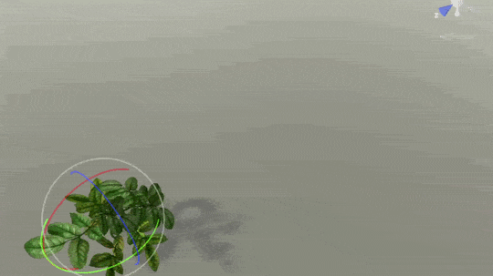

# Shader Story

## Vertex Animation: LODs

> LODs are often different *meshes*, not cheaper copies of the same mesh: different topology, vertex counts, vertex colors, UV payloads, pivots, and bounds. If your motion depends on vertex colors, packed UVs, stored pivots, or phase offsets, and that data disappears or shifts in a lower LOD, the motion can **pop, rotate around the wrong point, or change amplitude at the transition**.

> **LOD is not just mesh reduction. It is also behavior reduction.** And a coarse distant LOD should run *simpler, weaker* motion; consistency across LODs means stable cross-fades, not identical motion.

```hlsl
half lodLevel = ComputeMotionLodLevel();  // distance → 0..3
float4 scales = GetMotionLodScales(lodLevel, _MainLodScales, _DetailLodScales, _LeafLodScales);  // per-layer strength per LOD
```
---

### The motion ladder

A production-ready ladder spends performance where the player can actually read it:

- **LOD0**: full motion: broad sway + noise + detail + leaf flutter + normal reconstruction.
- **LOD1**: reduced motion on all layers; the silhouette still moves, the fine detail calms down.
- **LOD2**: broad sway only. No leaf motion, no normal reconstruction.
- **LOD3**: motion disabled entirely; a static card or cross-fade.

Two rules that keep the ladder from becoming a bug:

1. **Every layer scales by the same LOD decision, in every pass.** If the forward pass drops leaf flutter at distance but the shadow pass keeps it, the shadow flutters past the mesh; the [Pass Consistency](https://github.com/DeGGeD/ShaderStory/blob/main/Chapters/VertexAnimation/Shipping/PassConsistency.md) contract again.
2. **If two LODs visibly disagree during a dithered cross-fade, the asset shimmers and double-images.** Each LOD in the overlap band must produce the *same* silhouette motion, even if their internal layers differ. Tune the per-LOD scales so the overlap is indistinguishable.

The distance→level step is computed in the vertex shader from camera distance, so the whole population adapts without per-object CPU work.

---

### Visual demo
A forest LOD ladder with motion simplified by distance: full near-field detail up close, broad-only motion at mid range, static far away. Watch the transition bands; the cross-fades hold because the overlapping LODs agree on the silhouette.

<p align="center">

</p>

---

### URP Shader Code
Distance-based motion LOD: three wind layers, each with its own per-LOD strength, all driven by one distance step.

```hlsl
Shader "DecompiledArt/VertexAnimation/Shipping/Lods/Lods"
{
    Properties
    {
        [MainColor] _Color("Main Color", Color) = (0.6, 0.9, 0.5, 1)

        [Header(Wind Layers)]
        _MainAmplitude("Main Sway Amplitude", Float) = 0.5
        _DetailAmplitude("Detail Sway Amplitude", Float) = 0.15
        _LeafAmplitude("Leaf Flutter Amplitude", Float) = 0.05
        _WindFrequency("Wind Frequency", Float) = 1.0
        _HeightMask("Height Mask Base", Float) = 0.0

        [Header(Motion LOD)]
        // Distances (meters) for LOD1 / LOD2 / LOD3 steps.
        _MotionLodDistances("Motion LOD Distances", Vector) = (12, 25, 40, 0)

        // Per-LOD strength for each layer: LOD0 / LOD1 / LOD2 / LOD3.
        _MainLodScales("Main Layer Scales (L0 L1 L2 L3)", Vector) = (1, 0.7, 0.45, 0)
        _DetailLodScales("Detail Layer Scales (L0 L1 L2 L3)", Vector) = (1, 0.5, 0, 0)
        _LeafLodScales("Leaf Layer Scales (L0 L1 L2 L3)", Vector) = (1, 0.35, 0, 0)

        [Toggle(_VISUALIZE_MOTION_LOD)] _VisualizeMotionLod("Visualize Motion LOD", Float) = 0
    }

    SubShader
    {
        Tags
        {
            "RenderPipeline" = "UniversalPipeline"
            "RenderType" = "Opaque"
            "Queue" = "Geometry"
        }

        Pass
        {
            Name "UniversalForward"
            Tags { "LightMode" = "UniversalForward" }

            Cull Off
            ZWrite On
            ZTest LEqual

            HLSLPROGRAM
            #pragma target 3.0
            #pragma vertex Vert
            #pragma fragment Frag

            #pragma shader_feature_local _VISUALIZE_MOTION_LOD

            #include "Packages/com.unity.render-pipelines.universal/ShaderLibrary/Core.hlsl"
            #include "Packages/com.unity.render-pipelines.universal/ShaderLibrary/Lighting.hlsl"

            CBUFFER_START(UnityPerMaterial)
                half4 _Color;
                float _MainAmplitude;
                float _DetailAmplitude;
                float _LeafAmplitude;
                float _WindFrequency;
                float _HeightMask;

                float3 _MotionLodDistances;

                float4 _MainLodScales;
                float4 _DetailLodScales;
                float4 _LeafLodScales;
            CBUFFER_END

            struct Attributes
            {
                float3 positionOS : POSITION;
                float3 normalOS : NORMAL;
                float4 color : COLOR;
            };

            struct Varyings
            {
                float4 positionCS : SV_POSITION;
                float3 normalWS : TEXCOORD0;
                float3 worldPos : TEXCOORD1;
                half motionLod : TEXCOORD2;
            };

            float WrappedTime()
            {
                const float kWrapPeriod = 1024.0;
                return frac(_Time.y / kWrapPeriod) * kWrapPeriod;
            }

            // Distance from the camera to the object pivot, stepped into a
            // motion-LOD level 0..3. Computed per vertex; cheap enough.
            half ComputeMotionLodLevel()
            {
                float3 objectPivotWS = TransformObjectToWorld(float3(0.0, 0.0, 0.0));

                float3 cameraToPivot = GetCameraPositionWS() - objectPivotWS;
                float distanceSq = dot(cameraToPivot, cameraToPivot);

                float3 lodDistanceSq = _MotionLodDistances * _MotionLodDistances;

                half motionLodLevel = step(lodDistanceSq.x, distanceSq);
                motionLodLevel += step(lodDistanceSq.y, distanceSq);
                motionLodLevel += step(lodDistanceSq.z, distanceSq);

                return motionLodLevel;
            }

            // Pick this LOD's per-layer strengths in one call.
            float4 GetMotionLodScales(half lodLevel, float4 main, float4 detail, float4 leaf)
            {
                if (lodLevel < 0.5h) return float4(main.x, detail.x, leaf.x, 0.0);
                if (lodLevel < 1.5h) return float4(main.y, detail.y, leaf.y, 0.0);
                if (lodLevel < 2.5h) return float4(main.z, detail.z, leaf.z, 0.0);
                return float4(main.w, detail.w, leaf.w, 0.0);  // LOD3: static
            }

            Varyings Vert(Attributes IN)
            {
                Varyings OUT;

                float time = WrappedTime();

                half lodLevel = ComputeMotionLodLevel();
                float4 lod = GetMotionLodScales(lodLevel, _MainLodScales, _DetailLodScales, _LeafLodScales);

                float3 worldPos = TransformObjectToWorld(IN.positionOS);
                float mask = saturate(IN.positionOS.y + _HeightMask);
                float phase = time * _WindFrequency + worldPos.x * 0.5;

                float3 displacedOS = IN.positionOS;

                // Broad sway: the silhouette layer, kept the longest.
                displacedOS += float3(1.0, 0.0, 0.0) * (sin(phase) * _MainAmplitude * lod.x) * mask;

                // Detail sway: calmed first.
                displacedOS += float3(0.0, 1.0, 0.0) * (sin(phase * 1.7) * _DetailAmplitude * lod.y) * mask;

                // Leaf flutter: dropped at mid range.
                displacedOS += float3(0.0, 0.0, 1.0) * (sin(phase * 3.1) * _LeafAmplitude * lod.z) * mask;

                float3 displacedWS = TransformObjectToWorld(displacedOS);

                OUT.positionCS = TransformWorldToHClip(displacedWS);
                OUT.normalWS = TransformObjectToWorldNormal(IN.normalOS);
                OUT.worldPos = displacedWS;
                OUT.motionLod = lodLevel;
                return OUT;
            }

            half4 Frag(Varyings IN) : SV_Target
            {
                half3 normalWS = normalize(IN.normalWS);
                Light mainLight = GetMainLight(TransformWorldToShadowCoord(IN.worldPos));

                half NdotL = saturate(dot(normalWS, mainLight.direction));
                half3 color = _Color.rgb * (0.25 + NdotL) * mainLight.color;
                color *= mainLight.shadowAttenuation;

                // Debug: color the motion-LOD level so the ladder is visible.
                #if defined(_VISUALIZE_MOTION_LOD)
                    half3 lodColor = lerp(half3(1, 1, 1), half3(1, 0, 0), IN.motionLod / 3.0h);
                    color *= lodColor;
                #endif

                return half4(color, 1.0);
            }
            ENDHLSL
        }
    }

    FallBack Off
}
```

> And the cross-fade rule: whatever the far LOD drops, the near LOD in the overlap band must still match it *silhouette-wise*. Tune until the shimmer disappears, not until the layers "look similar".

---

## 🔗 Related Chapters

[Pass Consistency](https://github.com/DeGGeD/ShaderStory/blob/main/Chapters/VertexAnimation/Shipping/PassConsistency.md) • [Bounds](https://github.com/DeGGeD/ShaderStory/blob/main/Chapters/VertexAnimation/Shipping/Bounds.md) • [Controlled Irregularity](https://github.com/DeGGeD/ShaderStory/blob/main/Chapters/VertexAnimation/Patterns/ControlledIrregularity.md)

**Related functions:** [Step](https://github.com/DeGGeD/ShaderStory/blob/main/Chapters/CommonFunctions/Step.md) • [Distance](https://github.com/DeGGeD/ShaderStory/blob/main/Chapters/CommonFunctions/Distance.md) • [Frac](https://github.com/DeGGeD/ShaderStory/blob/main/Chapters/CommonFunctions/Frac.md)

---

## ❤️ Support Shader Story

If this article helped you, consider supporting the project on Patreon - you'll get access to the related source files, reference cheat-sheets, and other exclusive resources:

<p align="center">
  <a href="https://www.patreon.com/decompiled_art" target="_blank">
    
  </a>
  <a href="https://www.buymeacoffee.com/shaderstory" target="_blank">
    
  </a>
</p>

Your support helps keep this library open, growing, and free for everyone.
