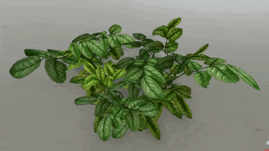

# Shader Story

## Vertex Animation: Motion Vectors & TAA

> Temporal systems don't only care about the current frame. **TAA, motion blur, and friends need to know where the surface *was* in the previous frame** so history can be reprojected. If the motion-vector pass doesn't evaluate the same deformation, the renderer behaves as if the surface were static, and you get **ghosting, smearing, and shimmering**. Foliage makes this especially visible: thin, alpha-tested, high-frequency, constantly moving.

> Most TAA foliage issues are really **motion-vector consistency** issues. The first instinct, "reduce TAA strength", treats the symptom.

```hlsl
float3 currentOS = EvaluateAnimatedPositionOS(IN.positionOS, IN.color, WrappedTime());
float3 previousOS = EvaluateAnimatedPositionOS(IN.positionOS, IN.color, WrappedTimeOffset(-MotionDeltaTime()));
// motion vector = difference of the two clip-space results
```

---

### What the pass must do

The `MotionVectors` pass evaluates the geometry at **two times**: now, and one delta-time ago, and writes the difference (in screen space) as the motion vector. Three conditions, all mandatory:

1. **The same deformation function** as every other pass (the [Pass Consistency](https://github.com/DeGGeD/ShaderStory/blob/main/Chapters/VertexAnimation/Shipping/PassConsistency.md) contract, extended to time).
2. **A deterministic previous-frame result.** If the previous evaluation is driven by unstable randomness or frame-dependent noise, the vectors stay broken even when the code *looks* correct.
3. **The same silhouette behavior.** The same alpha cutout as the forward pass, so TAA doesn't accumulate history through holes that the forward pass clipped.

One legitimate escape valve: for dense distant forests, deliberately simplify or fade motion layers, and *accept* some temporal artifacts as a conscious performance tradeoff, never as an accidental bug (see [LODs](https://github.com/DeGGeD/ShaderStory/blob/main/Chapters/VertexAnimation/Shipping/Lods.md)).

The previous-frame time must also come from the *same* time source: wrap `time - deltaTime` through the same wrapping function, or the two evaluations live on different clocks.

---

### Visual demo
The current frame looks right, but TAA ghosts and smears the foliage: the motion-vector pass reports zero motion, so history reprojects from the wrong place. The fix toggle makes the motion-vector pass evaluate the same deformation at the current and previous frame, and the ghosts collapse.

<p align="center">

</p>

---

### URP Shader Code
A `MotionVectors` pass with both states: broken (zero vectors, on purpose) and fixed (same deformation evaluated at current and previous time).

```hlsl
Shader "DecompiledArt/VertexAnimation/Shipping/MotionVectorsTaa/MotionVectorsTaa"
{
    Properties
    {
        [MainColor] _Color("Main Color", Color) = (0.6, 0.9, 0.5, 1)

        [Header(Wind)]
        _WindDir("Wind Direction OS", Vector) = (1, 0.2, 0, 0)
        _WindAmplitude("Wind Amplitude", Float) = 0.4
        _WindFrequency("Wind Frequency", Float) = 1.2
        _HeightMask("Height Mask Base", Float) = 0.0

        [Header(Workshop Fixes)]
        [Toggle(_FIX_MOTION_VECTORS)] _FixMotionVectors("Fix Motion Vectors", Float) = 1
    }

    SubShader
    {
        Tags
        {
            "RenderPipeline" = "UniversalPipeline"
            "RenderType" = "Opaque"
            "Queue" = "Geometry"
        }

        HLSLINCLUDE

        #include "Packages/com.unity.render-pipelines.universal/ShaderLibrary/Core.hlsl"

        CBUFFER_START(UnityPerMaterial)
            half4 _Color;
            float3 _WindDir;
            float _WindAmplitude;
            float _WindFrequency;
            float _HeightMask;
        CBUFFER_END

        struct Attributes
        {
            float3 positionOS : POSITION;
            float3 normalOS : NORMAL;
            float4 color : COLOR;
        };

        // Bounded time, wrapped once.
        float WrappedTime()
        {
            const float kWrapPeriod = 1024.0;
            return frac(_Time.y / kWrapPeriod) * kWrapPeriod;
        }

        // Previous-frame time through the *same* wrap, so both evaluations
        // live on the same clock.
        float WrappedTimeOffset(float offset)
        {
            const float kWrapPeriod = 1024.0;
            return frac((_Time.y + offset) / kWrapPeriod + 1.0) * kWrapPeriod;
        }

        // Clamp delta time so a hitch can't produce a giant fake vector.
        float MotionDeltaTime()
        {
            return max(unity_DeltaTime.x, 1.0 / 60.0);
        }

        // ------------------------------------------------------------------
        // THE SHARED DEFORMATION, same inputs in every pass.
        // ------------------------------------------------------------------
        float3 ApplyWindOffset(float3 positionOS, float3 worldPos, float time)
        {
            float mask = saturate(positionOS.y + _HeightMask) * saturate(0.5 + _Color.a);
            float phase = time * _WindFrequency + worldPos.x * 0.5;

            float3 bendDir = normalize(_WindDir);
            return bendDir * (sin(phase) * _WindAmplitude) * mask;
        }

        float3 EvaluateAnimatedPositionOS(float3 positionOS, float4 color, float time)
        {
            float3 worldPos = TransformObjectToWorld(positionOS);
            return positionOS + ApplyWindOffset(positionOS, worldPos, time);
        }

        // Motion vector = current NDC minus previous NDC.
        float2 ComputeClipMotionDelta(float3 currentPositionOS, float3 previousPositionOS)
        {
            float4 currentPositionCS = TransformWorldToHClip(TransformObjectToWorld(currentPositionOS));
            float4 previousPositionCS = TransformWorldToHClip(TransformObjectToWorld(previousPositionOS));

            float2 currentPositionNDC = currentPositionCS.xy / max(currentPositionCS.w, 1e-5);
            float2 previousPositionNDC = previousPositionCS.xy / max(previousPositionCS.w, 1e-5);

            return currentPositionNDC - previousPositionNDC;
        }

        ENDHLSL

        // ============================================================
        // FORWARD PASS
        // ============================================================
        Pass
        {
            Name "UniversalForward"
            Tags { "LightMode" = "UniversalForward" }

            Cull Off
            ZWrite On
            ZTest LEqual

            HLSLPROGRAM
            #pragma target 3.0
            #pragma vertex Vert
            #pragma fragment Frag

            #include "Packages/com.unity.render-pipelines.universal/ShaderLibrary/Lighting.hlsl"

            struct Varyings
            {
                float4 positionCS : SV_POSITION;
                float3 normalWS : TEXCOORD0;
                float3 worldPos : TEXCOORD1;
            };

            Varyings Vert(Attributes IN)
            {
                Varyings OUT;

                float3 displacedOS = EvaluateAnimatedPositionOS(
                    IN.positionOS, IN.color, WrappedTime());
                float3 displacedWS = TransformObjectToWorld(displacedOS);

                OUT.positionCS = TransformWorldToHClip(displacedWS);
                OUT.normalWS = TransformObjectToWorldNormal(IN.normalOS);
                OUT.worldPos = displacedWS;
                return OUT;
            }

            half4 Frag(Varyings IN) : SV_Target
            {
                half3 normalWS = normalize(IN.normalWS);
                Light mainLight = GetMainLight(TransformWorldToShadowCoord(IN.worldPos));

                half NdotL = saturate(dot(normalWS, mainLight.direction));
                half3 color = _Color.rgb * (0.25 + NdotL) * mainLight.color;
                color *= mainLight.shadowAttenuation;

                return half4(color, 1.0);
            }
            ENDHLSL
        }

        // ============================================================
        // MOTION VECTORS, the structural fix for TAA ghosting.
        // ============================================================
        Pass
        {
            Name "MotionVectors"
            Tags { "LightMode" = "MotionVectors" }

            ZWrite Off
            ZTest LEqual
            Cull Off

            HLSLPROGRAM
            #pragma target 3.0
            #pragma vertex Vert
            #pragma fragment Frag

            #pragma shader_feature_local _FIX_MOTION_VECTORS

            struct MVVaryings
            {
                float4 positionCS : SV_POSITION;
                float2 motionVector : TEXCOORD1;
            };

            MVVaryings Vert(Attributes IN)
            {
                MVVaryings OUT;

                #if defined(_FIX_MOTION_VECTORS)
                    // The fix: the same deformation function, evaluated at the
                    // current and the previous frame, deterministically.
                    float3 currentOS = EvaluateAnimatedPositionOS(
                        IN.positionOS, IN.color, WrappedTime());
                    float3 previousOS = EvaluateAnimatedPositionOS(
                        IN.positionOS, IN.color,
                        WrappedTimeOffset(-MotionDeltaTime()));

                    OUT.motionVector = ComputeClipMotionDelta(currentOS, previousOS);
                #else
                    // The broken case, on purpose: the pass reports zero motion,
                    // so TAA reprojects history from the *rest* position.
                    OUT.motionVector = float2(0.0, 0.0);
                #endif

                OUT.positionCS = TransformObjectToHClip(IN.positionOS);
                return OUT;
            }

            half4 Frag(MVVaryings IN) : SV_Target
            {
                return half4(IN.motionVector, 0.0, 0.0);
            }
            ENDHLSL
        }
    }

    FallBack Off
}
```

---

## 🔗 Related Chapters

[Pass Consistency](https://github.com/DeGGeD/ShaderStory/blob/main/Chapters/VertexAnimation/Shipping/PassConsistency.md) • [LODs](https://github.com/DeGGeD/ShaderStory/blob/main/Chapters/VertexAnimation/Shipping/Lods.md) • [Normals Reconstruction](https://github.com/DeGGeD/ShaderStory/blob/main/Chapters/VertexAnimation/Patterns/NormalsReconstruction.md)

**Related functions:** [Frac](https://github.com/DeGGeD/ShaderStory/blob/main/Chapters/CommonFunctions/Frac.md) • [Normalize](https://github.com/DeGGeD/ShaderStory/blob/main/Chapters/CommonFunctions/Normalize.md)

---

## ❤️ Support Shader Story

If this article helped you, consider supporting the project on Patreon: you'll get access to the related source files, reference cheat-sheets, and other exclusive resources:

<p align="center">
  <a href="https://www.patreon.com/decompiled_art" target="_blank">
    
  </a>
  <a href="https://www.buymeacoffee.com/shaderstory" target="_blank">
    
  </a>
</p>

Your support helps keep this library open, growing, and free for everyone.
