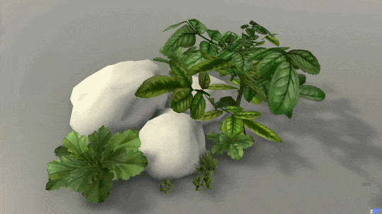

# Shader Story

## Vertex Animation: Normals (Shipping)

> Vertex displacement changes the surface, but the normals you imported describe the *bind pose*. Subtle leaf flutter can be perfectly fine on art-directed normals, often bent, averaged, or biased at import for a broader canopy response, and a physically "correct" reconstruction can make a stylized asset look *worse*. But strong deformation (broad bends, large pivots, waves) detaches highlights and reflections from the shape, and *that* you must repair.

> **Match the visual goal, not the math by default.** This is a per-asset decision: keep, bend, bias, blend, or reconstruct, driven by the lighting intent of the asset, not by a default.

```hlsl
float3 N = normalize(lerp(originalNormalWS, reconstructedNormalWS, _NormalBlend));
```

---

### The decision ladder

For each asset, the question is *what should the lighting do when the surface moves?* Five answers, in order of effort:

1. **Keep**: the imported normal, unchanged. Correct enough for subtle flutter on art-directed normals; zero cost.
2. **Bend / bias**: a fixed directional adjustment (e.g. bias toward the average canopy direction). Cheap artist control for stylized assets where "correct" reads wrong.
3. **Blend**: `lerp(original, reconstructed, strength)`. The production workhorse: partial repair keeps the art direction while fixing the worst of the detachment. The strength is an *artistic* knob, not a correctness knob.
4. **Reconstruct**: rebuild the normal from the displaced surface (finite-difference, height-field, or analytic; the methods themselves live in [Normals Reconstruction](https://github.com/DeGGeD/ShaderStory/blob/main/Chapters/VertexAnimation/Patterns/NormalsReconstruction.md)).
5. **Layer detail on top**: a normal map for micro-detail, riding on the repaired large form, re-orthonormalized against it.

The practical split: **large motion from geometry, small detail from shading.** And because the normal is a *consumer* of the displaced position, whatever decision you make must apply to every pass that lights or shades the surface. The [Pass Consistency](https://github.com/DeGGeD/ShaderStory/blob/main/Chapters/VertexAnimation/Shipping/PassConsistency.md) contract extends to normals, not just positions.

---

### Visual demo
The same deformed mesh under different normal strategies: original, bent, and reconstructed. Watch the highlights and reflections decide whether the shading reads as art-directed or detached; the blend knob is where the decision actually lives.

<p align="center">

</p>

---

### URP Shader Code
A bending mesh with the full decision: a wind deformation that also bends the normal (the cheap "bias" answer), a finite-difference reconstruction, and the blend between them, the one knob that ships most assets.

```hlsl
Shader "DecompiledArt/VertexAnimation/Shipping/NormalsShipping/NormalsShipping"
{
    Properties
    {
        [MainColor] _Color("Main Color", Color) = (0.6, 0.9, 0.5, 1)

        [Header(Wind)]
        _WindDir("Wind Direction OS", Vector) = (1, 0.2, 0, 0)
        _WindAmplitude("Wind Amplitude", Float) = 0.5
        _WindFrequency("Wind Frequency", Float) = 1.0
        _HeightMask("Height Mask Base", Float) = 0.0

        [Header(Normal Decision)]
        // 0 = keep the imported normal
        // 1 = bend it with the deformation (cheap stylized answer)
        // 2 = reconstruct it from the displaced surface
        [Enum(Keep,0,Bend,1,Reconstruct,2)] _NormalStrategy("Normal Strategy", Float) = 1
        _NormalBlend("Normal Blend", Range(0, 1)) = 0.6
    }

    SubShader
    {
        Tags
        {
            "RenderPipeline" = "UniversalPipeline"
            "RenderType" = "Opaque"
            "Queue" = "Geometry"
        }

        Pass
        {
            Name "UniversalForward"
            Tags { "LightMode" = "UniversalForward" }

            Cull Off
            ZWrite On
            ZTest LEqual

            HLSLPROGRAM
            #pragma target 3.0
            #pragma vertex Vert
            #pragma fragment Frag

            #pragma shader_feature_local _NORMALSTRATEGY_KEEP _NORMALSTRATEGY_BEND _NORMALSTRATEGY_RECONSTRUCT

            #include "Packages/com.unity.render-pipelines.universal/ShaderLibrary/Core.hlsl"
            #include "Packages/com.unity.render-pipelines.universal/ShaderLibrary/Lighting.hlsl"

            CBUFFER_START(UnityPerMaterial)
                half4 _Color;
                float _NormalStrategy;
                float _NormalBlend;
                float3 _WindDir;
                float _WindAmplitude;
                float _WindFrequency;
                float _HeightMask;
            CBUFFER_END

            struct Attributes
            {
                float3 positionOS : POSITION;
                float3 normalOS : NORMAL;
            };

            struct Varyings
            {
                float4 positionCS : SV_POSITION;
                float3 normalWS : TEXCOORD0;
                float3 worldPos : TEXCOORD1;
            };

            float WrappedTime()
            {
                const float kWrapPeriod = 1024.0;
                return frac(_Time.y / kWrapPeriod) * kWrapPeriod;
            }

            // The shared wind deformation (positions).
            float3 ApplyWindOffset(float3 positionOS, float3 worldPos, float time)
            {
                float mask = saturate(positionOS.y + _HeightMask);
                float phase = time * _WindFrequency + worldPos.x * 0.5;

                float3 bendDir = normalize(_WindDir);
                return bendDir * (sin(phase) * _WindAmplitude) * mask;
            }

            // The bend answer: tilt the normal in the same direction the
            // surface bends, scaled by the same mask. Cheap, stylized,
            // and stable, with no extra evaluations.
            float3 BendNormalOS(float3 normalOS, float3 positionOS, float time)
            {
                float mask = saturate(positionOS.y + _HeightMask);
                float phase = time * _WindFrequency + TransformObjectToWorld(positionOS).x * 0.5;

                float3 bendDir = normalize(_WindDir);
                float tilt = sin(phase) * _WindAmplitude * 0.5 * mask;

                // Rotate the normal toward the bend direction by the tilt.
                float3 bent = normalOS + bendDir * tilt;
                return normalize(bent);
            }

            // The reconstruct answer: finite differences on the displaced
            // surface: the general method from the Patterns chapter.
            float3 ReconstructNormalOS(float3 positionOS, float time)
            {
                const float eps = 0.02;

                float3 worldPos = TransformObjectToWorld(positionOS);
                float3 p = positionOS + ApplyWindOffset(positionOS, worldPos, time);

                float3 pxOS = positionOS + float3(eps, 0.0, 0.0);
                float3 pzOS = positionOS + float3(0.0, 0.0, eps);

                float3 px = pxOS + ApplyWindOffset(pxOS, TransformObjectToWorld(pxOS), time);
                float3 pz = pzOS + ApplyWindOffset(pzOS, TransformObjectToWorld(pzOS), time);

                return normalize(cross(pz - p, px - p));
            }

            Varyings Vert(Attributes IN)
            {
                Varyings OUT;

                float time = WrappedTime();

                float3 worldPos = TransformObjectToWorld(IN.positionOS);
                float3 displacedOS = IN.positionOS + ApplyWindOffset(IN.positionOS, worldPos, time);
                float3 displacedWS = TransformObjectToWorld(displacedOS);

                float3 originalNormalWS = TransformObjectToWorldNormal(IN.normalOS);

                // The decision ladder, per asset.
                float3 finalNormalOS = IN.normalOS;

                #if defined(_NORMALSTRATEGY_BEND)
                    finalNormalOS = BendNormalOS(IN.normalOS, IN.positionOS, time);
                #elif defined(_NORMALSTRATEGY_RECONSTRUCT)
                    finalNormalOS = ReconstructNormalOS(IN.positionOS, time);
                #endif

                float3 finalNormalWS = TransformObjectToWorldNormal(finalNormalOS);

                // The shipped answer: blend the art-directed normal toward
                // the repaired one. 1.0 = fully trust the reconstruction.
                OUT.normalWS = normalize(lerp(originalNormalWS, finalNormalWS, saturate(_NormalBlend)));

                OUT.positionCS = TransformWorldToHClip(displacedWS);
                OUT.worldPos = displacedWS;
                return OUT;
            }

            half4 Frag(Varyings IN) : SV_Target
            {
                half3 normalWS = normalize(IN.normalWS);
                Light mainLight = GetMainLight(TransformWorldToShadowCoord(IN.worldPos));

                half NdotL = saturate(dot(normalWS, mainLight.direction));

                half3 color = _Color.rgb * (0.25 + NdotL) * mainLight.color;
                color *= mainLight.shadowAttenuation;

                return half4(color, 1.0);
            }
            ENDHLSL
        }
    }

    FallBack Off
}
```

---

## 🔗 Related Chapters

[Normals Reconstruction](https://github.com/DeGGeD/ShaderStory/blob/main/Chapters/VertexAnimation/Patterns/NormalsReconstruction.md) • [Pass Consistency](https://github.com/DeGGeD/ShaderStory/blob/main/Chapters/VertexAnimation/Shipping/PassConsistency.md) • [Harden Normals](https://github.com/DeGGeD/ShaderStory/blob/main/Chapters/Derivatives/HardenNormals.md)

**Related functions:** [Cross](https://github.com/DeGGeD/ShaderStory/blob/main/Chapters/CommonFunctions/Cross.md) • [Normalize](https://github.com/DeGGeD/ShaderStory/blob/main/Chapters/CommonFunctions/Normalize.md) • [Lerp](https://github.com/DeGGeD/ShaderStory/blob/main/Chapters/CommonFunctions/Lerp.md)

---

## ❤️ Support Shader Story

If this article helped you, consider supporting the project on Patreon: you'll get access to the related source files, reference cheat-sheets, and other exclusive resources:

<p align="center">
  <a href="https://www.patreon.com/decompiled_art" target="_blank">
    
  </a>
  <a href="https://www.buymeacoffee.com/shaderstory" target="_blank">
    
  </a>
</p>

Your support helps keep this library open, growing, and free for everyone.
