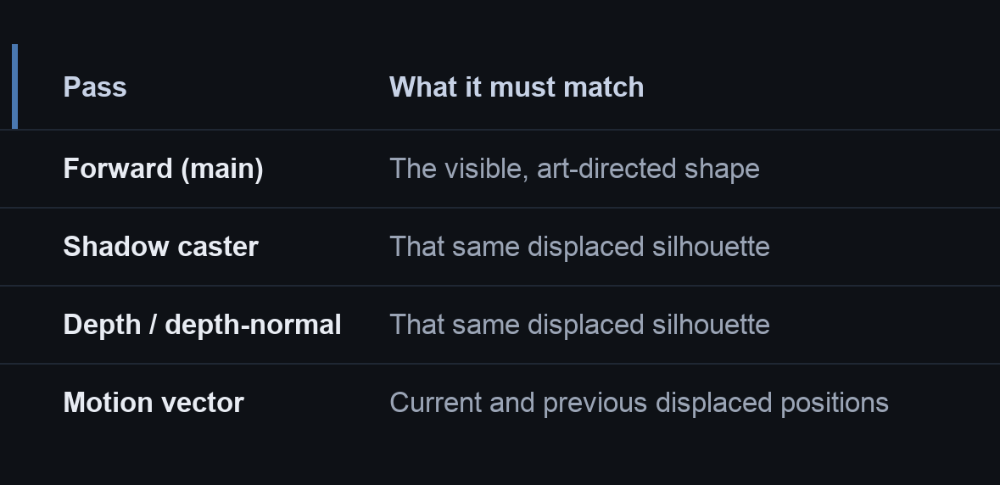
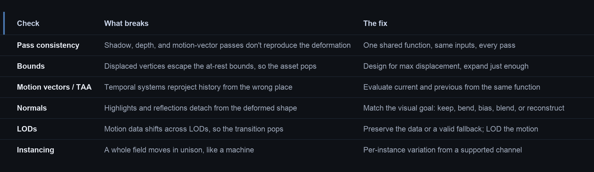
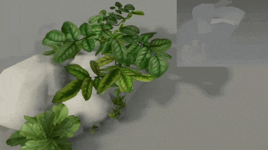

# Shader Story

## Vertex Animation: Pass Consistency

> Everything so far makes a *demo*. The first shipping check is the most common failure in the wild: the forward pass bends the vertices, but the **shadow, depth, and motion-vector passes don't** reproduce that deformation. The asset looks correct, *but* the shadow doesn't move, depth-dependent systems read the wrong shape, and the whole thing is subtly *inconsistent*, which is exactly what the eye catches before the brain can name.

> **Don't ship a pretty vertex function. Ship the motion contract.**

```hlsl
// One function, many passes:
float3 EvaluateAnimatedPositionOS(float3 positionOS, float4 color, float time);
```

---

### The motion contract, pass by pass

"Looks fine" in the main pass is only *one* part of the contract:

<p align="center">

</p>

The correct fix is **not** to re-implement the effect per pass. Centralize the deformation in **one shared function** (an `HLSLINCLUDE` block or a shared `.hlsl` file), call it from every pass, and make sure each pass uses the *same inputs*: same time source, same wind parameters, same masks, same pivots, same per-instance variation, same space conventions.

```hlsl
HLSLINCLUDE
    float3 ApplyWindOffset(float3 positionOS, float3 worldPos, float time);
    float3 EvaluateAnimatedPositionOS(float3 positionOS, float4 color, float time);
ENDHLSL

// Every pass that renders this geometry calls the same function:
// positionOS = EvaluateAnimatedPositionOS(IN.positionOS, IN.color, WrappedTime());
```

Copy-paste per pass *will* drift; one pass gets an update, another doesn't, and the artifact appears in a system nobody suspects. Shared logic with shared inputs doesn't. The bug is rarely "shadow quality"; the bug is usually **different geometry in different passes**.

The six shipping checks, at a glance:

<p align="center">

</p>

---

### Visual demo
The leaves move, but the shadow doesn't: the forward pass is deformed while the shadow caster still renders the undeformed shape. The lighting and the shadow are telling two different stories; the fix toggle applies the same deformation to the shadow pass.

<p align="center">

</p>

---

### URP Shader Code
The structural fix as a minimal shader: one deformation function in `HLSLINCLUDE`, three passes, two live toggles. Untoggle the shadow fix and watch the shadow detach; untoggle the depth fix and the depth buffer lies.

```hlsl
Shader "DecompiledArt/VertexAnimation/Shipping/PassConsistency/PassConsistency"
{
    Properties
    {
        _Color("Main Color", Color) = (0.6, 0.9, 0.5, 1)

        [Header(Wind - the shared inputs)]
        _WindDir("Wind Direction OS", Vector) = (1, 0.2, 0, 0)
        _WindAmplitude("Wind Amplitude", Float) = 0.4
        _WindFrequency("Wind Frequency", Float) = 1.2
        _HeightMask("Height Mask Base", Float) = 0.0

        [Header(Workshop Fixes)]
        [Toggle(_FIX_SHADOWPASS)] _FixShadowPass("Fix Shadow Pass", Float) = 1
        [Toggle(_FIX_DEPTHPASS)] _FixDepthPass("Fix Depth Pass", Float) = 1
    }

    SubShader
    {
        Tags
        {
            "RenderPipeline" = "UniversalPipeline"
            "RenderType" = "Opaque"
            "Queue" = "Geometry"
        }

        HLSLINCLUDE

        #include "Packages/com.unity.render-pipelines.universal/ShaderLibrary/Core.hlsl"
        #include "Packages/com.unity.render-pipelines.universal/ShaderLibrary/Lighting.hlsl"

        CBUFFER_START(UnityPerMaterial)
            half4 _Color;
            float3 _WindDir;
            float _WindAmplitude;
            float _WindFrequency;
            float _HeightMask;
        CBUFFER_END

        struct Attributes
        {
            float3 positionOS : POSITION;
            float3 normalOS : NORMAL;
            float4 color : COLOR;
        };

        struct Varyings
        {
            float4 positionCS : SV_POSITION;
            float3 normalWS : TEXCOORD0;
            float3 worldPos : TEXCOORD1;
        };

        // ------------------------------------------------------------------
        // Time wrapping: keeps trig inputs bounded in long sessions.
        // ------------------------------------------------------------------
        float WrappedTime()
        {
            const float kWrapPeriod = 1024.0;
            return frac(_Time.y / kWrapPeriod) * kWrapPeriod;
        }

        // ------------------------------------------------------------------
        // THE SHARED DEFORMATION.
        //
        // One function, called by every pass that renders this geometry,
        // with the same inputs. This is the motion contract.
        // ------------------------------------------------------------------
        float3 ApplyWindOffset(float3 positionOS, float3 worldPos, float time)
        {
            // Height mask: the base stays planted, the top bends.
            float mask = saturate(positionOS.y + _HeightMask);
            float phase = time * _WindFrequency + worldPos.x * 0.5;

            float3 bendDir = normalize(_WindDir);
            return bendDir * (sin(phase) * _WindAmplitude) * mask;
        }

        float3 EvaluateAnimatedPositionOS(float3 positionOS, float4 color, float time)
        {
            float3 worldPos = TransformObjectToWorld(positionOS);
            return positionOS + ApplyWindOffset(positionOS, worldPos, time);
        }

        ENDHLSL

        // =================================================================
        // FORWARD PASS, the "pretty" pass.
        // =================================================================
        Pass
        {
            Name "UniversalForward"
            Tags { "LightMode" = "UniversalForward" }

            Cull Off
            ZWrite On
            ZTest LEqual

            HLSLPROGRAM
            #pragma target 3.0
            #pragma vertex Vert
            #pragma fragment Frag

            Varyings Vert(Attributes IN)
            {
                Varyings OUT;

                // The same deformation function, same time source.
                float3 displacedOS = EvaluateAnimatedPositionOS(
                    IN.positionOS, IN.color, WrappedTime());

                float3 displacedWS = TransformObjectToWorld(displacedOS);

                OUT.positionCS = TransformWorldToHClip(displacedWS);
                OUT.normalWS = TransformObjectToWorldNormal(IN.normalOS);
                OUT.worldPos = displacedWS;
                return OUT;
            }

            half4 Frag(Varyings IN) : SV_Target
            {
                half3 normalWS = normalize(IN.normalWS);
                Light mainLight = GetMainLight(TransformWorldToShadowCoord(IN.worldPos));

                half NdotL = saturate(dot(normalWS, mainLight.direction));
                half3 color = _Color.rgb * (0.25 + NdotL) * mainLight.color;
                color *= mainLight.shadowAttenuation;

                return half4(color, 1.0);
            }
            ENDHLSL
        }

        // =================================================================
        // SHADOW CASTER, must render the same geometry the forward pass shows.
        // =================================================================
        Pass
        {
            Name "ShadowCaster"
            Tags { "LightMode" = "ShadowCaster" }

            ZWrite On
            ZTest LEqual
            ColorMask 0
            Cull Off

            HLSLPROGRAM
            #pragma target 3.0
            #pragma vertex Vert
            #pragma fragment Frag

            #pragma shader_feature_local _FIX_SHADOWPASS

            #include "Packages/com.unity.render-pipelines.universal/ShaderLibrary/Shadows.hlsl"

            Varyings Vert(Attributes IN)
            {
                Varyings OUT;

                float3 positionOS = IN.positionOS;

                #if defined(_FIX_SHADOWPASS)
                    // The contract: the exact same deformation as the forward pass.
                    positionOS = EvaluateAnimatedPositionOS(IN.positionOS, IN.color, WrappedTime());
                #else
                    // The broken case, on purpose: the shadow renders the
                    // *undeformed* shape and tells a different story.
                #endif

                float3 positionWS = TransformObjectToWorld(positionOS);
                float3 normalWS = TransformObjectToWorldNormal(IN.normalOS);

                OUT.positionCS = TransformWorldToHClip(
                    ApplyShadowBias(positionWS, normalWS, _MainLightPosition.xyz));
                return OUT;
            }

            half4 Frag(Varyings IN) : SV_Target
            {
                return 0;
            }
            ENDHLSL
        }

        // =================================================================
        // DEPTH, fog, decals, SSAO, and soft particles read this shape.
        // =================================================================
        Pass
        {
            Name "DepthOnly"
            Tags { "LightMode" = "DepthOnly" }

            ZWrite On
            ZTest LEqual
            ColorMask 0
            Cull Off

            HLSLPROGRAM
            #pragma target 3.0
            #pragma vertex Vert
            #pragma fragment Frag

            #pragma shader_feature_local _FIX_DEPTHPASS

            Varyings Vert(Attributes IN)
            {
                Varyings OUT;

                float3 positionOS = IN.positionOS;

                #if defined(_FIX_DEPTHPASS)
                    positionOS = EvaluateAnimatedPositionOS(IN.positionOS, IN.color, WrappedTime());
                #endif

                OUT.positionCS = TransformObjectToHClip(positionOS);
                return OUT;
            }

            half4 Frag(Varyings IN) : SV_Target
            {
                return 0;
            }
            ENDHLSL
        }
    }

    FallBack Off
}
```

> The same rule applies to everything downstream of the geometry: if the passes above agree, motion vectors, LODs, and instancing all have a sane contract to build on; the next pages are the other five checks.

---

## 🔗 Related Chapters

[Bounds](https://github.com/DeGGeD/ShaderStory/blob/main/Chapters/VertexAnimation/Shipping/Bounds.md) • [Motion Vectors & TAA](https://github.com/DeGGeD/ShaderStory/blob/main/Chapters/VertexAnimation/Shipping/MotionVectorsTaa.md) • [Normals (Shipping)](https://github.com/DeGGeD/ShaderStory/blob/main/Chapters/VertexAnimation/Shipping/NormalsShipping.md) • [LODs](https://github.com/DeGGeD/ShaderStory/blob/main/Chapters/VertexAnimation/Shipping/Lods.md) • [Instancing](https://github.com/DeGGeD/ShaderStory/blob/main/Chapters/VertexAnimation/Shipping/Instancing.md)

**Related functions:** [Frac](https://github.com/DeGGeD/ShaderStory/blob/main/Chapters/CommonFunctions/Frac.md) • [Normalize](https://github.com/DeGGeD/ShaderStory/blob/main/Chapters/CommonFunctions/Normalize.md)

---

## ❤️ Support Shader Story

If this article helped you, consider supporting the project on Patreon: you'll get access to the related source files, reference cheat-sheets, and other exclusive resources:

<p align="center">
  <a href="https://www.patreon.com/decompiled_art" target="_blank">
    
  </a>
  <a href="https://www.buymeacoffee.com/shaderstory" target="_blank">
    
  </a>
</p>

Your support helps keep this library open, growing, and free for everyone.
