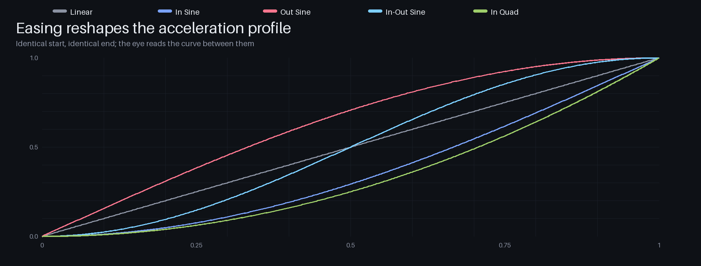
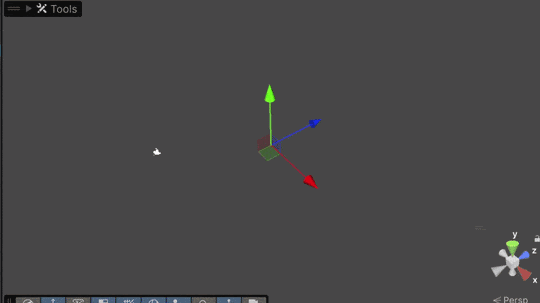

# Shader Story

## Vertex Animation: Easing Functions

> Once you have a normalized 0..1 time value, **easing reshapes how it moves**. Linear time changes at a constant rate, which reads as mechanical. An easing curve changes the *acceleration profile*: ease-in reads as anticipation, ease-out as recovery, bounce and elastic as impact and recoil. The start and end can be identical; the curve between them is what the eye actually reads.

> **Ping-pong** converts a hard 0→1 loop into a continuous 0→1→0, the natural fit for breathing, sway, and anything that should ease back instead of snapping.


```hlsl
half t = frac(_Time.y / _Duration);  // local 0..1 loop
half tpp = 1.0 - abs(2.0 * t - 1.0);  // ping-pong: 0 -> 1 -> 0
half eased = EaseInOutSine(tpp);  // shape the acceleration
```
---

### Shaping the curve

The family, and what each one *feels* like:

- **Linear**: constant rate. Reads as a machine.
- **In Sine / In Quad / In Cubic**: start slow, accelerate. Reads as *anticipation, charge-up*.
- **Out Sine / Out Quad / Out Cubic**: start fast, settle. Reads as *recovery, landing*.
- **In-Out Sine / In-Out Quad / In-Out Cubic**: soft, controlled. Often the best default for organic motion.
- **Out Bounce**: hits the target, drops, settles. Stylized landing.
- **In-Out Back / Out Elastic**: overshoot and secondary response. Great for stylized impacts and recoil; easy to overuse.

<p align="center">

</p>

### Two structural details

**Ping-pong removes the hard restart.** A wrapped phase runs 0 to 1, then snaps back to 0. One expression turns that sawtooth into a triangle wave:

```hlsl
half tpp = 1.0 - abs(2.0 * t - 1.0);
```

That single line turns a jarring loop into a continuous in-out motion, the difference between "resetting" and "breathing".

**Centralize the helpers.** If the effect will live in a project long enough for someone else to maintain it, put the easing and ping-pong helpers in a shared include file, not copied into every shader. One definition, every pass, no drift.

---

### Visual demo
One object, one distance, seven curves. Flip through the modes: identical endpoints, identical amplitude, but each curve reads as a different physical event. Toggle ping-pong to watch the loop stop snapping. The raw-phase bypass lets you compare shaped time against the unshaped clock.

<p align="center">

</p>

---

### URP Shader Code
A short, readable demo enum: the full easing library lives in the shared include, exactly as it should in a real project.

```hlsl
Shader "DecompiledArt/VertexAnimation/Time/EasingFunctions/EasingFunctions"
{
    Properties
    {
        [MainColor] _BaseColor("Base Color", Color) = (1.0, 0.9, 0.7, 1.0)

        // Keep the live demo enum short and readable.
        // The actual easing math is centralized in the shared include.
        [Enum(Linear,0,InSine,1,InOutSine,2,InQuad,3,OutBounce,4,InOutBack,5,OutElastic,6)]
        _EaseMode("Easing Function", Float) = 0

        [Min(0.001)] _Duration("Duration (Seconds)", Float) = 1.5
        _Distance("Distance", Float) = 0.75
        _MoveDirectionOS("Move Direction (Object Space)", Vector) = (0, 1, 0, 0)

        // 0 = one-way looping motion 0->1, 1 = ping-pong motion 0->1->0
        [Toggle] _PingPong("Ping Pong", Float) = 0

        // Lets you compare shaped time vs raw linear time.
        [Toggle] _UseRawPhase("Use Raw Phase (Bypass Ease)", Float) = 0

        // Presentation: move 0->Distance, or -Distance->+Distance around rest pose.
        [Toggle] _CenterAroundOrigin("Center Around Rest Pose", Float) = 0
    }

    SubShader
    {
        Tags { "RenderType" = "Opaque" "Queue" = "Geometry" "RenderPipeline" = "UniversalPipeline" }

        Pass
        {
            Name "Forward"
            Tags { "LightMode" = "UniversalForward" }

            HLSLPROGRAM
            #pragma target 4.5
            #pragma vertex vert
            #pragma fragment frag

            #include "Packages/com.unity.render-pipelines.universal/ShaderLibrary/Core.hlsl"

            // -----------------------------------------------------------------
            // Reusable easing library.
            // Input: t in [0..1]. Output: usually [0..1] (back/elastic overshoot).
            // Centralize these, one definition, every shader, every pass.
            // -----------------------------------------------------------------

            inline half EaseLinear(half t) { return t; }
            inline half EaseInSine(half t) { return 1.0h - cos(0.5h * PI * t); }
            inline half EaseInOutSine(half t) { return 0.5h - 0.5h * cos(PI * t); }
            inline half EaseInQuad(half t) { return t * t; }

            inline half EaseOutBounce(half t)
            {
                const half n1 = 7.5625h;
                const half d1 = 2.75h;

                if (t < 1.0h / d1)
                    return n1 * t * t;
                else if (t < 2.0h / d1)
                {
                    t -= 1.5h / d1;
                    return n1 * t * t + 0.75h;
                }
                else if (t < 2.5h / d1)
                {
                    t -= 2.25h / d1;
                    return n1 * t * t + 0.9375h;
                }
                else
                {
                    t -= 2.625h / d1;
                    return n1 * t * t + 0.984375h;
                }
            }

            inline half EaseInOutBack(half t)
            {
                const half c1 = 1.70158h;
                const half c2 = c1 * 1.525h;

                if (t < 0.5h)
                {
                    half x = 2.0h * t;
                    return 0.5h * (x * x * ((c2 + 1.0h) * x - c2));
                }
                else
                {
                    half x = 2.0h * t - 2.0h;
                    return 0.5h * (x * x * ((c2 + 1.0h) * x + c2) + 2.0h);
                }
            }

            inline half EaseOutElastic(half t)
            {
                const half c4 = (2.0h * PI) / 3.0h;

                if (t == 0.0h) return 0.0h;
                if (t == 1.0h) return 1.0h;

                return pow(2.0h, -10.0h * t) * sin((t * 10.0h - 0.75h) * c4) + 1.0h;
            }

            inline half ApplyEaseByEnum(half t, int easeMode)
            {
                switch (easeMode)
                {
                    case 0: return EaseLinear(t);
                    case 1: return EaseInSine(t);
                    case 2: return EaseInOutSine(t);
                    case 3: return EaseInQuad(t);
                    case 4: return EaseOutBounce(t);
                    case 5: return EaseInOutBack(t);
                    case 6: return EaseOutElastic(t);
                    default: return t;
                }
            }

            struct Attributes
            {
                float4 positionOS : POSITION;
                half3 normalOS : NORMAL;
            };

            struct Varyings
            {
                float4 positionHCS : SV_POSITION;
                half3 normalWS : TEXCOORD0;
                half debugPhase : TEXCOORD1;
            };

            CBUFFER_START(UnityPerMaterial)
                half4 _BaseColor;
                half3 _MoveDirectionOS;
                half _Distance;
                half _Duration;
                half _EaseMode;
                half _PingPong;
                half _UseRawPhase;
                half _CenterAroundOrigin;
            CBUFFER_END

            inline half GetLoopPhase01()
            {
                half invDuration = rcp(max(_Duration, 0.0001h));
                return frac(_Time.y * invDuration);
            }

            // 0..1 sawtooth -> 0..1..0 triangle wave.
            inline half ToPingPong01(half t)
            {
                return 1.0h - abs(2.0h * t - 1.0h);
            }

            inline half3 SafeNormalizeHalf3(half3 v)
            {
                half lenSq = dot(v, v);
                return (lenSq > 1e-6h) ? v * rsqrt(lenSq) : half3(0.0h, 1.0h, 0.0h);
            }

            Varyings vert(Attributes IN)
            {
                Varyings OUT;

                float3 positionOS = IN.positionOS.xyz;

                // Whole-object translation: every vertex receives the same time value.
                half baseT = GetLoopPhase01();
                half loopT = lerp(baseT, ToPingPong01(baseT), saturate(_PingPong));

                int easeMode = (int)round(_EaseMode);
                half easedT = ApplyEaseByEnum(loopT, easeMode);
                half finalT = lerp(easedT, loopT, saturate(_UseRawPhase));

                half3 moveDirOS = SafeNormalizeHalf3(_MoveDirectionOS);

                // One-way: 0 -> Distance. Centered: -Distance -> +Distance.
                half displacementT = lerp(finalT, finalT * 2.0h - 1.0h, saturate(_CenterAroundOrigin));
                positionOS += moveDirOS * (displacementT * _Distance);

                VertexPositionInputs positionInputs = GetVertexPositionInputs(positionOS);
                VertexNormalInputs normalInputs = GetVertexNormalInputs(IN.normalOS);

                OUT.positionHCS = positionInputs.positionCS;
                OUT.normalWS = normalInputs.normalWS;
                OUT.debugPhase = finalT;
                return OUT;
            }

            half4 frag(Varyings IN) : SV_Target
            {
                half3 normalWS = normalize(IN.normalWS);
                half ndl = saturate(dot(normalWS, normalize(half3(-0.3h, 0.85h, 0.25h))));
                half lighting = 0.2h + 0.8h * ndl;

                // Light feedback so the eased state is visible on the surface.
                half accent = lerp(0.92h, 1.08h, IN.debugPhase);

                return half4(_BaseColor.rgb * lighting * accent, _BaseColor.a);
            }
            ENDHLSL
        }
    }

    FallBack Off
}
```

---

## 🔗 Related Chapters

[Time Wrapping](https://github.com/DeGGeD/ShaderStory/blob/main/Chapters/VertexAnimation/Time/TimeWrapping.md) • [Phase Offset](https://github.com/DeGGeD/ShaderStory/blob/main/Chapters/VertexAnimation/Time/PhaseOffset.md) • [Sine Wave Offset](https://github.com/DeGGeD/ShaderStory/blob/main/Chapters/VertexAnimation/Patterns/SineWaveOffset.md)

**Related functions:** [Smoothstep](https://github.com/DeGGeD/ShaderStory/blob/main/Chapters/CommonFunctions/Smoothstep.md) • [Sine / Cosine](https://github.com/DeGGeD/ShaderStory/blob/main/Chapters/CommonFunctions/SineCosine.md) • [Power](https://github.com/DeGGeD/ShaderStory/blob/main/Chapters/CommonFunctions/Power.md)

---

## ❤️ Support Shader Story

If this article helped you, consider supporting the project on Patreon - you'll get access to the related source files, reference cheat-sheets, and other exclusive resources:

<p align="center">
  <a href="https://www.patreon.com/decompiled_art" target="_blank">
    
  </a>
  <a href="https://www.buymeacoffee.com/shaderstory" target="_blank">
    
  </a>
</p>

Your support helps keep this library open, growing, and free for everyone.
