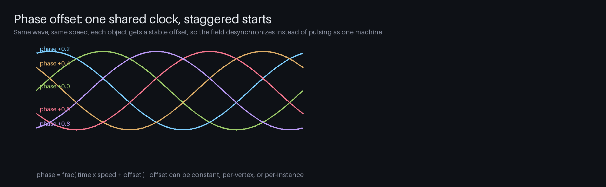
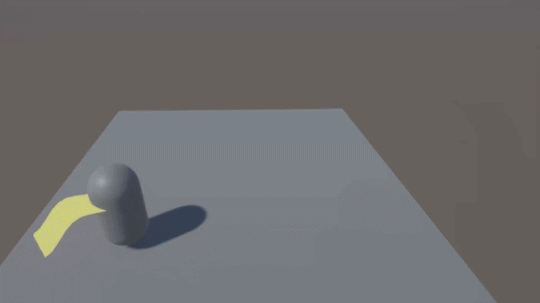

# Shader Story

## Vertex Animation: Phase Offset

> If every object uses exactly the same time value, everything moves in perfect sync, and a field of synchronized motion reads as *immediately artificial*. A **phase offset** (a stable value added to the phase) staggers motion per object, per instance, or per vertex. One line of math, and the whole scene stops moving like a machine.

```hlsl
float phase = frac(_Time.y * _Speed + _PhaseOffset) * TWO_PI;
```
---

### Why sync is so visible to the eye

The eye tracks *relative* timing. Two leaves that bend at exactly the same instant are read as "same object, copied"; the brain knows nothing in nature is phase-locked. The fix is not more amplitude; it's **controlled irregularity**: the same wave, the same speed, different *starts*.

Where the offset comes from, smallest to largest scope:

- **Constant**: one `_PhaseOffset` property per material. Breaks sync against other materials, costs nothing.
- **Per-vertex**: derived from position (e.g. `dot(positionOS, axis) * scale`) or baked into a stream. Spreads the phase *across* the mesh so it forms a traveling wave instead of a rigid pulse.
- **Per-instance**: a stable hash of the object's world position, or an explicit `[PerRendererData]` value. Breaks sync *between* objects while keeping one shared material.

The offset must be **stable**. A phase re-rolled every frame is not variation; it's shimmer. Derive it from identity (position, a hash, baked data), never from per-frame randomness.

<p align="center">

</p>

> One property, one shared clock, staggered starts. Enough variation to hide the repetition, not so much that the motion loses its art direction. See [Controlled Irregularity](https://github.com/DeGGeD/ShaderStory/blob/main/Chapters/VertexAnimation/Patterns/ControlledIrregularity.md) for the full toolkit.

---

### Visual demo
The same setup from one asset to a field of them. Each object runs the same wave with a different stable phase, so the population sways as *many things* instead of one machine, all from one shared material and one shader.

<p align="center">

</p>

---

### URP Shader Code
Three levels of offset in one shader: a constant property, a per-vertex spatial spread, and a stable per-instance hash, so you can see exactly which scope each one affects.

```hlsl
Shader "DecompiledArt/VertexAnimation/Time/PhaseOffset/PhaseOffset"
{
    Properties
    {
        [MainColor] _BaseColor("Base Color", Color) = (0.55, 0.9, 0.6, 1.0)
        [Min(0.001)] _Speed("Speed", Float) = 1.2
        _Amplitude("Amplitude", Float) = 0.2
        _Frequency("Spatial Frequency", Float) = 3.0
        _MotionAxisOS("Motion Axis (Object Space)", Vector) = (0, 1, 0, 0)

        [Header(Phase offset sources)]
        // Level 1: constant, artist-tuned for the whole material.
        _PhaseOffset("Constant Phase Offset (0..1)", Range(0.0, 1.0)) = 0.0

        // Level 2: per-vertex spread, turns a pulse into a traveling wave.
        _VertexPhaseScale("Vertex Phase Scale", Range(0.0, 10.0)) = 2.0

        // Level 3: per-instance stagger from a stable object hash.
        _InstanceJitter("Instance Phase Jitter", Range(0.0, 1.0)) = 1.0
    }

    SubShader
    {
        Tags { "RenderType" = "Opaque" "Queue" = "Geometry" "RenderPipeline" = "UniversalPipeline" }

        Pass
        {
            Name "Forward"
            Tags { "LightMode" = "UniversalForward" }

            HLSLPROGRAM
            #pragma target 4.5
            #pragma vertex vert
            #pragma fragment frag

            #include "Packages/com.unity.render-pipelines.universal/ShaderLibrary/Core.hlsl"

            struct Attributes
            {
                float4 positionOS : POSITION;
                half3 normalOS : NORMAL;
            };

            struct Varyings
            {
                float4 positionHCS : SV_POSITION;
                half3 normalWS : TEXCOORD0;
            };

            CBUFFER_START(UnityPerMaterial)
                half4 _BaseColor;
                half _Speed;
                half _Amplitude;
                half _Frequency;
                half3 _MotionAxisOS;
                half _PhaseOffset;
                half _VertexPhaseScale;
                half _InstanceJitter;
            CBUFFER_END

            // Stable per-object identity: same object, same value, every frame.
            // This is what makes the stagger a *desync* instead of shimmer.
            float Hash13(float3 value)
            {
                value = frac(value * 0.1031);
                value += dot(value, value.yzx + 33.33);
                return frac((value.x + value.y) * value.z);
            }

            Varyings vert(Attributes IN)
            {
                Varyings OUT;

                float3 positionOS = IN.positionOS.xyz;

                // One shared clock, bounded.
                half basePhase = frac(_Time.y * _Speed) * TWO_PI;

                // Level 3: stable per-instance start.
                float3 objectPivotWS = TransformObjectToWorld(float3(0.0, 0.0, 0.0));
                half instancePhase = Hash13(objectPivotWS) * _InstanceJitter * TWO_PI;

                // Level 2: per-vertex spread along the motion axis.
                half vertexPhase = dot((half3)positionOS, _MotionAxisOS) * _VertexPhaseScale;

                // Level 1: constant artist offset.
                half phase = basePhase + instancePhase + vertexPhase + _PhaseOffset * TWO_PI;

                half wave = sin(phase);
                half3 axisOS = normalize(_MotionAxisOS);
                positionOS += axisOS * wave * _Amplitude;

                OUT.positionHCS = TransformObjectToHClip(positionOS);
                OUT.normalWS = TransformObjectToWorldNormal(IN.normalOS);
                return OUT;
            }

            half4 frag(Varyings IN) : SV_Target
            {
                half3 normalWS = normalize(IN.normalWS);
                half ndl = saturate(dot(normalWS, normalize(half3(0.35h, 0.8h, 0.2h))));
                half lit = 0.25h + 0.75h * ndl;
                return half4(_BaseColor.rgb * lit, _BaseColor.a);
            }
            ENDHLSL
        }
    }

    FallBack Off
}
```

---

## 🔗 Related Chapters

[Time Wrapping](https://github.com/DeGGeD/ShaderStory/blob/main/Chapters/VertexAnimation/Time/TimeWrapping.md) • [Controlled Irregularity](https://github.com/DeGGeD/ShaderStory/blob/main/Chapters/VertexAnimation/Patterns/ControlledIrregularity.md) • [Instancing](https://github.com/DeGGeD/ShaderStory/blob/main/Chapters/VertexAnimation/Shipping/Instancing.md)

**Related functions:** [Frac](https://github.com/DeGGeD/ShaderStory/blob/main/Chapters/CommonFunctions/Frac.md) • [Dot](https://github.com/DeGGeD/ShaderStory/blob/main/Chapters/CommonFunctions/Dot.md)

---

## ❤️ Support Shader Story

If this article helped you, consider supporting the project on Patreon - you'll get access to the related source files, reference cheat-sheets, and other exclusive resources:

<p align="center">
  <a href="https://www.patreon.com/decompiled_art" target="_blank">
    
  </a>
  <a href="https://www.buymeacoffee.com/shaderstory" target="_blank">
    
  </a>
</p>

Your support helps keep this library open, growing, and free for everyone.
