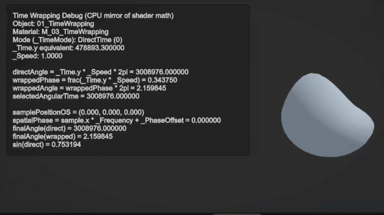

# Shader Story

## Vertex Animation: Time Wrapping

> Raw `_Time.y` grows forever, which is fine for sequencing, but for **motion** you usually want a bounded local value. **Time wrapping** converts continuous time into a repeating 0..1 phase, which keeps `sin()` arguments small, makes loops restart cleanly, and makes the motion easier to combine with masks and easing.

> **Use continuous time for systems. Use wrapped time for motion.**

```hlsl
half angle = frac(_Time.y * _Speed) * TWO_PI;  // bounded, repeating 0..2π
half wave = sin(angle);
```
---

### Why wrap

Two things happen if you feed ever-growing values into trig functions:

1. **Precision drift.** As `_Time.y` gets large, the increment per frame gets smaller than the floating-point resolution at that magnitude. Long editor sessions and always-on game scenes will eventually make waves stutter or freeze.
2. **Unreadable tuning.** A "phase" of 84,312 radians is not something an artist can reason about. A 0..1 phase is.

Wrapping fixes both:

```hlsl
// Looping motion: stable repeating 0..1 phase
float phase01 = frac(_Time.y * _Speed);

// Duration-based motion: local time, easier to restart
float localTime = fmod(_Time.y, _Duration);
float local01 = localTime / _Duration;
```

`frac()` is the cheap wrap for positive time. For explicit durations, `fmod()` reads better. The shape of the motion is unchanged; only the input's *bound* changes.

---

### Visual demo
Same motion, two time sources. The direct-time version runs on unbounded `_Time.y`; the wrapped version converts to a repeating 0..1 phase first. Watch the wrapped version snap back cleanly at the top of each cycle. That clean restart is the whole point of bounded local time. The overlay prints both values so you can see the gap open up over time.

<p align="center">

</p>

---

### URP Shader Code
One traveling wave with a live toggle between the two time sources, plus an optional height mask so the mesh doesn't move as a rigid block.

```hlsl
Shader "DecompiledArt/VertexAnimation/Time/TimeWrapping/TimeWrapping"
{
    Properties
    {
        [MainColor] _BaseColor("Base Color", Color) = (0.8, 0.9, 1.0, 1.0)

        // 0 = direct unbounded time, 1 = wrapped phase.
        // A live toggle makes the difference visible on purpose.
        [Enum(DirectTime,0,WrappedPhase,1)] _TimeMode("Time Mode", Float) = 1

        [Min(0.001)] _Speed("Cycles Per Second", Float) = 1.0
        _Amplitude("Amplitude", Float) = 0.25
        _Frequency("Spatial Frequency", Float) = 1.0
        _PhaseOffset("Phase Offset", Float) = 0.0

        _MotionAxisOS("Motion Axis (Object Space)", Vector) = (0, 1, 0, 0)
        _MaskByHeight("Mask By Local Y", Float) = 0.0
        _HeightMin("Height Min", Float) = -0.5
        _HeightMax("Height Max", Float) = 0.5
    }

    SubShader
    {
        Tags { "RenderType" = "Opaque" "Queue" = "Geometry" "RenderPipeline" = "UniversalPipeline" }

        Pass
        {
            Name "Forward"
            Tags { "LightMode" = "UniversalForward" }

            HLSLPROGRAM
            #pragma target 4.5
            #pragma vertex vert
            #pragma fragment frag

            #include "Packages/com.unity.render-pipelines.universal/ShaderLibrary/Core.hlsl"

            struct Attributes
            {
                float4 positionOS : POSITION;
                half3 normalOS : NORMAL;
            };

            struct Varyings
            {
                float4 positionHCS : SV_POSITION;
                half3 normalWS : TEXCOORD0;
            };

            CBUFFER_START(UnityPerMaterial)
                half4 _BaseColor;
                half3 _MotionAxisOS;
                half _MaskByHeight;
                half _Amplitude;
                half _Frequency;
                half _PhaseOffset;
                half _Speed;
                half _TimeMode;
                half _HeightMin;
                half _HeightMax;
            CBUFFER_END

            // Direct: the angle keeps growing forever.
            // Wrapped: convert to a repeating 0..1 phase first, then back to radians.
            // Bounded arguments keep sin() stable in long-running sessions.
            inline half GetAngularTime()
            {
                half timeMode = step(0.5h, _TimeMode);
                half directAngle = _Time.y * _Speed * TWO_PI;
                half wrappedAngle = frac(_Time.y * _Speed) * TWO_PI;
                return lerp(directAngle, wrappedAngle, timeMode);
            }

            // Optional positional weighting so the base of the mesh stays planted.
            inline half GetHeightMask(float3 positionOS)
            {
                half t = saturate((positionOS.y - _HeightMin) / max(0.0001h, _HeightMax - _HeightMin));
                half shaped = t * t * (3.0h - 2.0h * t);
                return lerp(1.0h, shaped, saturate(_MaskByHeight));
            }

            Varyings vert(Attributes IN)
            {
                Varyings OUT;

                float3 positionOS = IN.positionOS.xyz;

                half3 axisOS = normalize(_MotionAxisOS);
                half heightMask = GetHeightMask(positionOS);

                // Per-vertex spatial phase so the mesh forms a traveling wave.
                half spatialPhase = positionOS.x * _Frequency + _PhaseOffset;
                half angle = GetAngularTime() + spatialPhase;

                half wave = sin(angle);
                half offsetAmount = wave * _Amplitude * heightMask;
                positionOS += axisOS * offsetAmount;

                VertexPositionInputs positionInputs = GetVertexPositionInputs(positionOS);
                VertexNormalInputs normalInputs = GetVertexNormalInputs(IN.normalOS);

                OUT.positionHCS = positionInputs.positionCS;
                OUT.normalWS = normalInputs.normalWS;
                return OUT;
            }

            half4 frag(Varyings IN) : SV_Target
            {
                half3 normalWS = normalize(IN.normalWS);
                half ndl = saturate(dot(normalWS, normalize(half3(0.35h, 0.8h, 0.2h))));
                half lit = 0.25h + 0.75h * ndl;
                return half4(_BaseColor.rgb * lit, _BaseColor.a);
            }
            ENDHLSL
        }
    }

    FallBack Off
}
```

---

## 🔗 Related Chapters

[Easing Functions](https://github.com/DeGGeD/ShaderStory/blob/main/Chapters/VertexAnimation/Time/EasingFunctions.md) • [Phase Offset](https://github.com/DeGGeD/ShaderStory/blob/main/Chapters/VertexAnimation/Time/PhaseOffset.md) • [Sine Wave Offset](https://github.com/DeGGeD/ShaderStory/blob/main/Chapters/VertexAnimation/Patterns/SineWaveOffset.md)

**Related functions:** [Frac](https://github.com/DeGGeD/ShaderStory/blob/main/Chapters/CommonFunctions/Frac.md) • [Fmod](https://github.com/DeGGeD/ShaderStory/blob/main/Chapters/CommonFunctions/Fmod.md) • [Sine / Cosine](https://github.com/DeGGeD/ShaderStory/blob/main/Chapters/CommonFunctions/SineCosine.md)

---

## ❤️ Support Shader Story

If this article helped you, consider supporting the project on Patreon - you'll get access to the related source files, reference cheat-sheets, and other exclusive resources:

<p align="center">
  <a href="https://www.patreon.com/decompiled_art" target="_blank">
    
  </a>
  <a href="https://www.buymeacoffee.com/shaderstory" target="_blank">
    
  </a>
</p>

Your support helps keep this library open, growing, and free for everyone.
